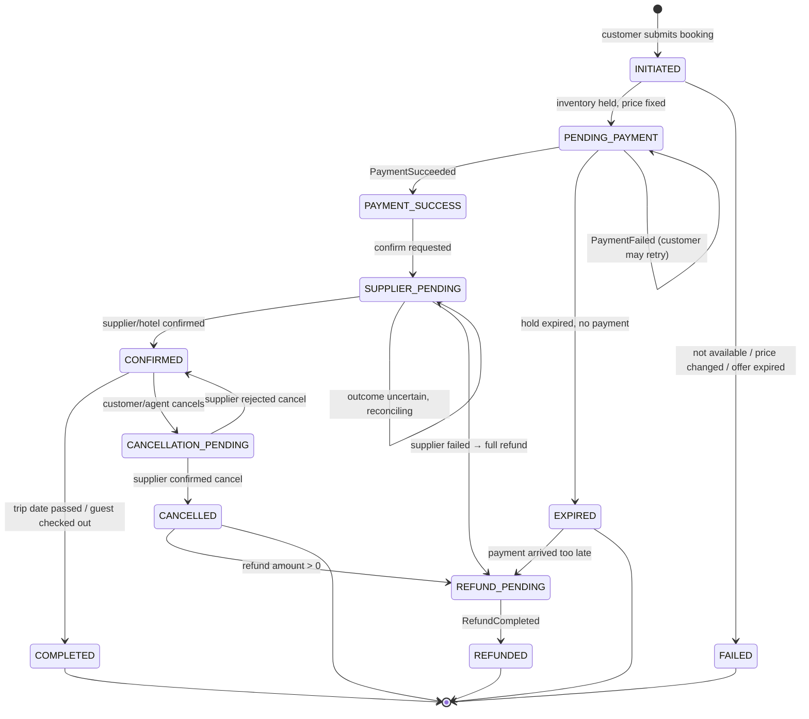
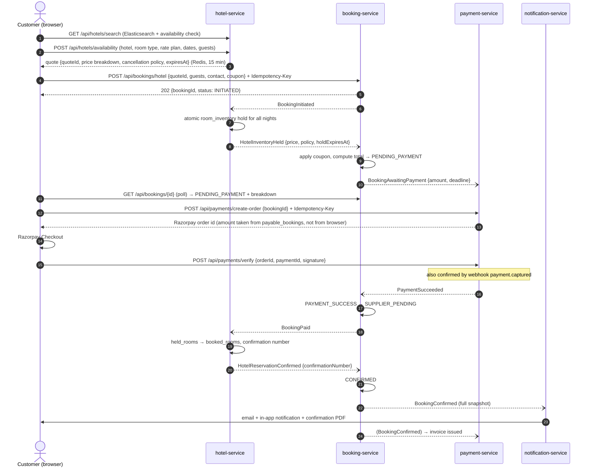
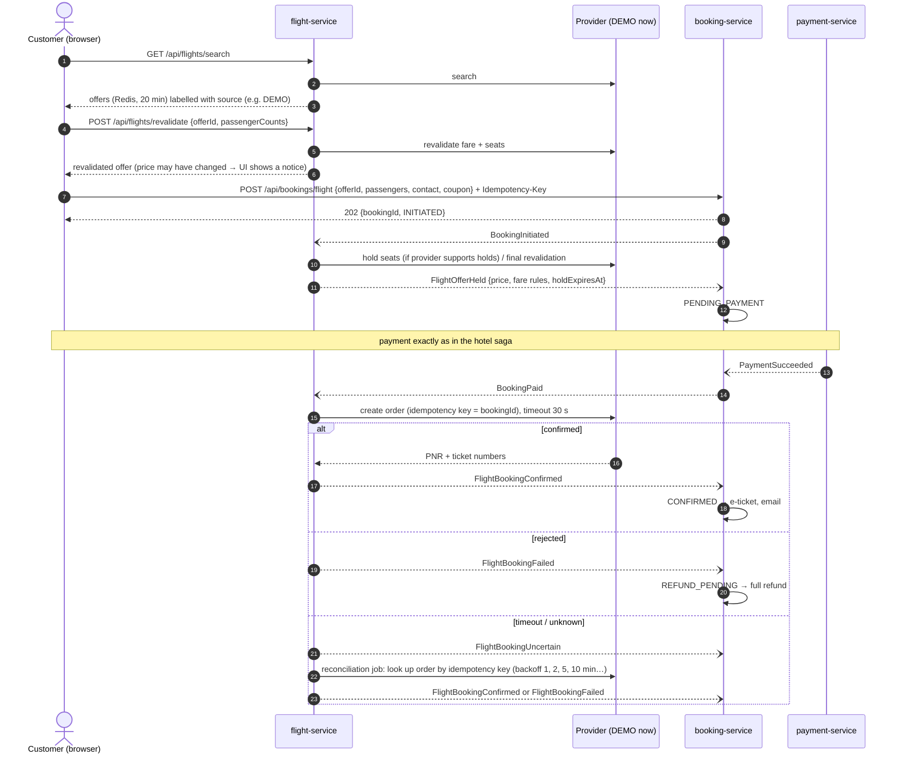
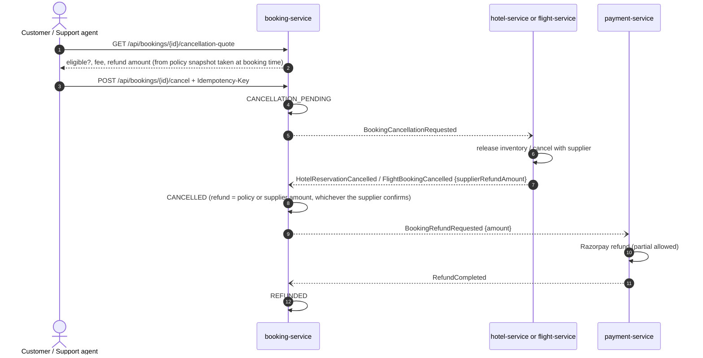

# Booking Workflow

> Status: hotel booking saga (§1, §2) **implemented and verified in Phase 5**, flights (§3) in Phase 6, cancellations
> and refunds (§4) in **Phase 7** (2026-11-05).

A booking is a **stateful business process** that runs across several services. It is not a single database
insert. This document describes every step and every failure path. If code and this document disagree,
fix one of them.

---

## 1. Booking states (booking-service)

| Status | Shown to customer as | My Trips tab |
|--------|---------------------|--------------|
| INITIATED | "Checking availability…" | Pending |
| PENDING_PAYMENT | "Awaiting payment (expires in mm:ss)" | Pending |
| PAYMENT_SUCCESS / SUPPLIER_PENDING | "Payment received — confirming with airline/hotel" | Pending |
| CONFIRMED | "Confirmed" + supplier reference | Upcoming |
| COMPLETED | "Completed" | Completed |
| CANCELLATION_PENDING | "Cancellation in progress" | Upcoming |
| CANCELLED / REFUND_PENDING / REFUNDED | "Cancelled" + refund status | Cancelled |
| FAILED / EXPIRED | "Not completed" + reason (+ refund status if paid) | Cancelled |

Every status change inserts a row into `booking_status_history`. This feeds the booking timeline
(`GET /api/bookings/{id}/timeline`).

**Golden rules**

1. Selecting a flight or room does **not** reserve it. Only a successful hold does.
2. A successful payment does **not** mean the booking is confirmed. Only the supplier/hotel confirmation does.
3. A confirmed ticket or voucher is **never shown** before the `CONFIRMED` status.
4. All prices come from the backend. The frontend only displays them.
5. State changes ignore events that are duplicated or arrive too late. For example, `PaymentSucceeded` for a
   booking that is already `CONFIRMED` is recorded and skipped.
6. Whenever money has to go back to the customer, the booking moves to `REFUND_PENDING` and then `REFUNDED`.
   `failure_reason` / the cancellation record explains why.

---

## 2. Hotel booking saga

### Hotel failure paths

| Situation | What happens |
|-----------|-------------|
| Quote expired or not found | hotel-service publishes `HotelInventoryHoldFailed{QUOTE_EXPIRED}` → booking `FAILED`. The UI asks the customer to re-check availability. |
| Rooms sold out between quote and booking | `HotelInventoryHoldFailed{SOLD_OUT}` → `FAILED`. |
| Price changed since the quote | `HotelInventoryHoldFailed{PRICE_CHANGED, newPrice}` → `FAILED`. The UI shows the new price and offers to re-quote. |
| Customer never pays | The hotel-service scheduler (every minute) releases expired holds → `HotelInventoryReleased{EXPIRED}` → booking `EXPIRED`, coupon usage released, payment-service marks the booking not payable. |
| Payment fails | `PaymentFailed` → booking stays `PENDING_PAYMENT`. The customer can retry until the hold expires. |
| Payment arrives after the hold expired | booking-service sees `EXPIRED` + `PaymentSucceeded` → `REFUND_PENDING` and publishes `BookingRefundRequested{full amount}` → `REFUNDED`. The customer is notified. |
| Double-click on "Book" | Same `Idempotency-Key` → the same booking is returned. No second booking is created. |
| Same event delivered twice | `processed_events` check → second delivery ignored. |
| Two customers want the last room | Atomic `UPDATE … WHERE free >= rooms` (see DATABASE_DESIGN.md §3). Only one hold succeeds. |

Holds last **payment window (15 min) + 5 min grace** so a payment completed at the last second can still be
confirmed. payment-service refuses to create new orders after the payment window.

### 2.1 As built in Phase 5

Where the code settled details that the draft left open (and how each failure path is proven by a test):

| Topic | As built |
|-------|----------|
| Create | `POST /api/bookings/hotel` answers `202` with the booking in `INITIATED`; the browser follows the booking (live `booking.status-changed`, plus 2 s polling while the system works). Only quote id, guests and contact come from the browser; hotel, dates and every price come from `HotelInventoryHeld`. |
| Payment window | `paymentDeadline = holdExpiresAt − 5 min`. payment-service only creates orders while `payable_bookings.status = AWAITING_PAYMENT` and before the deadline (`409 PAYMENT_WINDOW_CLOSED`). An order that is already open can still be paid in the grace period. |
| hotel-service never answers | A booking still `INITIATED` after 10 minutes (job every minute) becomes `FAILED / NO_RESPONSE` and `BookingFailed` is published, so rooms held later are released again. |
| Failed payment | `PaymentFailed` adds a timeline entry (`fromStatus == status`) and `payment_status = PAYMENT_FAILED`; the booking stays `PENDING_PAYMENT`. A new attempt creates a new order. |
| Paid at the last moment | `HotelInventoryReleased{EXPIRED}` arriving for a booking that already is `SUPPLIER_PENDING` is ignored; the hotel answers the `BookingPaid` that follows (it still gets the rooms if they are free, otherwise `HotelReservationFailed`). |
| Hotel cannot confirm after payment | `HotelReservationFailed` → `REFUND_PENDING` + `BookingRefundRequested{BOOKING_FAILED}` → `REFUNDED`. |
| Payment after `EXPIRED` / `FAILED` | `REFUND_PENDING` + `BookingRefundRequested{LATE_PAYMENT}` → `REFUNDED`. |
| Second payment for a paid booking | The booking is not touched; a timeline note and `BookingRefundRequested{DUPLICATE_PAYMENT}` give the second payment back. |
| Duplicate / late events | `processed_events` per consumer, and every handler checks the booking's status first (`Ignoring … in status …` in the log). |
| Coupons | Reserved when the room is held (discount calculated from the *held* price), consumed on `CONFIRMED`, released on `EXPIRED` and on a failed confirmation. |
| Money amounts | `PaymentSucceeded.amount` must equal the booking total; payment-service charges exactly `BookingAwaitingPayment.amount`. |
| Realtime | `booking.status-changed`, `payment.status-changed`, `notification.created` (see REALTIME_UPDATES.md). |

Tests per failure path (all on real MySQL/Redis/Elasticsearch through Testcontainers):

| Failure path of the table above | Test |
|---------------------------------|------|
| Quote expired / sold out / price changed | booking `HotelBookingSagaIntegrationTest.holdFailuresEndTheBookingWithAReason`; hotel `anExpiredQuoteHoldsNothing`, `roomsSoldOutBetweenQuoteAndBooking`, `priceChangedSinceTheQuote`, `oneGuestNameIsNeededPerRoom` |
| Customer never pays | booking `anUnpaidBookingExpiresWhenTheHotelReleasesTheRooms`; hotel `anUnpaidHoldExpiresAndALatePaymentStillGetsTheRoomsIfTheyAreFree`, `theExpiryJobLeavesHoldsThatAreStillValid` |
| Payment fails | booking `aFailedPaymentCanBeRetried`; payment `aFailedPaymentIsRecordedAndANewAttemptCanSucceed` |
| Payment after expiry | booking `aPaymentAfterExpiryIsRefundedInFull`; hotel `aLatePaymentForRoomsSoldMeanwhileFailsSoTheCustomerIsRefunded` |
| Paid just before the hold ended | booking `aPaymentJustBeforeTheHoldEndedWaitsForTheHotelInsteadOfExpiring` |
| Hotel cannot confirm | booking `theHotelCannotConfirmAfterPaymentSoTheCustomerIsRefunded` |
| Second payment | booking `aSecondPaymentIsRefundedAndTheBookingStaysConfirmed` |
| Double click / same key | booking `submittingIsIdempotentPerKey`; payment `theOrderIsForTheAmountTheServerKnowsAndRepeatingItGivesTheSameOrder` |
| Same event twice, late events | booking `duplicateAndLateEventsAreIgnored`; hotel `theSameEventDeliveredTwiceIsHandledOnce` |
| hotel-service silent | booking `aBookingTheHotelNeverAnswersFailsAfterTheTimeout` |
| Last room, two customers | hotel `InventoryConcurrencyIntegrationTest` (Phase 4) |

---

## 3. Flight booking saga

### Flight failure paths

| Situation | What happens |
|-----------|-------------|
| Offer expired in Redis | `FlightOfferUnavailable{OFFER_EXPIRED}` → `FAILED`. The UI sends the customer back to search. |
| Fare increased at revalidation | Revalidate returns the new price. The customer must accept it before booking. |
| Supplier rejects the order after payment | `FlightBookingFailed` → full refund → `REFUNDED`. |
| Supplier timeout after payment | **Never retry blindly** (could create two tickets). Status `UNCERTAIN`; the reconciliation job queries the supplier. If the outcome is still unknown after 2 hours, the booking goes to the support agent "Needs attention" queue. |
| Supplier is down | Circuit breaker opens → search shows "Flight search temporarily unavailable". It never shows stale results as available. |

### 3.1 As built in Phase 6

Event names differ slightly from the draft above; the flow is the same. Events: `FlightOfferHeld`, `FlightOfferHoldFailed`
(`OFFER_EXPIRED`, `SOLD_OUT`, `PRICE_CHANGED`, `INVALID_PASSENGERS`), `FlightOfferReleased` (`EXPIRED`, `BOOKING_FAILED`,
`BOOKING_EXPIRED`), `FlightBookingConfirmed` (PNR + one ticket per traveller), `FlightBookingFailed` (`SUPPLIER_REJECTED`,
`HOLD_LOST`, `NOT_FOUND_AT_SUPPLIER`), `FlightBookingUncertain`.

| Topic | As built |
|-------|----------|
| Round trips | One trip offer with one or two *slices*: the customer picks an outbound and a return flight, `revalidate` prices both (the sum) and returns one `tripOfferId`; one booking, one payment, one PNR. |
| Revalidate | Re-prices every flight at today's fare and checks the seats; nothing is reserved. If the price rose, the trip offer says `priceChanged` with `previousTotal` and the customer must accept it on the details page. |
| Hold | `BookingInitiated{flight}`: flight-service checks the trip offer (404 → `OFFER_EXPIRED`), that the travellers match the trip, **re-prices** (fare changed since the customer accepted → `PRICE_CHANGED` with the new total) and holds the seats of every flight all-or-nothing (`SOLD_OUT`). Infants need no seat. Holds last 20 minutes, the payment deadline is 5 minutes earlier. |
| Fares | Search offers two fare families per flight (Saver non-refundable, Flex refundable). Price = distance × cabin/fare multiplier × days-before-departure × how full the flight is (banded, so the price does not jitter), plus fuel/airport charges and GST (5 % economy, 12 % business/first); child 75 %, infant 10 %. |
| Order | `BookingPaid{FLIGHT}`: the order is created at the supplier with the **booking id as idempotency key**. Held seats become sold in the same step. A booking paid after its hold expired takes the same seats again if they are free, otherwise `FlightBookingFailed{HOLD_LOST}` → refund. |
| Rejected | `FlightBookingFailed{SUPPLIER_REJECTED}`: seats released, booking `SUPPLIER_PENDING → REFUND_PENDING` (full refund), coupon released. |
| Unknown outcome | A timeout leaves the flight booking `UNCERTAIN` and publishes `FlightBookingUncertain` (a timeline note; the booking stays `SUPPLIER_PENDING`, the customer waits, nothing is retried). The reconciliation job (every minute, pauses 1, 2, 5, 10 min) looks the order up **by idempotency key**: found → `FlightBookingConfirmed` (never a second order); not found after 2 looks **and** 5 minutes → `NOT_FOUND_AT_SUPPLIER` → refund; still unknown after 2 hours → `NEEDS_ATTENTION` (support queue in Phase 9; never refunded blindly). |
| Passengers | Names, types, dates of birth, nationality go in the events; **passport numbers never do** (encrypted in booking-service only; a real supplier adapter would need a secure lookup). Child 2–11 and infant under 2 are checked at booking time against today. |
| Provider management | Admin can disable a provider: search then answers `503 FLIGHT_SEARCH_UNAVAILABLE`; bookings already paid stay with their provider. A health job (1 min) updates `healthStatus`. |

Tests per path (flight-service `FlightBookingSagaIntegrationTest` 15, booking-service `FlightBookingSagaIntegrationTest` 9):

| Path | Test |
|------|------|
| Offer expired / travellers do not match / sold out / fare changed | flight `anExpiredTripHoldsNothing`, `travellersThatDoNotMatchTheTripAreRefused`, `seatsThatSoldOutBetweenSelectionAndBookingFailTheHold`, `aFareThatChangedSinceTheCustomerAcceptedItIsNotHonoured`; booking `holdFailuresEndTheFlightBookingWithAReason` |
| Paid → issued (PNR, tickets, once) | flight `aPaidBookingGetsItsPnrAndOneTicketPerPassenger`; booking `heldPaidConfirmedWithThePnrAppearingOnlyAtTheEnd` |
| Supplier rejects | flight `anAirlineThatRejectsTheOrderGetsTheSeatsBackAndTheCustomerIsRefunded`; booking `anAirlineThatCouldNotIssueTheTicketsMeansAFullRefund` |
| Supplier timeout, order exists | flight `whenTheAirlineDoesNotAnswerTheOrderIsLookedUpNeverCreatedTwice`; booking `anAirlineThatDoesNotAnswerLeavesTheCustomerWaitingUntilItIsResolved` |
| Supplier timeout, order lost | flight `anOrderTheAirlineNeverCreatedIsFoundMissingAndRefundedAfterSeveralLooks`, `anOutcomeThatStaysUnknownForTooLongNeedsAPerson` |
| Hold ends / late payment | flight `anUnpaidHoldExpiresAndTheJobLeavesHoldsThatAreStillValid`, `aPaymentThatArrivesAfterTheHoldExpiredStillGetsTheSeatsIfTheyAreFree`, `aLatePaymentForSeatsSoldMeanwhileFailsSoTheCustomerIsRefunded`; booking `anUnpaidFlightBookingExpiresAndGivesTheCouponBack` |
| Duplicate / late events | booking `lateAndDuplicateFlightEventsAreIgnored`; flight `theSeatsAreHeldAtTheAcceptedPriceUntilTheDeadline` (repeated `BookingInitiated`) |

---

## 4. Cancellation and refund saga

- A cancellation is **not** successful until the hotel inventory or supplier confirms it.
- If the supplier rejects the cancellation → `CancellationFailed` → booking returns to `CONFIRMED`, the customer
  is told why, and a support ticket is opened automatically.
- Every cancellation and refund step creates an audit event.

### 4.1 As built in Phase 7

Events: `BookingCancellationRequested` (booking → hotel/flight, `cancellationId` = idempotency key, `requestedAt`),
`HotelReservationCancelled` / `HotelReservationCancellationFailed`, `FlightBookingCancelled` (with the airline's own
`airlineFee`) / `FlightCancellationFailed`, then `BookingCancelled` / `BookingCancellationFailed` (for notifications)
and the existing `BookingRefundRequested{CANCELLATION}` → `RefundCompleted` / `RefundFailed`.

| Topic | As built |
|-------|----------|
| Who | The owner; support agents and admins (`BOOKING_MANAGE_ANY`) on the customer's behalf with a **required reason** (`initiatedBy` = their role). Waiving the fee (full refund, e.g. the airline cancelled the flight) needs `REFUND_MANAGE` (admin). |
| When | Only `CONFIRMED` bookings, until `bookings.cancel_until`: hotels the check-in moment in the **hotel's time zone** (`HotelInventoryHeld.checkInAt`), flights 4 hours before the first departure (`FlightOfferHeld.departureAt`, airport time zone; `booking.flight-cancel-cutoff`). Bookings held before Phase 7 got the deadline from their stored dates in India time. |
| Fee | From the terms accepted at booking time (never today's rate plan). Hotels: 0 before `freeCancellationUntil`, then the fee % of the stay price (room charges + GST, before the coupon); non-refundable = 100 %. Flights: the fee % of the **fare** (taxes and charges come back); the airline's own fee in `FlightBookingCancelled` is final, and if it is higher than quoted the booking is flagged `REFUND_DIFFERS`. Refund = paid − fee, never negative: a coupon discount is not given back. Round trips with two fare families use the higher fee % (the snapshot keeps one). |
| Quote and request | `GET …/cancellation-quote`, then `POST …/cancel` with `Idempotency-Key` and the `expectedRefundAmount` the customer saw: if the figures changed meanwhile (the free period ended) → `409 CANCELLATION_QUOTE_CHANGED` and nothing happens. The fee is fixed at the request time, so a slow answer never costs the customer more. |
| Hotel | hotel-service checks that the reservation is `CONFIRMED` and `requestedAt` is before the check-in time, gives the **booked** rooms back (`booked_rooms − n` for every night) and marks it `CANCELLED` with a cancellation number `HX…`. Otherwise `TOO_LATE` / `NOT_CANCELLABLE`. |
| Flight | flight-service calls `cancelOrder` (key = cancellation id). DEMO airline: allowed until 4 h before departure, fee % of the fare, sold seats back on sale, reference `DX…`. Refused → `TOO_LATE` / `NOT_ALLOWED` / `NOT_CANCELLABLE`. **No answer → `CANCEL_UNCERTAIN`**: never cancelled again blindly; the reconciliation job (every minute, waits 1, 2, 5, 10 min) looks the cancellation up: found → `FlightBookingCancelled`; not found after 2 looks and 5 minutes → `SUPPLIER_NO_ANSWER` (the tickets stay valid). |
| Outcomes | Confirmed: `CANCELLED`, then `REFUND_PENDING → REFUNDED` when something comes back; `paymentStatus` ends `REFUNDED` or `PARTIALLY_REFUNDED`. Nothing to refund (non-refundable): stays `CANCELLED` with `paymentStatus = PAID`. Refused: back to `CONFIRMED`, the cancellation is `REJECTED` with the reason, the customer gets an e-mail and a notification, and the booking goes to the support queue (`CANCELLATION_REJECTED`) **instead of an automatic support ticket** (tickets arrive in Phase 8). The customer may try again. |
| Repeated answers | Hotel and flight service repeat their answer when the same cancellation is requested again; booking-service only acts on the answer to its **pending** cancellation, so duplicates and late answers to an earlier (rejected) request are ignored. A refund is counted once per refund request. |
| Reconciliation (booking side) | Job every 5 min: a cancellation unanswered for 10 min is sent again (same id), a refund request unanswered for 30 min too (payment-service repeats its final answer); after 3 tries the booking is flagged `CANCELLATION_NO_ANSWER` / `REFUND_NO_ANSWER`. The flag clears itself when the answer arrives. |
| Failed refund | `RefundFailed` → note on the timeline and the flag `REFUND_FAILED`; an admin (`REFUND_MANAGE`) sends it again (`retry-refund`: a new request for the same money). |
| Support queue | `bookings.attention_reason/note/since` plus internal `booking_support_notes` (escalate, resolve, retry, cancel on behalf): visible only with `BOOKING_READ_ANY`, never on the customer's timeline. |
| Audit | booking-service `BOOKING_CANCELLATION_REQUESTED`, `BOOKING_CANCELLATION_FEE_WAIVED`, `BOOKING_CANCELLED`, `BOOKING_CANCELLATION_REJECTED`, `BOOKING_REFUND_REQUESTED/COMPLETED/FAILED/RETRIED`, `BOOKING_ESCALATED`, `BOOKING_ATTENTION_RESOLVED`; hotel-service `HOTEL_RESERVATION_CANCELLED`; flight-service `FLIGHT_ORDER_CANCELLED`; payment-service `REFUND_STARTED/PROCESSED/FAILED`. Amounts and ids only, never notes or personal data. reporting-service stores them (`audit_logs`, `GET /api/admin/audit-logs`). |
| Notifications | `BookingCancelled` → e-mail (fee, refund, cancellation number) + bell; `BookingCancellationFailed` → e-mail ("your booking is still valid") + bell; the refund of a cancellation gets a bell entry but no second e-mail. |
| Confirmation numbers | Shown once the booking was ever confirmed (`confirmedAt`), so a cancelled booking still shows its PNR / hotel number in the API; the pages show them only while the booking is valid. |

Tests (all against real MySQL, Redis and Mailpit through Testcontainers):

| Path | Test |
|------|------|
| Free period → full refund; idempotent request; repeated supplier/payment answers; audit trail | booking `CancellationIntegrationTest.aStayCancelledInTheFreePeriodIsRefundedInFull` |
| Fee after the free period, partial refund, coupon not refunded | booking `afterTheFreePeriodTheFeeIsKeptAndTheRestIsRefundedButNotTheCouponDiscount`; payment `partialRefundsAddUpButNeverExceedThePayment` |
| Non-refundable → cancelled, nothing refunded | booking `aNonRefundableStayIsCancelledWithoutARefund` |
| Quote changed while the page was open | booking `aQuoteThatChangedWhileThePageWasOpenIsNotHonoured` |
| Not confirmed / too late / not the owner / no key / customer cannot waive | booking `onlyConfirmedBookingsBeforeTheDeadlineCanBeCancelledAndOnlyByTheirOwner` |
| Hotel refuses → still confirmed, support alerted, new request possible, late answer ignored | booking `theHotelRefusesSoTheBookingStaysConfirmedAndSupportIsAlerted`; hotel `aStayIsOnlyCancelledWhenConfirmedAndBeforeTheCheckInTime` |
| Hotel gives the booked rooms back, once | hotel `aConfirmedStayCancelledBeforeCheckInGivesTheBookedRoomsBack` |
| Airline fee is final, a higher fee is flagged | booking `aFlightIsCancelledAtTheAirlinesFeeAndAHigherFeeThanQuotedIsFlagged`; flight `anIssuedBookingIsCancelledAtTheFareFamilysFeeAndTheSeatsGoBackOnSale` |
| Airline refuses (too late, not allowed) or never answers | flight `theAirlineRefusesWhenItIsTooLateOrNotAllowedAndTheTicketsStayValid`, `anUnansweredCancellationIsLookedUpNeverSentTwice`, `aCancellationTheAirlineNeverMadeIsReportedAfterSeveralLooksAndTheBookingStaysValid`; booking `theAirlineRefusingOrNotAnsweringLeavesTheTicketsValid` |
| Support: cancel on behalf (reason), fee waiver (admin only) | booking `supportCancelsOnBehalfWithAReasonAndOnlyRefundManagersWaiveTheFee` |
| Failed refund → flag → admin retry → refunded | booking `aFailedRefundIsFlaggedAndARefundManagerSendsItAgain` |
| Lookup, escalate, resolve; notes stay internal | booking `supportFindsBookingsAndKeepsTheNeedsAttentionQueue` |
| Unanswered cancellation / refund asked again, then flagged | booking `unansweredCancellationsAndRefundsAreAskedAgainThenFlagged`; payment `aRefundRequestGivesTheMoneyBackExactlyOnce` (repeated answer) |
| E-mails | notification `aCancellationSendsOneEmailWithTheFeeAndTheRefundAndARefusalSaysTheBookingIsStillValid` |
| Audit storage and search | reporting `AuditLogIntegrationTest` |

### 4.2 Phase 9 additions

- **The hotel cancels (hotel manager portal).**
  1. hotel-service puts the rooms back on sale. It sends `HotelReservationCancelled` with `initiatedBy: HOTEL`, the
     reason and a new cancellation id of its own.
  2. booking-service records a cancellation by `HOTEL` (no fee; idempotent on that id). It moves the booking
     `CONFIRMED → CANCELLATION_PENDING → CANCELLED → REFUND_PENDING → REFUNDED` and refunds everything the customer
     still has with us.
  3. If the customer's own cancellation is waiting for the hotel at that moment, that one is completed without a fee.
     A repeated answer is ignored once the booking is cancelled.
  4. The customer gets "The hotel cancelled your stay" by bell, e-mail and PDF.
- **Goodwill refund (admin).** `POST /api/admin/bookings/{id}/refunds` creates a refund request with reason
  `GOODWILL`. The booking keeps its status; its payment status becomes `PARTIALLY_REFUNDED` once the money is back. A
  later cancellation works on the money that is left: the fee is capped by it, and the refund is what remains.
- **Check-in and check-out.** `GuestCheckedIn` adds a line to the timeline. `GuestCheckedOut` moves
  `CONFIRMED → COMPLETED` at once, without waiting for the nightly job. A no-show has no event: the booking stays
  confirmed until the job completes it after the stay.
- **Snapshots for reporting.** Every transaction that changes a booking writes one `BookingSnapshot` (its final
  state) just before commit. A one-time start-up job publishes one for every older booking.

| Rule | Test |
|------|------|
| Hotel cancels: full refund, once; snapshots; goodwill refund rules; check-out completes; admin search | booking `AdminBookingIntegrationTest` |
| Front desk date and state rules, hotel cancellation event, rooms back | hotel `HotelFrontDeskIntegrationTest` |

---

## 5. Idempotency summary

| Where | Mechanism |
|-------|-----------|
| Create booking | `Idempotency-Key` header, unique `(user_id, idempotency_key)` |
| Create payment order | `Idempotency-Key`, unique `payment_transactions.idempotency_key`; one active order per booking |
| Verify payment / webhook | unique `provider_payment_id`, unique `provider_event_id`; state change only from `PENDING`/`INITIATED` |
| Cancel / refund | `Idempotency-Key`, unique `cancellations(booking_id, idempotency_key)`; `cancellationId` is the key at the hotel and the airline (`cancelOrder`); `refundRequestId` is unique in `refunds` and sent to Razorpay |
| Supplier booking | provider idempotency key = `bookingId` (DEMO supports it; real adapters must map it) |
| Event consumers | `processed_events(event_id)` |

## 6. Scheduled jobs

| Job | Service | Every | Does |
|-----|---------|-------|------|
| Release expired holds | hotel-service | 1 min | releases `HELD` reservations past `hold_expires_at` |
| Release expired seat holds | flight-service | 1 min | same for flight holds |
| Supplier reconciliation | flight-service | 1 min | resolves `UNCERTAIN` supplier bookings and `CANCEL_UNCERTAIN` cancellations |
| Cancellation / refund reconciliation | booking-service | 5 min | asks again about unanswered cancellations (10 min) and refunds (30 min); flags them for support after 3 tries |
| Payment reconciliation | payment-service | 5 min | asks Razorpay about `PENDING` payments older than 10 min |
| Complete past trips | booking-service | hourly | `CONFIRMED` → `COMPLETED` after travel date / check-out (a hotel check-out completes the stay at once, Phase 9) |
| Snapshot backfills | booking-service, identity-service | once at start-up | `BookingSnapshot` / `UserSnapshot` of every existing booking / account for reporting-service (row lock in `data_backfills`, Phase 9) |
| Dashboard refresh signal | reporting-service | 10 s | `dashboard.updated` to admins if facts changed since the last signal (Phase 9) |
| Travel reminders | notification-service | 15 min | e-mail + bell 24 h before check-in / the first departure (`upcoming_trips`, from `BookingConfirmed.startsAt`); never for cancelled trips, and not for trips booked less than 24 h ahead (Phase 8) |
| Outbox cleanup | all | daily | deletes published outbox rows older than 7 days |
