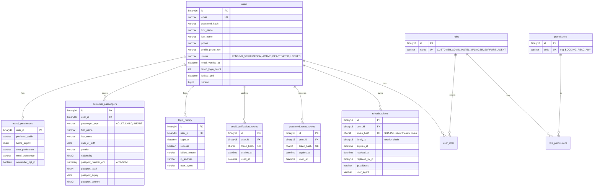
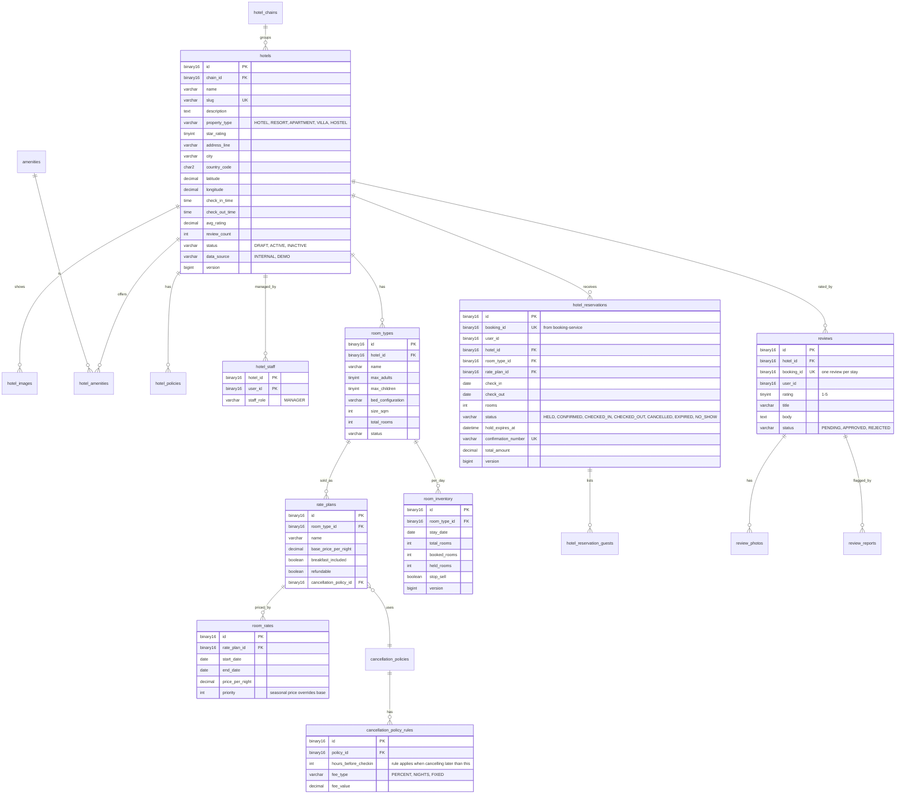
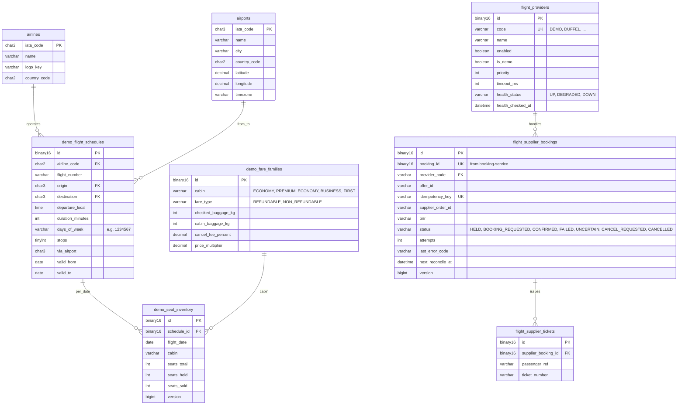
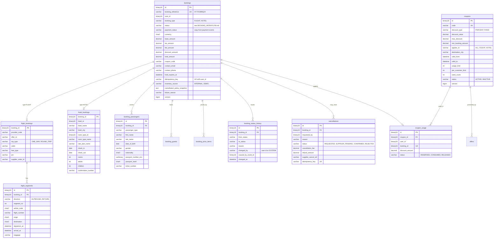
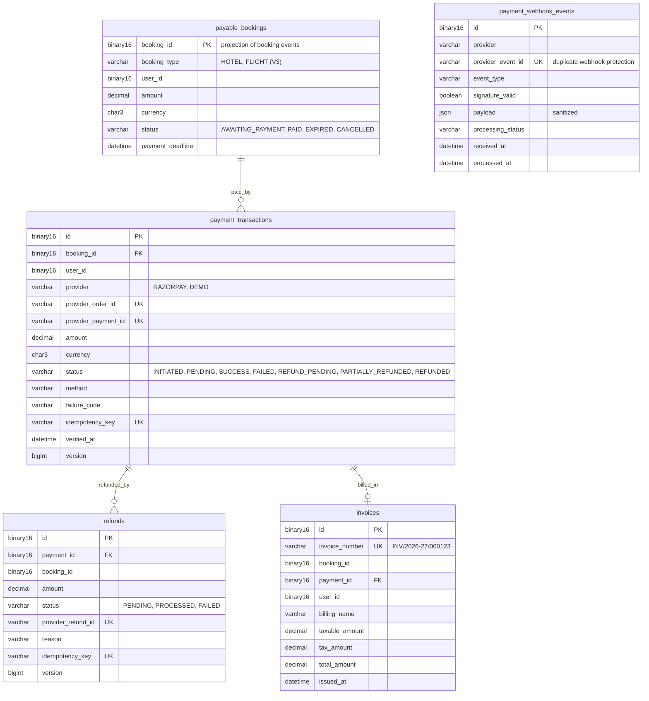

# Database Design

> Status: **Phase 1 draft** (2026-11-02). Final columns are fixed in each service's Flyway migrations.

## 1. Rules

1. **One database per service** (`identity_db`, `hotel_db`, `flight_db`, `booking_db`, `payment_db`,
   `notification_db`, `reporting_db`). Locally they all run in one MySQL container. Each service
   connects with its own DB user that has rights **only** on its own database.
2. **No foreign keys across services.** A column like `bookings.user_id` stores the ID from
   identity-service, but there is no database FK. Data from other services arrives through events.
3. **IDs**: UUID version 7 stored as `BINARY(16)`. Reference tables (airports, airlines) use their natural codes.
4. **Every business table** has `created_at`, `updated_at`, `created_by`, `updated_by`.
   Tables that are updated concurrently also have `version BIGINT` (JPA `@Version`, optimistic locking).
5. **Money**: `DECIMAL(12,2)` + `currency CHAR(3)`.
6. **Enums** are stored as `VARCHAR` (readable, safe to extend), validated in Java.
7. **Temporary data is not stored as permanent inventory.** Flight search results and hotel price
   quotes live in Redis with a TTL (this replaces the suggested `flight_search_cache` table).
8. **Sensitive values** (passport numbers) are encrypted at rest. A separate `*_last4` column
   is used for display and search.

### 1.1 Tables every service has

| Table | Purpose |
|-------|---------|
| `outbox_events` | `id`, `aggregate_type`, `aggregate_id`, `event_type`, `payload` (Avro bytes), `correlation_id`, `created_at`. Debezium publishes each row to Kafka. Rows are deleted by a cleanup job after 7 days. |
| `processed_events` | `event_id` (PK), `consumer_name`, `processed_at`. Makes Kafka consumers idempotent. |
| `flyway_schema_history` | Created by Flyway. |

---

## 2. identity_db (identity-service)



Key indexes: `users(email)` unique; `refresh_tokens(user_id, revoked_at)`; `login_history(user_id, login_at)`.

**Phase 9** (`V4__data_backfills.sql`): `data_backfills` (name PK, done_at). One row per one-time start-up job; the
row is locked while the job runs, so with several instances exactly one does the work. The first job publishes a
`UserSnapshot` of every account for reporting-service.

**Phase 11** (sign-in per portal): no new table or column. `login_history.failure_reason` can be `PORTAL_NOT_ALLOWED`.
The event `AuthEmailRequested` (topic `identity-email.events`) gains `portal` (optional, default `null`): for
`ACCOUNT_INVITATION` the staff sign-in page (`admin`, `hotel-manager`, `support`). Backward compatible (a field with a
default).

---

## 3. hotel_db (hotel-service)

> The requirements suggested `hotels` + `hotel_branches`. Here each **physical property** is a row in
> `hotels` (this is what customers search and book), and properties of the same brand are grouped by
> `hotel_chains`. A hotel manager can be assigned to several properties ("branches") through `hotel_staff`.



Other tables: `amenities(id, code UK, name, category HOTEL|ROOM)`, `room_type_amenities`,
`hotel_images(id, hotel_id, room_type_id NULL, storage_key, caption, sort_order, is_cover)`,
`hotel_policies(id, hotel_id, policy_type, description)`, `cancellation_policies(id, hotel_id, name)`,
`landmarks(id, city, name, latitude, longitude)` for "distance from" filters,
`hotel_reservation_guests(id, reservation_id, first_name, last_name, is_lead, age)`,
`review_photos`, `review_reports(id, review_id, reporter_id, reason, status)`.

**Preventing overbooking** (§10): `room_inventory` has a unique key `(room_type_id, stay_date)` and a
check `booked_rooms + held_rooms <= total_rooms`. A hold runs one atomic statement per stay:

```sql
UPDATE room_inventory
   SET held_rooms = held_rooms + :rooms, version = version + 1
 WHERE room_type_id = :roomTypeId
   AND stay_date >= :checkIn AND stay_date < :checkOut
   AND stop_sell = false
   AND total_rooms - booked_rooms - held_rooms >= :rooms;
-- if updated rows != number of nights → roll back: not available
```

Two customers racing for the last room cannot both succeed. Only one `UPDATE` can satisfy the condition.

**Elasticsearch index `hotels`** (read model): id, name, city, country, `location` (geo_point), star rating,
guest rating, property type, amenity codes, min price, free-cancellation flag, breakfast flag, cover image.
Updated from `HotelCatalogChanged` events.

**As built (Phase 4, `V2__hotel_catalog.sql`)** — differences from the draft above:

- **Cancellation terms live on `rate_plans`** (`refundable`, `free_cancellation_hours`, `cancellation_fee_percent`)
  instead of `cancellation_policies` + `cancellation_policy_rules`. "Free until N hours before check-in, then X %"
  covers the usual hotel policies and keeps the manager screens simple. Can be split out later if multi-step rules
  are needed.
- `hotels` also has `time_zone` (cancellation deadlines are in hotel local time), `state`, `postal_code`,
  `contact_email`, `contact_phone`; `hotel_chains` is not built yet (no chain features in scope).
- `hotel_images` stores a large (≤ 1600 px) and a thumbnail (≤ 480 px) key per photo.
- `known_users`: local copy of identity's accounts (from `identity.events`) to assign hotel managers by email.
- Room types and rate plans are never deleted (bookings will reference them); they are set `INACTIVE`.
- `room_inventory` rows exist for 365 days ahead (created with the room type, extended nightly).
- `hotel_reservations` + guests arrive with bookings (Phase 5); `reviews` with Phase 8.
- The index mapping is versioned (`_meta.mappingVersion`); a different or missing version is rebuilt on startup.

**Phase 9 (front desk and reviews)**
- `V6__reservation_front_desk.sql`: `hotel_reservations` gains `checked_in_at`, `checked_out_at`, `no_show_at`,
  `cancelled_by` (`CUSTOMER` / `HOTEL`) and `cancellation_reason`. Statuses `CHECKED_IN`, `CHECKED_OUT` and `NO_SHOW`
  are added.
- `V7__reviews.sql`:
  - `hotels.seed_rating` and `seed_review_count`: the demo figures the rating starts from.
  - `reviews`: one per booking (unique `booking_id`). Columns: rating 1–5, title, text, author name, `PENDING` /
    `APPROVED` / `REJECTED`, rejection reason, moderated by and at.
  - `review_reports`: one per user per review, `OPEN` / `CLOSED`.
- The hotel's rating: `(seed_rating × seed_review_count + approved ratings) / (seed_review_count + approved reviews)`.
  It is written under a row lock, apart from the managers' `version`.
- Occupancy and revenue reports are calculated from `room_inventory` and `hotel_reservations`; there is no extra
  table.

---

## 4. flight_db (flight-service)



`demo_*` tables belong **only to the DEMO provider**. They simulate an airline's system and are never
read by booking logic directly. Booking logic only talks to the `FlightBookingProvider` interface.
`demo_orders` (supplier-side PNR records of the simulated airline) also belongs to the DEMO provider.

Flight search results and offers are stored in **Redis** (`flight:offer:{offerId}`, TTL 20 minutes).

**As built in Phase 6** (`V2__flights.sql`; differences from the diagram above):

- `flight:option:{id}` holds one search result (with the reference needed to find the same flight and fare again) and
  `flight:trip:{id}` the revalidated trip offer (one or two flights, price lines); both 20 minutes.
- `demo_flight_schedules` also has `international`, `distance_km`, `layover_minutes` and `cabins` (which cabins the flight sells);
  one schedule = one flight number, possibly with a technical stop (`via_airport`). `demo_fare_families` holds the price multiplier
  per cabin and fare type. `demo_seat_inventory` rows are created on first use per flight, date and cabin; a CHECK keeps
  `held + sold <= total`.
- `flight_supplier_bookings` is flight-service's record from hold to ticket: `status` HELD, CONFIRMED, FAILED, UNCERTAIN,
  NEEDS_ATTENTION, RELEASED, EXPIRED; `trip_json` (what was held), `passengers_json` (names, types, dates of birth, never
  passports), `idempotency_key` = booking id, `attempts` / `uncertain_since` / `next_reconcile_at` for reconciliation.
  `flight_hold_items` lists the seats a hold took; `flight_supplier_tickets` the ticket per traveller. `airlines.iata_code` is
  `VARCHAR(3)` (some codes are alphanumeric).

---

## 5. booking_db (booking-service)



Other tables: `booking_guests(id, booking_id, room_no, first_name, last_name, is_lead, age)`,
`booking_price_items(id, booking_id, item_type, description, amount)`,
`offers(id, title, description, image_key, coupon_id, applies_to, valid_from, valid_to, status)`.

Key indexes: `bookings(user_id, created_at)`, `bookings(status, hold_expires_at)`,
unique `bookings(user_id, idempotency_key)`, `coupon_usage(coupon_id, user_id)`.

**As built in Phase 5** (`V2__bookings.sql`: hotel bookings only; `flight_bookings`, `flight_segments`,
`booking_passengers` arrive in Phase 6, `cancellations` in Phase 7, `offers` with the admin portal in Phase 9):

- `bookings` also holds `payment_status` (UNPAID, PAYMENT_FAILED, PAID, REFUND_PENDING, REFUNDED), the list fields
  `title`/`destination`/`start_date`/`end_date` (known once the room is held), `payment_deadline`, `paid_payment_id`,
  `coupon_note` (why a coupon was not applied), `failure_reason`/`failure_message`, `request_hash` (SHA-256 of the
  request: same `Idempotency-Key` with other content is refused) and `confirmed_at`.
- `hotel_bookings` keeps everything the customer saw (hotel, room type, rate plan, dates, guests count, cancellation
  terms) as a snapshot, plus `quote_id` and the `confirmation_number`, which stays empty until `CONFIRMED`.
- `booking_status_history(from_status, to_status, reason, changed_by, caused_by_event_id, changed_at)`: every change
  and every "something happened" note (a failed payment keeps the status, so `from = to`).
- `booking_refund_requests(id = refundRequestId, payment_id, amount, reason BOOKING_FAILED | LATE_PAYMENT |
  DUPLICATE_PAYMENT | CANCELLATION, status REQUESTED | COMPLETED | FAILED)`: money booking-service asked payment-service
  to return; the id is payment-service's idempotency key.
- Demo coupons (`WELCOME10`, `STAY500`, `GOA15`, `demo = true`) are created at startup when `booking.demo-data.enabled`
  (always off in production).

**Cancellations** (`V4__cancellations.sql`, Phase 7): `cancellations(booking_id, status PENDING | CONFIRMED | REJECTED,
initiated_by, requested_by, reason, fee_waived, paid_amount, quoted_fee, quoted_refund, cancellation_fee, refund_amount,
supplier_fee, supplier_reference, failure_reason/message, idempotency_key + request_hash (unique per booking), attempts,
last_sent_at, requested_at, completed_at)`; `bookings` gained `refunded_amount`, `cancel_until` (check-in moment / first
departure − 4 h), `cancelled_at` and the support flag `attention_reason/note/since`; `booking_refund_requests` gained
`cancellation_id`, `attempts`, `last_sent_at`; `booking_support_notes(booking_id, action, note, author_id, author_role,
created_at)` holds internal support notes. `payment_status` may be `PARTIALLY_REFUNDED`. hotel-service:
`hotel_reservations.status` `CANCELLED` + `cancellation_id`, `cancellation_reference`, `cancelled_at` (`V5`). flight-service
(`V3`): `flight_supplier_bookings` statuses `CANCEL_UNCERTAIN`, `CANCELLED` + cancellation id, reference, airline fee and
refund; the DEMO airline's `demo_orders` keep what was sold (seats, fare, total, fee %) and its cancellation.

**Flights** (`V3__flight_bookings.sql`): `flight_bookings` (same id as the booking: offer id, hold id, provider, trip type, cabin,
fare name, baggage, cancellation fee %, passenger counts, `slices_json` = the flights exactly as held, `pnr` empty until the
airline issued the booking) and `booking_passengers` (adults, then children, then infants; `passport_number_enc` is
AES-256-GCM, `passport_last4` is all the API shows; `ticket_number` empty until issued). Deviation: the flights are one JSON
snapshot instead of `flight_segments` rows, because nothing queries single segments yet.

**Phase 9** (`V6__admin_offers_goodwill.sql`):
- `offers`: id, title, description, `coupon_id` → coupons, applies_to, destination_city, valid_from, valid_to,
  seasonal, theme (`OCEAN`, `SUNSET`, `FOREST` or `CITY`), status, demo, audit columns, version. An offer only
  advertises a coupon: the discount rules stay the coupon's.
- `booking_refund_requests` gains `idempotency_key`, `request_hash`, `requested_by` and `note` for goodwill refunds
  (reason `GOODWILL`), with a unique key on `(booking_id, idempotency_key)`.
- Index `bookings(created_at)` for the admin search.
- `data_backfills`: the one-time `BookingSnapshot` of every booking.

---

## 6. payment_db (payment-service)



`invoice_sequences(financial_year PK, last_number)` is locked with `SELECT ... FOR UPDATE` so invoice
numbers have no gaps or duplicates. **No card number, CVV or similar data is ever stored.**

**As built in Phase 5** (`V2__payments.sql`; differences from the diagram above):

- `payable_bookings` also holds `booking_reference`, `description` and `contact_email` (shown on the payment page and
  sent to the provider); `amount`/`currency` never change after they were copied from `BookingAwaitingPayment`.
- `payable_bookings.booking_type` (`HOTEL` or `FLIGHT`, migration V3, indexed) comes from `BookingAwaitingPayment`; rows
  that existed before get it from the reference prefix (`HT-`, `FL-`). The admin payments list filters and shows it.
- `payment_transactions`: `UNIQUE (user_id, idempotency_key)` (not global), `refunded_amount` (sum of processed
  refunds, so `REFUNDED` vs `PARTIALLY_REFUNDED` is decided in one row), `failure_message`, `provider_payment_id`
  is `NULL` until the customer paid. Status moves `FAILED → SUCCESS` when a later payment on the same Razorpay order is captured.
- `payment_webhook_events`: unique `(provider, provider_event_id)`; `summary` is a **sanitized** JSON (ids, amount,
  status, method), the provider's full payload is not stored.
- `refunds`: `idempotency_key` = booking-service's `refundRequestId` (unique); `user_id` added.
- `invoices`: also `booking_reference`, `billing_email`, `description`, `discount_amount`; one invoice per booking
  (`UNIQUE booking_id`).

---

## 7. notification_db (notification-service)

| Table | Key columns |
|-------|------------|
| `notifications` | id, user_id, category (BOOKING, PAYMENT, REFUND so far), title, message, link (a path inside the web app), `source_event_id` UK (one notification per event), read_at, created_at — index `(user_id, read_at, created_at)`. Built in Phase 5 (`V3__notifications.sql`). |
| `notification_preferences` | user_id, channel (EMAIL, IN_APP, SMS), category (BOOKING, PAYMENT, REMINDER, PROMOTION), enabled |
| `email_messages` | id, source_event_id UK, to_email, template, subject, status (PENDING, SENT, FAILED), attempts, last_error, sent_at |
| `documents` | id, booking_id, user_id, document_type (BOOKING_CONFIRMATION, E_TICKET, INVOICE, PAYMENT_RECEIPT, CANCELLATION_CONFIRMATION, REFUND_RECEIPT), storage_key, file_name, content_type, size_bytes, sha256, created_at |
| `user_contacts` | projection from identity events: user_id PK, email, first_name, status |
| `upcoming_trips` | projection for reminders: booking_id PK, user_id, travel_date, reminder_sent_at |
| `support_tickets` | id, ticket_number UK, user_id, booking_id NULL, subject, category, status (OPEN, IN_PROGRESS, WAITING_CUSTOMER, ESCALATED, RESOLVED, CLOSED), priority, assigned_agent_id |
| `support_ticket_messages` | id, ticket_id, author_id, author_role, message, created_at |
| `newsletter_subscriptions` | id, email UK, status, confirmed_at |

**As built in Phase 8** (`V4__documents_preferences_tickets_newsletter.sql`):

- `documents`: the id is derived from `(document_type, reference_id)` (UNIQUE), so a document is made once per source
  (booking, invoice, payment, cancellation, refund) and a retried event overwrites the same file; `storage_key` is
  `documents/<id>.pdf` in `FileStorage` (never a URL); `title`, `file_name`, `sha256`, `size_bytes`.
- `notification_preferences(user_id, category, channel, enabled)`: only changed choices are stored; everything else is
  on; `EMAIL` for `BOOKING`/`PAYMENT`/`REFUND` is locked on in code.
- `booking_contacts` (projection from `BookingAwaitingPayment` / `BookingConfirmed`: owner, reference, description,
  contact e-mail, lead name, demo flag) instead of `user_contacts`: payment and refund events carry no contact data.
- `upcoming_trips` as planned, plus `starts_at` (UTC, from `BookingConfirmed.startsAt`), `details_json` (rows of the
  reminder e-mail), `status` and `confirmed_at`.
- `support_tickets` also has `booking_reference`, `source_event_id` (UNIQUE: one automatic ticket per refused
  cancellation), `last_message_at/by`, `closed_at`; `support_ticket_messages` as planned.
- `newsletter_subscriptions` also has `user_id`, `source` (FORM, ACCOUNT), `confirm_token_hash` (SHA-256, UNIQUE),
  `confirm_expires_at`, `unsubscribed_at`. Statuses `PENDING`, `SUBSCRIBED`, `UNSUBSCRIBED`.
- `notifications.category` now also `ACCOUNT`, `REMINDER`, `SUPPORT`; `source_event_id` widened to 64 characters
  (notifications derived from one event, e.g. "ticket opened").
- Not built: `notification_preferences` for SMS (no SMS channel yet).

**Phase 9** (`V5__ticket_queue.sql`): `support_tickets` gains `customer_email` (filled from `booking_contacts` for
older tickets) and `assigned_at`, plus the index `(assigned_agent_id, status)` for the agents' queue.

**Phase 11** (`V6__ticket_resolved_at.sql`): `support_tickets.resolved_at` = when the ticket was resolved or closed
(resolving and then closing keeps the first moment). It is cleared whenever the ticket leaves `RESOLVED` / `CLOSED`: a
customer reply that reopens it, a support reply (which sets `WAITING_CUSTOMER`) or an agent's status change. Indexes
`(resolved_at)` and `(created_at)` for the support dashboard. Older tickets: closed ones from `closed_at`, resolved ones
from `updated_at`.

---

## 8. reporting_db (reporting-service)

All tables except `system_settings` and `export_jobs` are **read models** built from events. They can be rebuilt by
replaying Kafka topics.

| Table | Key columns |
|-------|------------|
| `booking_facts` | booking_id PK, booking_reference, user_id, booking_type, status, payment_status, title, destination, hotel_id, route_origin, route_destination, origin_city, start_date, end_date, currency, total_amount, discount_amount, refunded_amount, contact_email, coupon_code, created_at, confirmed_at, cancelled_at, demo, changed_at. The latest `BookingSnapshot`; an older one never overwrites a newer one. **Phase 9** |
| `payment_facts` | payment_id PK, booking_id, user_id, provider, method, status (`SUCCESS` is final; or `FAILED`), amount, currency, failure_code, occurred_at. From `PaymentSucceeded` / `PaymentFailed` |
| `refund_facts` | refund_request_id PK, booking_id, booking_reference, payment_id, amount, reason, status (`REQUESTED` / `COMPLETED` / `FAILED`), requested_at, completed_at, failed_at, failure_reason. From `BookingRefundRequested` and payment-service's answers, in any order |
| `cancellation_facts` | cancellation_id PK, booking_id, booking_reference, booking_type, title, initiated_by, paid_amount, cancellation_fee, refund_amount, fee_waived, cancelled_at. From `BookingCancelled` |
| `user_facts` | user_id PK, email, first and last name, roles, status, email_verified, registered_at. From `UserSnapshot` and the identity events |
| `audit_logs` | id, source_event_id UK, service, actor_id, actor_roles, action, entity_type, entity_id, details (JSON, ids and amounts only), ip_address, correlation_id, occurred_at, received_at — index `(occurred_at)`, `(entity_type, entity_id, occurred_at)`, `(action, occurred_at)`, `(actor_id, occurred_at)`. **Built in Phase 7** (`V3__audit_logs.sql`). Read newest first with `ORDER BY audit_logs.occurred_at DESC, audit_logs.id DESC` (InnoDB adds `id` to every index, so an index serves that order). The columns must be qualified: a bare `id` there means the select list's `BIN_TO_UUID(id) AS id`, which no index holds (fixed 2026-11-09; before, MySQL sorted the whole table, 40 s for the first 5,000 of 10 million rows). |
| `system_settings` | setting_key PK, setting_value, value_type, description, updated_by, updated_at, version |
| `export_jobs` | id, dataset (`AUDIT_LOGS`), format (`XLSX` / `CSV`), filters (JSON), as_of, requested_by, requested_by_name, status (`QUEUED` / `RUNNING` / `READY` / `FAILED` / `EXPIRED`), total_rows, rows_written, parts, storage_key, file_name, size_bytes, error, link_token_hash (SHA-256 of the one-time link), link_expires_at, created_at, started_at, heartbeat_at, finished_at, expires_at — index `(requested_by, created_at)`, `(status, heartbeat_at)`. Background exports of the audit log (`V5__export_jobs.sql`, requested 2026-11-09): working state, not a read model. Every status change is a conditional UPDATE, so one instance runs a job; a removed job is deleted; finished jobs are forgotten after 7 days. |

**How the facts are built (Phase 9).**
- Writes are idempotent upserts keyed by the business id, so the listeners need no inbox. A redelivered, replayed or
  out-of-order event changes nothing it should not.
- Each topic has its own consumer group (`reporting-facts-bookings`, `-payments`, `-accounts`). A fresh reporting
  database is rebuilt from the 7 days Kafka keeps, plus the one-time snapshot backfills of booking- and
  identity-service. Payments, refunds and cancellations older than the retention are therefore not rebuilt (see the
  production note in PROJECT_ARCHITECTURE.md).
- Occupancy stays in hotel-service (`/api/admin/hotels/occupancy`), where the rooms are; there is no
  `hotel_occupancy_daily` copy.
- The planned `activity_feed` is the newest `audit_logs` rows.

**Phase 11:** no new table or column. The admin dashboard v2 reads the product type through `booking_facts` (joined on
`booking_id` for payments and refunds) and the cancellation type from `cancellation_facts.booking_type`; a failed
payment attempt counts its booking's `total_amount` (as the payments report already does).

**Report consistency** (§22): every total on the dashboard and in the reports comes from these tables with the same
India-day filter. `ReportConsistencyIntegrationTest` (exit check) feeds a month of events and compares every figure
with the source data. The live E2E compares the dashboard and the reports with booking-service's and payment-service's
own admin APIs. The planned nightly comparison job is not built.

---

## 9. Transaction boundaries (summary)

| Operation | One local transaction contains |
|-----------|-------------------------------|
| Create booking | insert booking + passengers/guests + status history + outbox row |
| Hold hotel rooms | update `room_inventory` (all nights) + insert reservation + outbox row + processed_events |
| Apply coupon | lock coupon row, check limits, insert `coupon_usage` (RESERVED), update booking totals + outbox row |
| Payment success | update payment transaction + outbox row (+ webhook event row when from a webhook) |
| Issue invoice | lock `invoice_sequences` row + insert invoice + outbox row |

There are **no distributed transactions**. Consistency across services comes from the saga and its
compensating steps ([BOOKING_WORKFLOW.md](BOOKING_WORKFLOW.md)).
