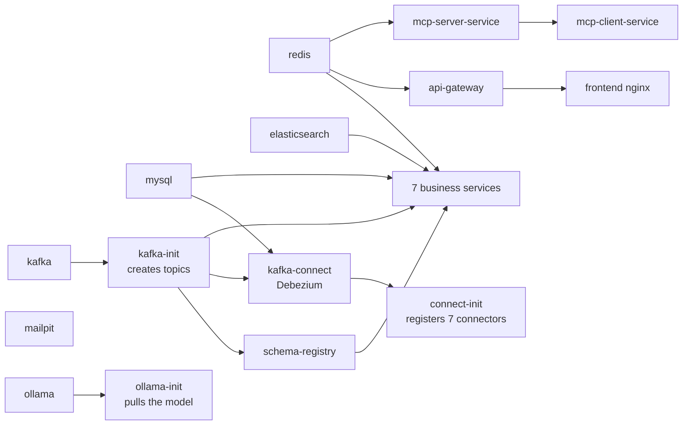

# Docker Setup

Run the **whole system** (infrastructure + 10 backend services + the AI assistant's local model + frontend) with Docker
Compose.

## 1. Requirements

- Docker Desktop with **at least 16 GB of memory** (Settings → Resources). The full stack uses about 14 GB since the AI
  assistant of Phase 11 (its model needs about 5 GB more). 20 GB or more is recommended on a 32 GB machine, and 22 GB
  with the voice profile ([AI_ASSISTANT.md](AI_ASSISTANT.md) §10).
- About 10 GB of free disk space for images and data, plus about 4.2 GB for the assistant's model.

## 2. First start

```powershell
cd "D:\Drive E\dev\flight-hotel-app"
Copy-Item .env.example .env      # then open .env and replace every "change-me-..." password
python -c "import secrets;print(secrets.token_urlsafe(48))"   # put the output in .env as MCP_SERVER_API_KEY=...
docker compose up -d --build     # first build takes 5–15 minutes (downloads Maven and npm packages)
docker compose ps                # wait until every service shows "(healthy)"
```

> Use passwords made of letters and digits only. The MySQL init script does not accept quotes.
> `MCP_SERVER_API_KEY` (Phase 11) needs at least 32 random characters; without it the assistant's two services do not
> start.

**Expected result** (`docker compose ps`): 19 running containers marked `healthy`. `kafka-init`, `connect-init` and
`ollama-init` run once and show `Exited (0)`. On the first start `ollama-init` downloads the assistant's model (about
4.2 GB) before it exits.

## 3. Addresses

| What | URL |
|------|-----|
| Web app | http://localhost:3000 |
| API gateway | http://localhost:8080 |
| Swagger UI (all services) | http://localhost:8080/swagger-ui.html |
| Mailpit (all emails sent locally) | http://localhost:8025 |
| Kafka Connect / Debezium connectors | http://localhost:8083/connectors |
| Schema Registry subjects | http://localhost:8081/subjects |
| Elasticsearch | http://localhost:9200 |
| Kafka UI (optional, see below) | http://localhost:8090 |
| MySQL | `localhost:3307`, users and passwords from `.env` |
| Services directly (debugging only) | http://localhost:8101 … 8107 |
| Assistant chat API (debugging only) | http://localhost:8108 (through the gateway: `/api/assistant/**`) |
| Global search API (debugging only) | http://localhost:8110 (through the gateway: `/api/search/**`); see [docs/GLOBAL_SEARCH_IMPLEMENTATION.md](docs/GLOBAL_SEARCH_IMPLEMENTATION.md) |
| Ollama (local only) | http://127.0.0.1:11434 |

mcp-server-service (8109) and the speech server have no published port.

### Demo accounts (local only)

With `DEMO_USERS_ENABLED=true` and a `DEMO_USER_PASSWORD` in `.env`, identity-service creates one active account per
role on startup: `admin@flighthotel.local`, `customer@flighthotel.local`, `manager@flighthotel.local`,
`support@flighthotel.local`. New customer accounts work too: register at http://localhost:3000/register, open the verification email in Mailpit
(http://localhost:8025), click the link, log in.

### Demo hotels (local only)

hotel-service seeds 16 **fictional, clearly labelled** hotels in eight Indian cities (Goa, Bengaluru, Mumbai, New Delhi,
Jaipur, Chennai, Kochi, Udaipur) with rooms, rates, a year-end peak season, 365 days of inventory, landmarks for
"distance from" and generated placeholder photos. Customers see a "Demo listing" badge on each. The demo hotel
manager (`manager@flighthotel.local`) is assigned to three of them. Set `DEMO_DATA_ENABLED=false` in `.env` to start
with an empty catalogue (always off in the `prod` profile). Profile and hotel photos are kept in the
`identity-storage` / `hotel-storage` volumes, the generated PDFs (confirmations, e-tickets, invoices, receipts) in
`notification-storage`.

### Storage and newsletter settings (Phase 8)

| Variable / property | Default | Meaning |
|---------------------|---------|---------|
| `travel.storage.type` | `local` | `local` (a folder, `travel.storage.local-root`, `/app/storage` in Docker) or `s3` |
| `travel.storage.s3.bucket`, `.region`, `.prefix` | –, `ap-south-1`, – | the private bucket; production uses the ECS task role (no keys) |
| `travel.storage.s3.endpoint`, `.path-style`, `.access-key`, `.secret-key` | empty | only for S3-compatible stores in tests |
| `NEWSLETTER_SECRET` | a fixed development value | signs newsletter unsubscribe links; **required** in `prod` |

## 4. What starts, in which order



- **kafka-init** creates every topic (`<domain>.events`, `<domain>.events.DLT`, compacted `settings.events`).
  Automatic topic creation is off.
- **connect-init** registers one Debezium outbox connector per service database (`infra/kafka-connect/connectors`).
- On startup **reporting-service** broadcasts the default system settings. Every service logs
  `System setting updated: key=...`, which is a quick end-to-end check of the outbox → Debezium → Kafka → consumer path.
- **AI assistant (Phase 11)**: `ollama` runs the local model; **ollama-init** pulls `ASSISTANT_CHAT_MODEL` (default
  `granite4:tiny-h`) into the `ollama-models` volume, then exits. `mcp-server-service` and `mcp-client-service` are
  the assistant's two services ([AI_ASSISTANT.md](AI_ASSISTANT.md)). Until the model is there, the app hides the chat.
- The optional profile `voice` adds the speech server `speaches` (+ `speaches-init`, which downloads the speech models
  once).

## 5. Everyday commands

```powershell
docker compose ps                                  # status
docker compose logs -f booking-service             # follow one service's logs
docker compose up -d --build booking-service       # rebuild + restart one service after code changes
docker compose restart notification-service
docker compose --profile tools up -d kafka-ui      # optional Kafka UI on :8090
docker compose --profile voice up -d               # optional speech server for the assistant
docker exec flight-hotel-ollama-1 ollama ps        # model loaded, memory
docker compose up -d ollama-init mcp-client-service   # after changing ASSISTANT_CHAT_MODEL in .env
docker compose stop                                # stop everything (data is kept)
docker compose down                                # remove containers (data volumes are kept)
docker compose down -v                             # ⚠ also deletes ALL data (MySQL, Kafka, Elasticsearch)
```

## 6. Quick health check

```powershell
curl.exe -s http://localhost:8080/api/public/settings          # 200 with site settings (public endpoint)
curl.exe -s -o NUL -w "%{http_code}" http://localhost:8080/api/admin/settings   # 401 (needs a token)
curl.exe -s http://localhost:8083/connectors?expand=status     # every connector "RUNNING"
docker compose logs reporting-service | Select-String "System setting updated" | Measure-Object
```

## 7. Images

| Image | Built from |
|-------|-----------|
| `flighthotel/<service>:local` | `docker/backend.Dockerfile` with `--build-arg SERVICE=<service>`: one Maven build stage shared by all services, then a small JRE image per service (layered jar, non-root user) |
| `flighthotel/frontend:local` | `frontend/Dockerfile`: Node build → unprivileged nginx (`nginxinc/nginx-unprivileged`, uid 101, port 8080 inside the container, published as 3000; SPA fallback, `/api` proxy, SSE without buffering, security headers). The same image runs on Kubernetes ([KUBERNETES_DEPLOYMENT.md](KUBERNETES_DEPLOYMENT.md)) |
| `flighthotel/mcp-server-service:local`, `flighthotel/mcp-client-service:local` (Phase 11) | the same `docker/backend.Dockerfile` |
| `ollama/ollama:0.40.14`, `ghcr.io/speaches-ai/speaches:0.8.3-cpu` (Phase 11) | pulled, not built: the model server and the optional speech server (profile `voice`) |

## 8. Troubleshooting

| Problem | Fix |
|---------|-----|
| `ports are not available ... 3306` (or another port) | Something on Windows already uses that port. MySQL is published on **3307** by default (`MYSQL_HOST_PORT` in `.env`). For other ports, stop the program using the port (`Get-NetTCPConnection -LocalPort 9092`). |
| After rebuilding or recreating **one** backend service (`docker compose up -d notification-service`), calls through the gateway to it answer `500`, and `docker compose logs api-gateway` shows `Failed to resolve 'notification-service'` | The gateway remembered the failed name lookup from while the container was restarting. Restart it: `docker compose restart api-gateway`. (Recreating the services together with the gateway, or `docker compose up -d` of the whole stack, avoids it.) |
| `Set MYSQL_ROOT_PASSWORD in .env` | You have no `.env` file, or a value is missing. Copy `.env.example` to `.env`. |
| A service stays `health: starting` / restarts | `docker compose logs <service>`. Most often the DB password in `.env` was changed **after** MySQL was first created. The init script only runs on an empty volume. Fix: `docker compose down -v` (deletes data) and start again. |
| Elasticsearch exits with code 137 | Not enough memory. Give Docker Desktop more memory. |
| Connector state `FAILED` | `curl.exe http://localhost:8083/connectors/<name>/status` shows the error. Re-run registration: `docker compose up connect-init`. |
| Services log `Connection to node -1 (localhost/127.0.0.1:9092) could not be established` | You started a service outside Docker before Kafka was up. Run `.\scripts\start-infra.ps1` first. |
| Build is very slow | The first build downloads all dependencies; later builds reuse the BuildKit cache. Make sure Docker Desktop uses the WSL 2 backend. |
| The assistant does not appear, or answers slowly | See [AI_ASSISTANT.md](AI_ASSISTANT.md) §12. |
