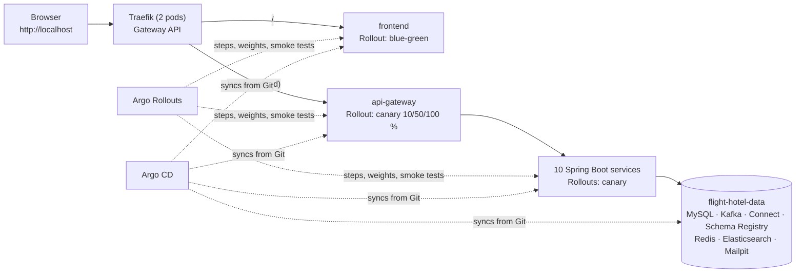

# Kubernetes Deployment Guide (kind, then EKS)

This guide deploys the whole application (11 Spring Boot services, the React web app, and the data services they
need) on a highly available Kubernetes cluster that runs in Docker with **kind**. It covers:

- Blue-Green and Canary releases with **Argo Rollouts**.
- GitOps with **Argo CD**.
- How the GitHub Actions pipeline feeds both.

Every step can be run by hand. The scripts in `deploy/scripts/` only bundle the same commands.

Docker Compose ([DOCKER_SETUP.md](DOCKER_SETUP.md)) remains the quickest way to develop locally. Use this guide to run
the application the way it will run in production, and to practise Kubernetes operations.

**Contents**
1. [What gets deployed](#1-what-gets-deployed)
2. [Prerequisites](#2-prerequisites)
3. [Step 1: create the HA cluster](#3-step-1-create-the-ha-cluster)
4. [Step 2: put the images in the local registry](#4-step-2-put-the-images-in-the-local-registry)
5. [Step 3: install the platform add-ons](#5-step-3-install-the-platform-add-ons)
6. [Step 4: create the secrets](#6-step-4-create-the-secrets)
7. [Step 5: deploy the application](#7-step-5-deploy-the-application)
8. [What the manifests contain](#8-what-the-manifests-contain)
9. [Blue-Green and Canary releases](#9-blue-green-and-canary-releases)
10. [GitOps with Argo CD](#10-gitops-with-argo-cd)
11. [CI/CD with GitHub Actions](#11-cicd-with-github-actions)
12. [Day-2 operations](#12-day-2-operations)
13. [Troubleshooting](#13-troubleshooting)
14. [Tear down, or go back to Docker Compose](#14-tear-down-or-go-back-to-docker-compose)
15. [Next: AWS EKS](#15-next-aws-eks)
16. [Versions and test record](#16-versions-and-test-record)

---

## 1. What gets deployed



| Namespace | Contents | Pod Security |
|-----------|----------|--------------|
| `flight-hotel` | 12 application Rollouts: 11 Spring Boot services and the web app | `restricted` |
| `flight-hotel-data` | MySQL 8.4, Redis 8.4, Kafka (Confluent Platform 8.4, KRaft), Schema Registry, Kafka Connect + Debezium 3.7, Elasticsearch 9.4, Mailpit | `baseline` (warns on `restricted`) |
| `traefik` | Traefik 3.7, the cluster's Gateway API implementation (the edge) | |
| `argo-rollouts` | Argo Rollouts 1.10 controller, its dashboard, the Gateway API traffic plugin | |
| `argocd` | Argo CD 3.6 | |
| `kube-system` | metrics-server 0.9 (feeds the autoscalers) | |

The URLs, once deployed:

| URL | What |
|-----|------|
| http://localhost | The web app. `/api/...` goes to api-gateway. |
| http://preview.localhost | The **new** web app version during a blue-green release, before promotion |
| http://argocd.localhost | Argo CD (user `admin`; password in section 10.2) |
| http://rollouts.localhost | Argo Rollouts dashboard. It shows every rollout's steps and has Promote / Abort / Retry buttons. |
| http://mail.localhost | Mailpit: every e-mail the application sends (verification, booking confirmations, ...) |

Browsers resolve `*.localhost` to your own machine. If another tool does not, see section 13.

### The `deploy/` folder

```text
deploy/
  kind/cluster.yaml                 the cluster: 3 control planes + 3 workers in 3 "zones"
  platform/                         cluster add-ons
    namespaces.yaml                 the two application namespaces, with their Pod Security levels
    analysis-templates.yaml         the smoke test every rollout runs (ClusterAnalysisTemplate)
    routes.yaml                     route to the Argo Rollouts dashboard
    values/                         Helm values: traefik, metrics-server, argo-rollouts, argo-cd
  charts/
    microservice/                   ONE generic chart; installed once per service (release name = service name)
    data-platform/                  MySQL, Kafka, ... for kind (EKS uses managed AWS services)
    shared/                         common ConfigMap, NetworkPolicies, ResourceQuota, LimitRange
  environments/
    kind/                           values for this cluster
      values.yaml                   image registry + the ONE image tag every service runs
      services/<service>.yaml       per service: port, env, probes, resources, autoscaling, rollout strategy
      data-platform.yaml, shared.yaml
    eks/                            prepared for the EKS phase (README.md)
  argocd/                           GitOps: projects, root app ("app of apps"), child apps, ApplicationSet
  scripts/                          PowerShell: kind-up, push-images, install-platform, create-secrets,
                                    deploy-apps, argocd-bootstrap, kind-down
```

There is one chart for all 12 services, not 12 copies. A service's file under `environments/<env>/services/` holds only
what differs, so adding a service means adding one values file.

---

## 2. Prerequisites

| Tool | Version used | Install (Windows) |
|------|--------------|-------------------|
| Docker Desktop (WSL 2) | 4.98, **at least 16 GB** memory for Docker | docker.com |
| kind | 0.33 | `winget install Kubernetes.kind` |
| kubectl | 1.36 (1.34 or newer) | comes with Docker Desktop |
| Helm | **4.3** (Helm 3 also works) | `winget install Helm.Helm` |
| Argo Rollouts kubectl plugin (recommended) | 1.10.2 | see below |
| argocd CLI (optional) | 3.6.1 | see below |

The two Argo command-line tools are single executables. Put them in a folder on your `PATH`:

```powershell
$dir = "$env:LOCALAPPDATA\Programs\k8s-tools"; New-Item -ItemType Directory -Force $dir | Out-Null
Invoke-WebRequest https://github.com/argoproj/argo-rollouts/releases/download/v1.10.2/kubectl-argo-rollouts-windows-amd64 -OutFile "$dir\kubectl-argo-rollouts.exe"
Invoke-WebRequest https://github.com/argoproj/argo-cd/releases/download/v3.6.1/argocd-windows-amd64.exe -OutFile "$dir\argocd.exe"
# Add $dir to your user PATH (Settings > System > About > Advanced system settings > Environment Variables),
# open a new terminal, then:
kubectl argo rollouts version
```

Without the plugin, use the dashboard (http://rollouts.localhost) or the `kubectl patch` commands in section 9.5.

**Before you start**

1. **A `.env` file** with the passwords (copy `.env.example`; see [LOCAL_SETUP_GUIDE.md](LOCAL_SETUP_GUIDE.md)). The
   cluster reads its secrets from this file.
2. **The images**: `docker compose build` builds the 12 application images (`flighthotel/<service>:local`).
3. **Free memory.** The full cluster uses about **12.5 GB**: 6 nodes, 14 application pods and 7 data pods. Stop the
   Compose stack first:

   ```powershell
   docker compose --profile tools stop
   ```

4. **Free ports** `80` and `443` on `127.0.0.1` (IIS or another web server must not use them), and `5001` for the
   local registry.

All commands below run from the repository root in PowerShell.

---

## 3. Step 1: create the HA cluster

```powershell
.\deploy\scripts\kind-up.ps1
```

| What happens | Why |
|--------------|-----|
| A registry container `kind-registry` on `localhost:5001` | Nodes pull the application images from it (nothing is pushed to the internet) |
| `kind create cluster --config deploy/kind/cluster.yaml` | **3 control-plane nodes** (etcd, API server, scheduler, controller manager on each). kind adds an HAProxy load balancer in front of the three API servers. **3 worker nodes**, labelled `topology.kubernetes.io/zone=zone-a/b/c` like three AWS Availability Zones. |
| `extraPortMappings` 80 → NodePort 30080, 443 → 30443 (127.0.0.1 only) | `http://localhost` reaches Traefik inside the cluster |
| `/etc/containerd/certs.d/localhost:5001/hosts.toml` on each node | `localhost:5001/...` inside a node means the registry container |

First creation: 3-5 minutes. Check:

```powershell
kubectl get nodes -L topology.kubernetes.io/zone
# 3 x control-plane, 3 x worker (zone-a, zone-b, zone-c), all Ready, v1.36.4
```

### Practise high availability

```powershell
# A control plane fails: the API keeps answering (etcd still has a 2-of-3 quorum).
docker stop flight-hotel-control-plane2
kubectl get nodes                    # still works; control-plane2 becomes NotReady within about a minute
docker start flight-hotel-control-plane2

# Maintenance on a worker: its application pods move to the other zones (about 15 seconds). The
# PodDisruptionBudgets keep at least one Traefik, web app and api-gateway pod running the whole time.
kubectl drain flight-hotel-worker --ignore-daemonsets --delete-emptydir-data `
  --pod-selector='app.kubernetes.io/component in (backend,gateway,frontend)'
kubectl get pods -n flight-hotel -o wide
kubectl uncordon flight-hotel-worker
```

> The `--pod-selector` leaves the data services where they are. Each worker runs one of `mysql-0`, `kafka-0`,
> `elasticsearch-0`, and kind's local volumes are tied to their node, so such a pod would stay `Pending` until the
> node is uncordoned. A backend with a single replica is briefly unavailable while its pod restarts elsewhere. On
> EKS, the data services are managed AWS services and every service runs 2+ replicas, so a drain is invisible.

---

## 4. Step 2: put the images in the local registry

```powershell
.\deploy\scripts\push-images.ps1               # application images as tag 1.0.0, plus mirrors of MySQL, Kafka, ...
```

- Application images go to `localhost:5001/flighthotel/<service>:<tag>`.
- The data services go to `localhost:5001/<same name>:<same tag>`, so the nodes do not pull them from Docker Hub.

**A new version always gets a new tag.** Nodes cache images by tag, so re-pushing `1.0.0` would not reach running nodes.

```powershell
docker compose build booking-service
.\deploy\scripts\push-images.ps1 -Tag 1.0.1 -AppOnly
```

---

## 5. Step 3: install the platform add-ons

```powershell
.\deploy\scripts\install-platform.ps1          # -SkipArgoCd if you only want manual Helm deployments
```

| Add-on | Version | Values | Role |
|--------|---------|--------|------|
| Gateway API CRDs | v1.6.3 (standard) | | `Gateway`, `HTTPRoute`: the portable successor of Ingress (ingress-nginx is retired) |
| metrics-server | 0.9.0 (chart 3.14.0) | `values/metrics-server.yaml` | CPU/memory metrics for `kubectl top` and the autoscalers |
| Traefik | 3.7 (chart 42.3.1) | `values/traefik.yaml` | Implements the Gateway `traefik-gateway`. 2 replicas, a PDB, spread over zones. |
| Argo Rollouts | 1.10.2 (chart 2.43.9) | `values/argo-rollouts.yaml` | Canary and blue-green controller + dashboard; Gateway API plugin 0.17.0 (checksum-pinned) |
| Argo CD | 3.6.1 (chart 10.15.0) | `values/argo-cd.yaml` | GitOps (section 10) |

The script also applies `namespaces.yaml`, the smoke-test `ClusterAnalysisTemplate` and the dashboard route. It takes
about 5 minutes and is safe to run again: every add-on uses `helm upgrade --install` with a pinned version.

```powershell
kubectl get gateway -n traefik          # traefik-gateway   PROGRAMMED True
kubectl get pods -A | Select-String -Pattern 'traefik|argo|metrics'
```

---

## 6. Step 4: create the secrets

```powershell
.\deploy\scripts\create-secrets.ps1
```

This creates the Secret `flight-hotel-secrets` in `flight-hotel` and `flight-hotel-data`. It holds the database
passwords, `DATA_ENCRYPTION_KEY`, `MCP_SERVER_API_KEY` and the optional demo / payment keys: 17 keys, read from `.env`.

- The Secret is built in memory and piped to `kubectl`, so **nothing is printed or written to disk**.
- Secrets are **never in Git**: no chart or values file contains a password. The pods read individual keys
  (`secretKeyRef`) that each service lists under `secretEnv:` in its values file.

**Changing a password:** edit `.env`, run the script again, then restart the affected service:
`kubectl argo rollouts restart <service> -n flight-hotel`. Changing a MySQL password also needs the change inside
MySQL itself, as with Docker Compose.

**EKS:** External Secrets Operator creates the same Secret from AWS Secrets Manager (section 15).

---

## 7. Step 5: deploy the application

```powershell
.\deploy\scripts\deploy-apps.ps1
```

1. **data-platform** in `flight-hotel-data`. The script waits until every database is ready and the two set-up Jobs
   have finished: `kafka-init` creates the topics and `connect-init` registers the 7 Debezium outbox connectors. The
   first start takes 3-10 minutes, depending on the machine.
2. **shared** in `flight-hotel`: the ConfigMap `flight-hotel-common` (database, Kafka, Redis and Elasticsearch
   addresses), the NetworkPolicies, the quota and the default limits.
3. **The 12 services**: one Helm release of `deploy/charts/microservice` per file in
   `deploy/environments/kind/services/`. A Spring Boot service is Ready after 30-90 seconds.

Each release is applied with `--server-side=false`, Helm's three-way merge (section 13 explains why). The script is
safe to run again.

Deploy one service or another tag:

```powershell
.\deploy\scripts\deploy-apps.ps1 -Only booking-service
.\deploy\scripts\deploy-apps.ps1 -Only booking-service -Tag 1.0.1
```

### Verify

```powershell
kubectl get pods -n flight-hotel-data            # 7 Running + 2 Completed jobs
kubectl get pods -n flight-hotel                 # 14 Running (frontend and api-gateway have 2 each)
kubectl get rollouts -n flight-hotel             # (or: kubectl argo rollouts list rollouts -n flight-hotel)
kubectl get hpa -n flight-hotel                  # cpu: x%/70% (a value, not <unknown>)
kubectl top pods -n flight-hotel
```

Then open http://localhost and sign in with a development account
([docs/DEVELOPMENT_TEST_ACCOUNTS.md](docs/DEVELOPMENT_TEST_ACCOUNTS.md), password `DevTest@2026!`), for example
`dev.customer1@flighthotel.local`.

The global search box returns hotels, destinations and the customer's trips. That proves the whole event pipeline
works: MySQL outbox → Debezium → Kafka → search-service → Elasticsearch.

### The AI assistant (optional, off by default)

The assistant's model server (Ollama) needs another 4-6 GB of memory, so it is off on kind. The chat then reports
the assistant as unavailable; everything else works. To turn it on:

1. Give Docker the extra memory first.
2. Mirror the image: `.\deploy\scripts\push-images.ps1 -IncludeOllama`.
3. Set `ollama.enabled: true` in `deploy/environments/kind/data-platform.yaml`.
4. Run `.\deploy\scripts\deploy-apps.ps1`. A Job downloads the model `granite4:tiny-h` once.
5. If the chat still says unavailable: `kubectl argo rollouts restart mcp-client-service -n flight-hotel`.

These steps were not run in the test on this machine (section 16), because Docker has too little memory for them.

---

## 8. What the manifests contain

| Kubernetes feature | Where | Details |
|--------------------|-------|---------|
| **Workloads** | `microservice/templates/workload.yaml` | An Argo `Rollout` per service (canary or blue-green). `strategy.type: rollingUpdate` makes it a plain `Deployment`. Data services: `StatefulSet` (MySQL, Kafka, Elasticsearch) and `Deployment`. |
| **Services** | `services.yaml` | `<service>` (stable/active), plus `<service>-canary` or `<service>-preview`. Argo Rollouts points each at the right ReplicaSet. |
| **Routing** | `httproute.yaml` | Gateway API `HTTPRoute`: `localhost/` → frontend, `localhost/api` → api-gateway (weighted during a canary), `preview.localhost` → frontend-preview |
| **ConfigMaps** | `shared` chart + `configmap.yaml` | Common settings, plus each service's own `env:`. A `checksum/config` annotation restarts pods when their config changes. |
| **Secrets** | `create-secrets.ps1` | One Secret. Each pod gets only the keys it lists (`secretEnv`). |
| **Health checks** | `workload.yaml` | **startup** probe (gives Spring Boot up to 5 minutes the first time), **readiness** (`/actuator/health/readiness`: in or out of the Service), **liveness** (`/actuator/health/liveness`: restart if stuck) |
| **Graceful shutdown** | `workload.yaml` | `preStop` sleep 10 s (endpoints are removed before the JVM stops), `terminationGracePeriodSeconds: 45`, Spring Boot graceful shutdown |
| **Autoscaling** | `hpa.yaml` | `autoscaling/v2` HPA on CPU (70 %) for the edge (frontend, api-gateway: 2-4 pods). It scales up fast and down slowly (5-minute window). It targets the Rollout. |
| **Availability** | `pdb.yaml`, topology spread | A PodDisruptionBudget for every service with 2 or more pods. Pods spread over zones and nodes. |
| **Resources** | values files, `shared` chart | Requests and memory limits on every container. CPU has no limit, so pods are not throttled. A `ResourceQuota` and a `LimitRange` (defaults for containers without resources) in `flight-hotel`. |
| **Security** | `workload.yaml`, `namespaces.yaml` | Pod Security `restricted`; non-root (uid 999, nginx 101); read-only root filesystem with `emptyDir` for `/tmp`; all capabilities dropped; `seccompProfile: RuntimeDefault`; no service-account token; `enableServiceLinks: false` |
| **Network policies** | `shared/templates/network-policies.yaml` | Default deny, then explicit allows (below) |
| **Storage** | `pvc.yaml`, StatefulSets | identity, hotel and notification keep uploaded files on a PVC (`helm.sh/resource-policy: keep`); reporting keeps finished audit log exports there (3Gi, files deleted after 24 h) and writes them in a larger `/tmp` first (`tmpSizeLimit: 3Gi`; the default is 256Mi). The data services use `volumeClaimTemplates`. |
| **Jobs** | data-platform | Helm hooks (Argo CD runs them as PostSync hooks): topics and connectors, idempotent |

**Network policies in `flight-hotel`:**

| Policy | Allows |
|--------|--------|
| `default-deny-all` | nothing, in or out: the starting point |
| `allow-dns` | DNS to kube-dns |
| `allow-within-namespace` | service → service (and the smoke-test Jobs) |
| `allow-from-gateway` | Traefik → the `frontend` and `gateway` components only |
| `allow-to-data-services` | → `flight-hotel-data` (MySQL, Kafka, ...) |
| `allow-external-egress` | → the internet on 443 / 587 (payment provider, S3, mail), never to private address ranges |

`flight-hotel-data` accepts connections only from `flight-hotel`, from itself, and from Traefik to Mailpit's web UI.
Try it yourself:

```powershell
kubectl run np-test -n default --image=localhost:5001/curlimages/curl:8.17.0 --restart=Never --command -- sleep 120
kubectl exec -n default np-test -- curl -s --max-time 5 http://booking-service.flight-hotel.svc.cluster.local:8104/actuator/health
# times out: the default namespace is not allowed in
kubectl delete pod np-test -n default
```

---

## 9. Blue-Green and Canary releases

Both strategies use **Argo Rollouts**, which replaces the `Deployment` with a `Rollout` that has the same pod template
and adds release steps. Every new version must pass the **smoke test** before it gets more traffic or is promoted.

The smoke test (`ClusterAnalysisTemplate http-smoke-test`):
- calls the new version's own Service 3 times, 10 seconds apart;
- uses the `curl` Job, each call retrying network errors 5 times;
- treats any failure as fatal (`failureLimit: 0`): the release is aborted and traffic stays on the stable version.

| Service | Strategy | Why |
|---------|----------|-----|
| `frontend` | **Blue-Green**, manual promotion | Static web app: users should never mix two versions of the UI. The new version is checked at http://preview.localhost first, then switched all at once. |
| `api-gateway` | **Canary with traffic weights**: 10 % → smoke test → 50 % → 100 % | The single entry point. The Gateway API plugin sets the exact share of requests through the HTTPRoute. |
| 10 backend services | **Canary by replicas**: 1 new pod next to the stable one → smoke test → 100 % | Called inside the cluster, so the share of pods decides the share of requests |

The steps are in each service's values file (`strategy:`). A new image tag, or any change to the pod template such as
config or resources, starts a release.

### 9.1 Blue-Green: the web app

```powershell
.\deploy\scripts\push-images.ps1 -Tag 1.0.1 -AppOnly             # (after docker compose build frontend)
.\deploy\scripts\deploy-apps.ps1 -Only frontend -Tag 1.0.1
kubectl argo rollouts get rollout frontend -n flight-hotel --watch
```

1. Two new (green) pods start next to the two live (blue) pods.
2. The smoke test runs against `frontend-preview`. On success the rollout **pauses** (`BlueGreenPause`).
3. http://localhost still shows the old version, and http://preview.localhost shows the new one: check it by hand.
4. Promote it, or abort it:

```powershell
kubectl argo rollouts promote frontend -n flight-hotel   # all traffic switches at once
kubectl argo rollouts abort frontend -n flight-hotel     # or: throw the new version away
```

After promotion the old pods stay for 60 seconds (`scaleDownDelaySeconds`), so an immediate
`kubectl argo rollouts undo frontend -n flight-hotel` switches back without starting pods.

### 9.2 Canary with traffic weights: api-gateway

```powershell
.\deploy\scripts\deploy-apps.ps1 -Only api-gateway -Tag 1.0.1
kubectl argo rollouts get rollout api-gateway -n flight-hotel --watch
kubectl get httproute api-gateway -n flight-hotel -o jsonpath='{.spec.rules[0].backendRefs[*].weight}'   # 90 10, then 50 50
```

Steps: `setWeight 10` → pause 30 s → smoke test → `setWeight 50` → pause 30 s → 100 %. Argo Rollouts rewrites the
weights of the HTTPRoute's two backends (`api-gateway` and `api-gateway-canary`), and Traefik splits the requests
accordingly. The whole release takes about 2 minutes.

### 9.3 Canary by replicas: a backend service

```powershell
.\deploy\scripts\deploy-apps.ps1 -Only booking-service -Tag 1.0.1
kubectl argo rollouts get rollout booking-service -n flight-hotel --watch
```

`setWeight 50` (one new pod next to the stable one) → pause 20 s → smoke test → pause 20 s → 100 %.

### 9.4 Automatic rollback

If the smoke test fails, Argo Rollouts aborts by itself: the canary pods are removed and all traffic stays on the
stable version. You can see it without breaking anything by pointing the smoke test at a path that does not exist:

```powershell
helm upgrade booking-service deploy/charts/microservice -n flight-hotel --server-side=false `
  -f deploy/environments/kind/values.yaml -f deploy/environments/kind/services/booking-service.yaml `
  --set global.image.tag=1.0.1 --set smokeTestPath=/does-not-exist
kubectl argo rollouts get rollout booking-service -n flight-hotel --watch
# ... Degraded: RolloutAborted: Metric "http-smoke-test" assessed Failed ... (1.0.0 kept serving)
.\deploy\scripts\deploy-apps.ps1 -Only booking-service      # back to the version in Git: Healthy at once
```

An aborted rollout stays `Degraded` until the desired state changes, either a fixed version or the previous one.
That is deliberate: someone has to look.

### 9.5 Command reference

| Action | Plugin | Without the plugin (Git Bash) |
|--------|--------|-------------------------------|
| Watch | `kubectl argo rollouts get rollout <s> -n flight-hotel --watch` | `kubectl get rollout <s> -n flight-hotel -w` or the dashboard |
| Promote (next step / blue-green switch) | `kubectl argo rollouts promote <s> -n flight-hotel` | `kubectl patch rollout <s> -n flight-hotel --subresource=status --type=merge -p '{"status":{"pauseConditions":null}}'` |
| Skip all steps | `kubectl argo rollouts promote <s> --full -n flight-hotel` | dashboard: "Promote-Full" |
| Abort | `kubectl argo rollouts abort <s> -n flight-hotel` | `kubectl patch rollout <s> -n flight-hotel --subresource=status --type=merge -p '{"status":{"abort":true}}'` |
| Retry an aborted rollout | `kubectl argo rollouts retry rollout <s> -n flight-hotel` | `kubectl patch rollout <s> -n flight-hotel --subresource=status --type=merge -p '{"status":{"abort":false}}'` |
| Restart all pods (rolling) | `kubectl argo rollouts restart <s> -n flight-hotel` | dashboard: "Restart" |

With Argo CD (section 10), do rollbacks with `git revert`, **not** `kubectl argo rollouts undo`: undo changes the
Rollout spec, so Argo CD's self-heal would put the Git version straight back. Promote, abort and retry are fine,
because they only change the status.

---

## 10. GitOps with Argo CD

With Argo CD, **Git is the source of truth**: Argo CD renders the same charts with the same values files and keeps the
cluster equal to the `main` branch. Your changes, and the image tags that CD writes, are commits. Argo CD deploys them,
and Argo Rollouts releases them step by step.

### 10.1 Layout

```text
deploy/argocd/
  projects.yaml                  AppProjects (least privilege): flight-hotel-gitops may only create Applications;
                                 flight-hotel may deploy to the two app namespaces and argo-rollouts (dashboard
                                 route), plus one cluster-wide kind (ClusterAnalysisTemplate)
  kind/root.yaml                 the root Application ("app of apps") -> deploy/argocd/kind/apps/
  kind/apps/
    platform-config.yaml         wave -3  smoke-test template + dashboard route
    data-platform.yaml           wave -2  chart data-platform (hooks run as PostSync)
    shared.yaml                  wave -1  chart shared
    services.yaml                wave  0  ApplicationSet: one Application per deploy/environments/kind/services/*.yaml
```

The root app waits until each wave is Healthy before it starts the next one; the Application health check in
`values/argo-cd.yaml` makes that possible. Every child app uses automated sync with `prune` and `selfHeal`, and passes
its values files in the same order as `deploy-apps.ps1` and CI.

`services.yaml` tells Argo CD to ignore the HTTPRoute weights (`ignoreDifferences` plus
`RespectIgnoreDifferences=true`). Without that, Argo CD would report a running canary as drift and reset the weights.

### 10.2 Bootstrap (once)

Argo CD reads the repository from a Git server, so the repository must be on GitHub (or any Git server the cluster can
reach).

```powershell
# 1. Point the Argo CD files at your repository (rewrites the repoURL lines), then commit and push them.
.\deploy\scripts\argocd-bootstrap.ps1 -RepoUrl https://github.com/<owner>/flight-hotel-app.git
git add deploy/argocd; git commit -m "Argo CD: repository URL"; git push

# 2. Run it again: it applies the projects and the root app. Add -PrivateRepo for a private repository; it asks
#    for a user name and a read-only token (fine-grained token, "Contents: read") and stores them as an Argo CD secret.
.\deploy\scripts\argocd-bootstrap.ps1 -RepoUrl https://github.com/<owner>/flight-hotel-app.git -PrivateRepo
```

Then open http://argocd.localhost. The user is `admin`; the password comes from (Git Bash):

```bash
kubectl -n argocd get secret argocd-initial-admin-secret -o jsonpath='{.data.password}' | base64 -d
```

Within a few minutes all 16 Applications are **Synced / Healthy**.

If `deploy-apps.ps1` deployed the application before, Argo CD **adopts** the running objects in place, because the
manifests are identical, and no pod restarts. Its sync log then shows "missing the
kubectl.kubernetes.io/last-applied-configuration annotation" warnings once; that is expected. From then on, deploy
through Git only, not with `deploy-apps.ps1`.

### 10.3 Day-to-day

| You want to... | Do this |
|----------------|---------|
| Release a new version of everything | Change `global.image.tag` in `deploy/environments/kind/values.yaml`, commit, push (CD does this for you, section 11) |
| Release one service | Add `image: { tag: "1.0.1" }` to its `services/<service>.yaml`, commit, push |
| Change a setting | Edit the values file, commit, push. The `checksum/config` annotation starts a release of that service. |
| Add a service | Add `services/<new>.yaml`. The ApplicationSet creates its Application. |
| Roll back | `git revert <commit>` and push. The Rollout releases the previous version through the same steps. |
| See what would change | Argo CD UI → the app → **Diff**, or `argocd app diff <app>` |
| Sync now instead of waiting (checks Git every 60 s) | UI → **Refresh**, or `kubectl annotate application <app> -n argocd argocd.argoproj.io/refresh=normal --overwrite` |

**Self-heal:** a change made with `kubectl edit` to anything Argo CD manages is undone within seconds, because Git
wins. To experiment by hand, turn auto-sync off for that app in the UI first.

### 10.4 Removing Argo CD (going back to Helm)

```bash
kubectl delete application flight-hotel-kind -n argocd                       # root app: no finalizer, nothing deleted
kubectl delete applicationset flight-hotel-services -n argocd --cascade=orphan
for a in $(kubectl get applications -n argocd -o name); do
  kubectl patch "$a" -n argocd --type json -p '[{"op":"remove","path":"/metadata/finalizers"}]'
done
kubectl delete applications -n argocd --all                                  # the workloads keep running
kubectl delete appproject flight-hotel flight-hotel-gitops -n argocd
```

The Helm releases are still there (`helm list -A`), so `deploy-apps.ps1` works again. **Never** delete a service
Application that still has its finalizer: the finalizer makes Argo CD delete that service's resources.

---

## 11. CI/CD with GitHub Actions

The workflows are `.github/workflows/ci.yml` and `cd.yml`; the full description, with repository settings, is
[docs/CI_CD.md](docs/CI_CD.md). In short:

```text
pull request / push ──► CI: backend + frontend tests, Helm lint + render + kubeconform for every environment,
                            Trivy (dependencies, Dockerfiles, rendered manifests), secret scan, workflow lint
main is green ────────► CD: build each image once → Trivy scan → push to GHCR (+ SBOM, provenance) → cosign sign
                        └► commits global.image.tag = <commit SHA> to deploy/environments/kind/values.yaml
Argo CD ─────────────► sees the commit, syncs; Argo Rollouts runs the canary / blue-green steps
EKS (later) ─────────► an approved pull request bumps deploy/environments/eks/values.yaml
```

GitHub never talks to the cluster: no kubeconfig and no cloud keys are stored in GitHub. A laptop cluster cannot be
reached from GitHub anyway; GitOps solves that because the cluster pulls.

**kind and the images CD builds.** CD pushes `ghcr.io/<owner>/flighthotel/<service>:<sha>`, while kind's values file
points at `localhost:5001/flighthotel`. To let kind run CD's images, set
`global.image.registry: ghcr.io/<owner>/flighthotel` in `deploy/environments/kind/values.yaml`, and either make the
packages public or add a pull secret. [docs/CI_CD.md](docs/CI_CD.md) section 4.3 has the three options and the
commands.

---

## 12. Day-2 operations

```powershell
# Logs (JSON, one line per event) of every pod of a service, following
kubectl logs -n flight-hotel -l app.kubernetes.io/name=booking-service -f --max-log-requests 6

# A shell in a pod (the root filesystem is read-only; /tmp is writable). Rollouts have no "deploy/<name>" shortcut:
kubectl get pods -n flight-hotel -l app.kubernetes.io/name=booking-service
kubectl exec -it -n flight-hotel <pod> -- sh

# MySQL from your machine (e.g. MySQL Workbench on 127.0.0.1:3317; 3306/3307 are taken by local MySQL / Compose)
kubectl port-forward -n flight-hotel-data svc/mysql 3317:3306

# Kafka topics
kubectl exec -n flight-hotel-data kafka-0 -- kafka-topics --bootstrap-server localhost:9092 --list

# Debezium connectors (all RUNNING?)
kubectl exec -n flight-hotel-data deploy/kafka-connect -- curl -s localhost:8083/connectors?expand=status

# Resource use, events
kubectl top pods -n flight-hotel
kubectl get events -n flight-hotel --sort-by=.lastTimestamp | Select-Object -Last 20
```

**Scaling.** frontend and api-gateway scale with their HPA (2-4 pods). For any other service, set `replicas:` in its
values file, or `autoscaling.enabled: true` with min/max values, and redeploy. Do not use `kubectl scale`: the next
deployment, or Argo CD's self-heal, resets it.

**Load test the autoscaler** (Git Bash). The `--overrides` gives the pod the security context the namespace's
`restricted` Pod Security level requires:

```bash
kubectl run load -n flight-hotel --image=localhost:5001/curlimages/curl:8.17.0 --restart=Never --overrides='{"spec":{
  "securityContext":{"runAsNonRoot":true,"runAsUser":100,"seccompProfile":{"type":"RuntimeDefault"}},
  "containers":[{"name":"load","image":"localhost:5001/curlimages/curl:8.17.0",
    "command":["sh","-c","while true; do curl -s -o /dev/null http://api-gateway:8080/api/airports; done"],
    "securityContext":{"allowPrivilegeEscalation":false,"capabilities":{"drop":["ALL"]}}}]}}'
kubectl get hpa api-gateway -n flight-hotel -w        # CPU far above 70 %: replicas 2 -> 4 within ~30 s
kubectl delete pod load -n flight-hotel               # back to 2 pods after the 5-minute scale-down window
```

**Restart everything after a cluster restart.** Docker Desktop restarts the kind nodes by itself and the pods come
back. If a service started before MySQL or Kafka were ready and stays unready, run
`kubectl argo rollouts restart <service> -n flight-hotel`.

---

## 13. Troubleshooting

| Symptom | Cause and fix |
|---------|---------------|
| Pods `ImagePullBackOff`, event `dial tcp [::1]:5001: connect: connection refused` | The node cannot use the local registry. Run `kind-up.ps1` again; it rewrites `hosts.toml` on every node. Check that `docker ps` shows `kind-registry`. |
| `ImagePullBackOff`, `not found` | That tag was never pushed: `push-images.ps1 -Tag <tag> -AppOnly`. Compare with `curl.exe http://localhost:5001/v2/flighthotel/<service>/tags/list`. |
| `CreateContainerConfigError: couldn't find key X in Secret` | Run `create-secrets.ps1` (it adds every key, empty ones too), then delete the pod. |
| A pod stays `Pending` | `kubectl describe pod` → "Insufficient memory" (give Docker more memory, or stop the Compose stack) or "exceeded quota" (raise `resourceQuota` in `deploy/environments/kind/shared.yaml`). |
| Helm: `conflict with "rollouts-controller" using v1: .spec.selector` | Helm 4 server-side apply fights with Argo Rollouts over the Service selector. Use `--server-side=false`, as `deploy-apps.ps1` does. Never use `--force-conflicts`: it would remove the version hash, so the Service would send traffic to both versions. |
| Helm: `another operation (install/upgrade/rollback) is in progress` | An interrupted upgrade left a `pending-upgrade` release. Check `helm history <release> -n <ns>`, then `kubectl delete secret -n <ns> -l owner=helm,name=<release>,status=pending-upgrade` and run the upgrade again. |
| A Rollout stays `Degraded` (`RolloutAborted`) | The smoke test failed, or someone aborted it. See why with `kubectl argo rollouts get rollout <s>`, then deploy a fixed or the previous version (or `retry`). |
| A blue-green rollout stays `Paused` (Argo CD: `Suspended`) | It waits for you: promote it (section 9.1). |
| Argo CD sync hangs on "waiting for deletion of hook batch/Job/kafka-init" | Happens once when Argo CD takes over the hook Jobs created by Helm. Hard refresh: `kubectl annotate application data-platform -n argocd argocd.argoproj.io/refresh=hard --overwrite`. |
| Argo CD application controller `OOMKilled` | The first sync of all apps needs more than 768Mi; `values/argo-cd.yaml` sets 1.5Gi. Re-run `install-platform.ps1`. If its StatefulSet does not roll, delete the pod `argocd-application-controller-0`. |
| An app stays `OutOfSync` although the sync succeeded | Something changes a field after Argo CD applies it. See the **Diff** in the UI. HTTPRoutes list `group`/`kind` explicitly for this reason; the weights are ignored on purpose. |
| `preview.localhost` (or another `*.localhost` name) does not resolve outside the browser | Add one line to `C:\Windows\System32\drivers\etc\hosts` as administrator: `127.0.0.1 preview.localhost argocd.localhost rollouts.localhost mail.localhost` |
| `kind create cluster` fails on port 80 or 443 | Another program listens on 127.0.0.1:80/443 (IIS, Skype, another cluster). Stop it, or change `hostPort` in `deploy/kind/cluster.yaml`; the URLs then include that port. |
| Spring Boot pod restarts during the first start | Its startup probe allows 5 minutes. A slow machine with everything starting at once can exceed that: check `kubectl describe pod` for `Startup probe failed`, then wait or raise `probes.startup.failureThreshold`. |
| Requests fail with 503 right after deploying everything | api-gateway is up before the services behind it. Wait until `kubectl get pods -n flight-hotel` shows all `1/1`. |

---

## 14. Tear down, or go back to Docker Compose

```powershell
.\deploy\scripts\kind-down.ps1                    # deletes the cluster and all its data (the registry stays)
.\deploy\scripts\kind-down.ps1 -RemoveRegistry    # also the registry and its images

docker compose --profile tools up -d              # back to the Compose stack (http://localhost:3000)
```

The cluster and the Compose stack do not share data: each has its own MySQL. You can run both if Docker has enough
memory, because their ports differ (cluster: 80/443/5001; Compose: 3000, 8080, 3307, ...).

---

## 15. Next: AWS EKS

The charts, the strategies, Argo CD and the CI/CD stay as they are. EKS gets its own values folder and its own
Argo CD root app, and uses managed AWS services instead of the `data-platform` chart:

1. **Infrastructure as code** (Terraform in `infra/`): VPC over 3 AZs, an EKS cluster with a managed node group, RDS
   MySQL (Multi-AZ), MSK, ElastiCache, OpenSearch, an S3 bucket, SES, ECR (optional).
2. **Add-ons**:
   - AWS Load Balancer Controller, with Traefik as `LoadBalancer` behind an NLB;
   - EBS CSI driver (`gp3`);
   - External Secrets Operator (AWS Secrets Manager → `flight-hotel-secrets`);
   - metrics-server, Argo Rollouts, and Argo CD in its HA mode.
3. **Values**:
   - `deploy/environments/eks/` gets `shared.yaml` (endpoints) and `services/*.yaml`: 2+ replicas with HPA, no demo
     data, real hostnames with TLS, S3 instead of PVCs;
   - `deploy/argocd/eks/` mirrors the kind layout without `data-platform`.
4. **Promotion**: CD's `promote-eks` job opens a pull request with the new tag. Merging it is the deployment (docs/CI_CD.md
   section 4.4).

The details and the kind-versus-EKS table are in [deploy/environments/eks/README.md](deploy/environments/eks/README.md).

---

## 16. Versions and test record

| Component | Version |
|-----------|---------|
| kind / node image | 0.33 / `kindest/node:v1.36.4` (pinned digest) |
| Gateway API | v1.6.3 standard |
| Traefik | 3.7.x (chart 42.3.1) |
| Argo Rollouts / Gateway API plugin | 1.10.2 (chart 2.43.9) / 0.17.0 |
| Argo CD | 3.6.1 (chart 10.15.0) |
| metrics-server | 0.9.0 (chart 3.14.0) |
| Helm (client) | 4.3 |
| Local registry | `registry:3.1.0` |

**Tested on 2026-11-08** on this kind cluster (Windows 11, Docker Desktop with 15.5 GB):

- HA: with one control plane stopped the API kept answering. Draining a worker (section 3) moved its application
  pods within 15 seconds, and http://localhost kept answering.
- Rebuilt from zero with the final scripts (`kind-down`, then sections 3-7): cluster 96 s, images 22 s, platform
  185 s, application 150 s; all pods Ready about two minutes later, with no restarts.
- Fresh deployment of everything with the scripts above: 7 data pods, 14 application pods, all Ready. The web app,
  sign-in, global search (Kafka → Elasticsearch) and bookings work through http://localhost. Every URL in section 1
  answers.
- HPA: under the load test in section 12, api-gateway went from 2 to 4 pods within about 25 seconds.
- Debezium: all 7 outbox connectors `RUNNING`; the topics were created by the `kafka-init` Job.
- NetworkPolicies are enforced: the `default` namespace cannot reach the services or MySQL, while api-gateway reaches
  the services.
- **Blue-Green** frontend 1.0.0 → 1.0.1:
  - the smoke test passed 3 out of 3, and the rollout paused;
  - preview.localhost reached the new pods while localhost reached the old ones;
  - after promotion, live traffic switched at once;
  - rollback to 1.0.0 the same way.
- **Canary** api-gateway: HTTPRoute weights 90/10 → smoke test → 50/50 → 100 %, Healthy after about 2 minutes.
- **Automatic rollback**: a failing smoke test on booking-service aborted the rollout, removed the canary pod and kept
  1.0.0 serving.
- **Argo CD** against an in-cluster test Git server:
  - all 16 Applications Synced / Healthy, adopting the Helm-deployed objects with **no pod restarts**;
  - a commit changing booking-service's tag was rolled out through its canary steps (Argo CD showed `Suspended`
    during the pauses);
  - `git revert` rolled it back;
  - a manual `kubectl` change to a managed ConfigMap was reverted by self-heal within 3 seconds;
  - handing back to Helm (section 10.4) kept everything running.
- CI checks, run locally:
  - `helm lint --strict` and `helm template` for all 14 kind releases, plus a server-side dry run against the cluster;
  - the Trivy misconfiguration gate of `ci.yml` (Rollouts scanned as Deployments): passed, with no HIGH/CRITICAL
    finding for the application charts;
  - actionlint, shellcheck and the infra drift check: clean.
- **Not tested**:
  - the optional AI assistant on kind (Ollama; not enough memory next to everything else);
  - the CI/CD workflows on GitHub itself, because the repository has no remote yet. They were linted and their checks
    run locally, but their first real run is on GitHub.
