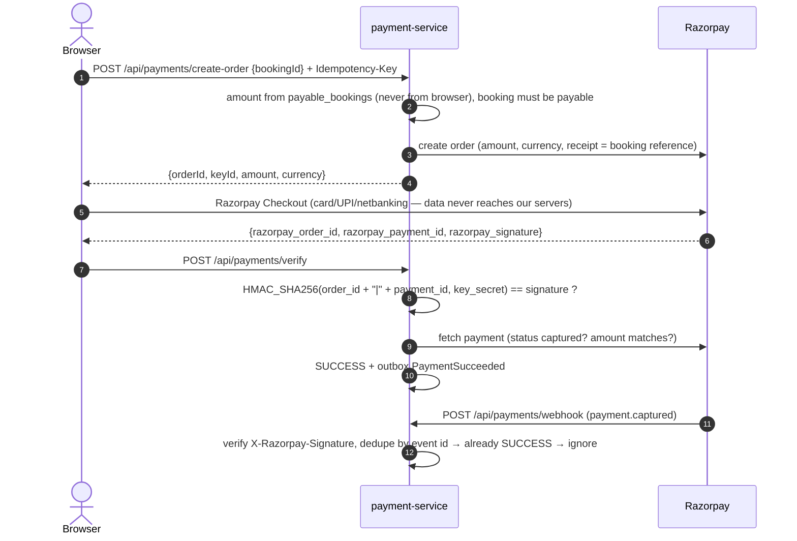

# Payment Integration

> Status: **final, implemented and verified in Phase 5** (2026-11-05). §8 lists what was built and the tests;
> §9 is the checklist for switching to Razorpay test mode.

## 1. Providers

| Provider | When it is used |
|----------|----------------|
| **Razorpay** (test mode, then live) | Main provider for the India-based demo (§13). |
| **DEMO** | Works without any Razorpay account. Shows a clearly labelled "Demo payment" page with **Pay** / **Fail** buttons. The backend still runs the full flow (order → verification → events). Enabled only in `local` and `docker` profiles; **disabled in production**. |

Configured with `PAYMENT_PROVIDER=razorpay|demo`. Both can be available at once (Razorpay when its keys are set,
DEMO when `payment.demo.enabled=true`); `PAYMENT_PROVIDER` decides which one creates **new** orders, while existing
payments, refunds and webhooks always go to the provider that created them. Startup fails with a clear message when
the chosen provider cannot be used (for example `razorpay` without keys, or `demo` in production).

```java
public interface PaymentProvider {
    String code();                                                       // RAZORPAY, DEMO
    ProviderOrder createOrder(BigDecimal amount, String currency, String receipt, String idempotencyKey);
    boolean verifyCheckoutSignature(String orderId, String paymentId, String signature);   // browser callback
    boolean verifyWebhookSignature(byte[] rawBody, String signatureHeader);
    ProviderPayment fetchPayment(String providerPaymentId);              // the provider's own truth
    List<ProviderPayment> fetchOrderPayments(String providerOrderId);    // reconciliation: browser never reported back
    ProviderRefund refund(String providerPaymentId, BigDecimal amount, String idempotencyKey);
    ProviderRefund fetchRefund(String providerRefundId);
}
```

Amounts are rupees at this interface; the Razorpay adapter converts to paise (`262550` for ₹2,625.50) and back.

## 2. What you need from Razorpay

| Item | Where it goes | Notes |
|------|--------------|-------|
| Test **Key ID** | `RAZORPAY_KEY_ID` | Dashboard → Test Mode → API Keys. The Key ID is public (sent to the browser). |
| Test **Key Secret** | `RAZORPAY_KEY_SECRET` | **Secret.** Backend only. Never commit it. |
| **Webhook secret** | `RAZORPAY_WEBHOOK_SECRET` | Set when creating the webhook. It is **not** the Key Secret. Live mode needs its own webhook and secret. |
| **Public HTTPS webhook URL** | Razorpay dashboard | Razorpay cannot call `localhost`. For local testing, expose the gateway with a tunnel (for example `ngrok http 8080` or Cloudflare Tunnel) and register `https://<tunnel>/api/payments/webhook`. Without a tunnel, the flow still works through browser verification + the reconciliation job. |
| Webhook events | Razorpay dashboard | `payment.captured`, `payment.failed`, `order.paid`, `refund.processed`, `refund.failed` |
| Auto-capture | Razorpay dashboard | Turn on auto-capture so authorised payments are captured automatically. |
| KYC / activation | Razorpay | Needed only for **live** mode, not for test mode. |

Amounts are sent to Razorpay in **paise** (₹1,499.00 → `149900`). The conversion happens only inside the
Razorpay adapter.

## 3. Payment flow



### Rules

1. **Never trust the browser.** `/verify` checks the signature **and** fetches the payment from Razorpay to confirm
   status and amount. The webhook is the second, independent confirmation.
2. **Webhook signature**: `HMAC_SHA256(rawRequestBody, webhook_secret)` compared with the `X-Razorpay-Signature`
   header using a constant-time comparison. The raw bytes are verified **before** JSON parsing.
3. **Duplicate webhooks**: the Razorpay event ID (`x-razorpay-event-id` header) is stored with a unique constraint in
   `payment_webhook_events`. A repeated event is acknowledged with `200` and not processed again.
4. **Webhook endpoint** is public (no JWT) but rate limited, signature-checked, and always answers quickly
   (`200` after storing; processing happens in the same transaction or right after).
5. **Idempotency**: `create-order` with the same `Idempotency-Key` returns the same order. A booking can have only one
   active order at a time.
6. **Amount check**: the captured amount must equal the order amount; a mismatch is flagged for manual review.
7. **Status changes only move forward**: `INITIATED → PENDING → SUCCESS | FAILED`; `SUCCESS → REFUND_PENDING →
   PARTIALLY_REFUNDED | REFUNDED`.

## 4. Payment statuses (§13)

| Status | Meaning |
|--------|--------|
| INITIATED | Order created at Razorpay; customer has not paid yet |
| PENDING | Customer submitted payment; waiting for verification/webhook |
| SUCCESS | Verified captured payment |
| FAILED | Payment failed or was abandoned |
| REFUND_PENDING | Refund requested at Razorpay |
| PARTIALLY_REFUNDED | Part of the amount refunded (cancellation fee kept) |
| REFUNDED | Full amount refunded |

## 5. Refunds

- Triggered only by the `BookingRefundRequested` event (from cancellations or failed bookings) or by an admin
  action that is audited. The refund amount comes from booking-service's cancellation calculation.
- Partial refunds are supported. The sum of refunds can never exceed the captured amount (checked with optimistic locking).
- Each refund carries an idempotency key, so a retried request never refunds twice.
- `refund.processed` / `refund.failed` webhooks and the reconciliation job update the refund status →
  `RefundCompleted` / `RefundFailed` events.
- **Phase 7:** the amount of a cancellation refund is paid − fee (BOOKING_WORKFLOW.md §4.1), so partial refunds are
  normal (`PARTIALLY_REFUNDED`). A request id that arrives again (booking-service's reconciliation) gets its final
  answer (`RefundCompleted` / `RefundFailed`) published again; a pending one is left to the provider look-up. Every
  refund step is an audit event (`REFUND_STARTED`, `REFUND_PROCESSED`, `REFUND_FAILED`) and a live
  `refund.status-changed`. A failed refund is sent again only by an admin through booking-service (`retry-refund`, a new
  request id); payment-service has no refund endpoint of its own (the admin refund page is Phase 9).

## 6. Reconciliation

Every 5 minutes payment-service asks Razorpay about payments still `INITIATED`/`PENDING` after 10 minutes, and
refunds still `PENDING` after 30 minutes, then publishes the correct event. This covers a closed browser
tab, a lost webhook or a network error.

## 7. What is never stored

Card numbers, CVV, expiry dates, UPI PINs, net-banking credentials or any raw payment instrument data. We only
store Razorpay IDs, amounts, statuses, the payment method type (for example `card`, `upi`) and failure codes.
Webhook events are stored as a **sanitized summary** (event, order, payment and refund ids, amount, status, method):
the provider's full payload also contains the customer's e-mail and phone number and is not kept.

## 8. As built in Phase 5

### 8.1 Behaviour that refines the rules above

| Topic | As built |
|-------|----------|
| Where the amount comes from | `payable_bookings`, filled from `BookingAwaitingPayment` (the final price after the hold and the coupon). `create-order` takes only `{bookingId}`. |
| One open order | A new `create-order` while an order is `INITIATED`/`PENDING` returns that order, whatever the `Idempotency-Key`. After `FAILED` it creates a new one. |
| DEMO provider | Stateless: `create-order` gives `order_demo_…`; `POST /api/payments/demo/pay|fail` (login needed, only own orders, only when `payment.demo.enabled`) returns `{orderId, paymentId, signature}` where the id says `pay_demo_ok_…` or `pay_demo_fail_…` and the signature is HMAC-SHA256 over `orderId|paymentId` with `payment.demo.secret`. The page then calls `verify` exactly like a real checkout. A browser cannot invent a successful demo payment without the secret. |
| `verify` | 1) signature (400 `INVALID_PAYMENT_SIGNATURE`), 2) the provider's own record of the payment, 3) the payment must belong to the order (400 `PAYMENT_ORDER_MISMATCH`), 4) amount and currency must match the order. A captured amount that differs is **flagged** (`failure_code = AMOUNT_MISMATCH`, error log "MANUAL REVIEW"), never confirmed. If the provider cannot be asked, the payment is remembered as `PENDING` and the reconciliation job settles it. |
| `FAILED` is not always final | Razorpay Checkout lets the customer retry inside the same order. If a later payment on that order is captured, the transaction moves `FAILED → SUCCESS`. A second, different payment on an already paid order is logged and ignored (booking-service refunds duplicates, see BOOKING_WORKFLOW.md §2.1). |
| Webhook | Events handled: `payment.captured`, `order.paid`, `payment.authorized`, `payment.failed`, `refund.processed`, `refund.failed` (others are acknowledged and ignored). Order of checks: signature over the raw bytes (401) → event id header (400) → duplicate (`200 DUPLICATE`) → parse → apply. A webhook and the browser callback can arrive in any order; the second one changes nothing. |
| Refunds | `BookingRefundRequested.refundRequestId` is the idempotency key (unique in `refunds`, and sent to Razorpay as `X-Refund-Idempotency`). Refused (`RefundFailed`) when the payment was never captured or the amount exceeds what is still refundable (captured − refunded − refunds in flight). A provider outage throws, so the Kafka step is rolled back and retried; a provider refusal (4xx) becomes `RefundFailed` and the payment stays paid. |
| Reconciliation | Job every 5 min: payments `INITIATED`/`PENDING` older than 10 min are looked up (by payment id, or by order for payments the browser never reported); a captured one is applied. An order nobody paid within 1 hour is closed as `FAILED / ABANDONED` without telling the booking. Refunds `PENDING` for 30 min are looked up and finished. |
| Invoices | `BookingConfirmed` → one invoice per booking, number `INV/2026-27/000123` (financial year April–March, India time) from `invoice_sequences` locked with `SELECT … FOR UPDATE` inside the same transaction → no gaps, no duplicates; `InvoiceIssued` is published. The PDF follows in Phase 8. |
| Realtime | `payment.status-changed` to the customer (and admin/support roles) on every payment or refund change. |

### 8.2 Configuration

| Variable | Default | Meaning |
|----------|---------|---------|
| `PAYMENT_PROVIDER` | `demo` | `demo` or `razorpay` (new orders) |
| `PAYMENT_DEMO_ENABLED` | `true` locally and in Docker, **`false` in the `prod` profile** | the DEMO provider and its `/api/payments/demo/*` endpoints |
| `PAYMENT_DEMO_SECRET` | a fixed demo value | signs DEMO callbacks; only used when the DEMO provider is on |
| `RAZORPAY_KEY_ID`, `RAZORPAY_KEY_SECRET`, `RAZORPAY_WEBHOOK_SECRET` | empty | see §2; secrets live only in the local `.env`, never in Git or chat |
| `RAZORPAY_API_URL` | `https://api.razorpay.com/v1` | tests point it at a local stand-in |

### 8.3 Tests (payment-service 27, all against real MySQL + Redis)

- `DemoPaymentFlowTest` (12): server-side amount and one open order per booking, order rules (other customer 404,
  closed window 409, key reuse 422), expired booking still settles an open order, signed callback verified once, forged
  or tampered callback never counts, failed payment + new attempt, Payment History per customer, refund exactly once,
  partial refunds never exceed the payment, uncaptured payment cannot be refunded, gap-free invoice numbers
  (+ duplicate `BookingConfirmed`), abandoned order closed by the job.
- `RazorpayPaymentFlowTest` (15, against a local HTTP stand-in for Razorpay's API): order in paise with the booking
  reference as receipt and Basic auth, captured payment with the right signature/amount, wrong signature refused
  **before** Razorpay is asked, amount mismatch flagged, payment of another order refused, authorized / failed /
  retry-after-failure, **webhook with wrong, missing or tampered signature → 401 and nothing stored**, signed capture
  webhook confirms once and a **repeated delivery is ignored** (also `order.paid` for the same payment), failed
  payment webhook + sanitized summary (no e-mail/phone), unknown event/order and broken bodies handled, lost browser
  callback found by the reconciliation job, Razorpay down at verification then settled later, refund via webhook,
  pending refund found by the job, refund refused by Razorpay → `RefundFailed`.
- Live (Docker stack, `e2e-hotel-booking.mjs`, 43 checks): the whole hotel booking with the DEMO provider, including a
  failed first payment, forged callbacks, hotel confirmation, invoice, e-mail and notifications.

## 9. Switching to Razorpay test mode (needs your keys)

Nothing here can be done without a Razorpay account; the code path is ready and tested against the stand-in.

1. Razorpay dashboard → **Test Mode** → API Keys → generate a key pair.
2. Put the three values in the local `.env` (not in Git, not in chat) and set `PAYMENT_PROVIDER=razorpay`:
   `RAZORPAY_KEY_ID=rzp_test_…`, `RAZORPAY_KEY_SECRET=…`, `RAZORPAY_WEBHOOK_SECRET=…` (a secret you choose when creating the webhook).
3. `docker compose up -d --build payment-service`, then book a stay: the payment page opens **Razorpay Checkout**
   (test cards: https://razorpay.com/docs/payments/payments/test-card-details/). The web CSP already allows
   `checkout.razorpay.com`, `api.razorpay.com` and `lumberjack.razorpay.com` (`frontend/nginx/security-headers.conf`).
4. Optional webhooks: `ngrok http 8080` (or Cloudflare Tunnel), register `https://<tunnel>/api/payments/webhook` with the
   events of §2 and your webhook secret. Without it the browser callback + the 5-minute reconciliation job still work.
5. Check: payment appears in Payment History as **Paid** (not "demo payment"), the booking confirms, `GET /api/invoices/booking/{id}` works.
