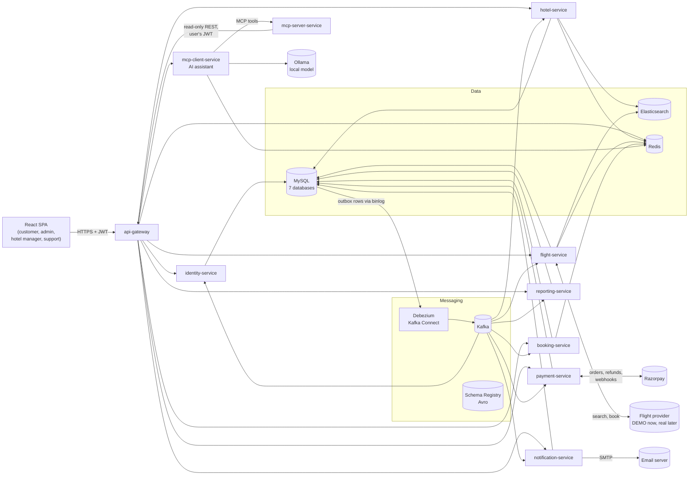
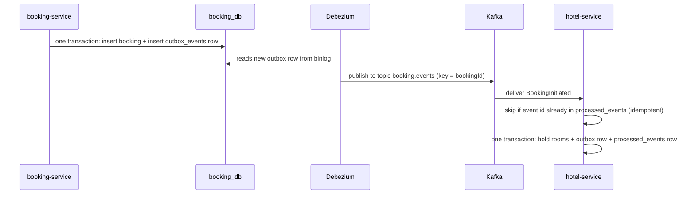

# Project Architecture — Hotel & Flight Travel Reservation System

> Status: **Approved 2026-11-02** (assumptions in §13 accepted as defaults)
> Source of requirements: `flight-hotel-app.txt`

This document explains how the system is built and why. Read it first. Then read
[BOOKING_WORKFLOW.md](BOOKING_WORKFLOW.md) to understand how a booking moves through the services.

---

## 1. Decision log

| # | Date | Decision | Reason |
|---|------|----------|--------|
| D1 | 2026-11-02 | **Coarse-grained microservices**: 7 business services + 1 API gateway | Requirements §3 and §23 ask for microservices, saga choreography and database-per-service. §4 asked for a modular monolith. The product owner chose microservices, but grouped the 18 business modules into 7 services so the system stays understandable and runs on a developer laptop. |
| D2 | 2026-11-02 | **Flights use a clearly labelled DEMO provider first** | Amadeus Self-Service was shut down on 17 July 2026. Duffel test access for new developers is unconfirmed. Real suppliers plug in later behind the same interfaces (see [SUPPLIER_INTEGRATION.md](SUPPLIER_INTEGRATION.md)). |
| D3 | 2026-11-02 | **Hotels use our own internal inventory** managed by Hotel Managers | The Hotel Manager role (§5, §21) manages rooms, prices and availability, so we own the inventory. An external hotel provider can be added later behind `HotelSearchProvider` / `HotelBookingProvider`. |
| D4 | 2026-11-02 | **Services talk to each other only through Kafka events** (no service-to-service REST calls in v1) | Saga choreography (§3). It also means one slow service cannot block another. The browser still calls services through the gateway. |
| D5 | 2026-11-02 | **Transactional outbox + Debezium** for publishing events | Writing to the database and to Kafka separately can lose events (the "dual write" problem). Each service writes the event into an `outbox_events` table in the same DB transaction, and Debezium streams it to Kafka. |
| D6 | 2026-11-02 | **Avro schemas (one shared `event-schemas` module) for all Kafka events** | §3: one central schema instead of duplicated DTO classes. REST request/response DTOs stay as Java records owned by each service, because Avro classes are not designed for JSON REST APIs. |
| D7 | 2026-11-02 | **One React app** with separate areas for Customer, Admin, Hotel Manager and Support Agent | One design system, one login, one build. Each area is lazy-loaded, so customers never download admin code. The backend still enforces every permission. |
| D8 | 2026-11-02 | **One MySQL container, one database + one DB user per service** | §23: database per service, but one container to save memory. Each service's DB user can only access its own database, so the boundary is enforced, not just agreed. |
| D9 | 2026-11-02 | **No service discovery server, no config server** | Docker Compose DNS (locally) and AWS ECS Service Connect (production) already resolve service names. Fewer moving parts for junior developers. |
| D10 | 2026-11-02 | **Auto refresh with Server-Sent Events + client-side pub/sub**; hub inside notification-service; Redis Pub/Sub fan-out | All live updates go server → browser; actions already use REST. SSE is plain HTTP with built-in reconnect and needs no extra broker. Details: [REALTIME_UPDATES.md](REALTIME_UPDATES.md). |
| D11 | 2026-11-02 | **Spring Boot 4.1.2 + Spring Cloud 2025.1.4** | Latest GA Boot (4.2 is still RC). Spring Cloud 2025.1.4 officially declares compatibility with Boot 4.0.x and 4.1.x. |
| D12 | 2026-11-06 | **AI assistant = two services + a local model**: mcp-client-service (chat API, Spring AI ChatClient on Ollama, memory in Redis) and mcp-server-service (read-only MCP tools, internal only) | The model must never get more rights than the user: tools call the gateway with the user's own JWT, so every existing rule applies. A local model (Ollama, CPU) keeps all data on the machine. MCP separates "what the model can do" (tools per role, validated, audited in one place) from "how it talks". Details: [AI_ASSISTANT.md](AI_ASSISTANT.md). |
| D13 | 2026-11-06 | **Model `granite4:tiny-h` by default** (see [AI_ASSISTANT.md](AI_ASSISTANT.md) §5) | Best tool choice, arguments and answers in a repeatable evaluation of nine small tool-calling models on this CPU, and two to three times faster than the 3–4 B dense models (mixture of experts, about 1 B active); 4.2 GB loaded. Lighter fallback: `granite4.1:3b`. |
| D14 | 2026-11-08 | **Kubernetes for deployment: Helm charts + Argo Rollouts + Argo CD, practised on a highly available kind cluster, then AWS EKS** (replaces the earlier ECS + Jenkins idea) | One generic chart for all 12 services keeps the manifests small. Gateway API (Traefik) is the edge, since ingress-nginx is retired. Blue-green for the web app and canary with a smoke test for the API gateway and the services make releases safe. GitOps means GitHub Actions never needs cluster credentials. Guide: [KUBERNETES_DEPLOYMENT.md](KUBERNETES_DEPLOYMENT.md). |

Defaults that still need your confirmation are listed in [§13 Assumptions](#13-assumptions-defaults-you-can-change).

---

## 2. Big picture



**How to read it**

1. The browser only talks to the **api-gateway**.
2. Each service owns **its own MySQL database**. No service reads another service's tables.
3. When something important happens (for example "booking created"), the service writes an **event** to its `outbox_events` table.
4. **Debezium** reads new outbox rows from the MySQL binlog and publishes them to **Kafka**.
5. Other services **consume** the events they care about and update their own data. This chain of reactions is the **saga**.
6. The **AI assistant** (Phase 11, D12): mcp-client-service answers questions with a local model (Ollama) and reads
   data through mcp-server-service, which calls the gateway with the user's own token.

---

## 3. Services

| Service | Port (local) | Owns database | Responsibility |
|---------|-------------|---------------|----------------|
| `api-gateway` | 8080 | — | Single entry point. Routing, JWT validation, rate limiting (Redis), CORS, correlation IDs. |
| `identity-service` | 8101 | `identity_db` | Registration, email verification, login/logout, JWT + refresh tokens, roles and permissions, profile, profile photo, saved passengers, travel preferences, login history, admin user management. |
| `hotel-service` | 8102 | `hotel_db` | Hotels, room types, amenities, images, policies, rate plans, seasonal prices, per-day room inventory, inventory holds, hotel reservations (check-in/out), hotel search (Elasticsearch), reviews and ratings. |
| `flight-service` | 8103 | `flight_db` | Airports and airlines, flight provider adapters (DEMO now), flight search and filters, offer details, fare revalidation, supplier booking and cancellation, supplier reconciliation. |
| `booking-service` | 8104 | `booking_db` | The customer's booking: booking state machine, passengers and guests, price breakdown, coupons and offers, cancellation rules and requests, booking history, My Trips. |
| `payment-service` | 8105 | `payment_db` | Payment providers (Razorpay + DEMO), payment orders, signature verification, webhooks, refunds, reconciliation, invoice records. |
| `notification-service` | 8106 | `notification_db` | Emails, in-app notification center, notification preferences, PDF documents (confirmations, e-tickets, invoices, receipts), secure downloads, travel reminders, newsletter, support tickets, **realtime hub** (SSE auto refresh). |
| `reporting-service` | 8107 | `reporting_db` | CQRS read side: admin dashboard, reports, CSV/PDF export, hotel occupancy, recent activity, audit log store, system settings. |
| `mcp-client-service` | 8108 | — (Redis only) | The AI assistant's chat API (Phase 11): conversation memory, grounding check, voice proxy. [AI_ASSISTANT.md](AI_ASSISTANT.md) |
| `mcp-server-service` | 8109 (internal) | — | Read-only MCP tools per role over the gateway (Phase 11). |
| `search-service` | 8110 | — (Elasticsearch read model) | Global search for every role: one typo-tolerant, ranked, role-filtered search over users, bookings, payments, refunds, tickets, reviews, destinations and pages, kept in sync from the other services' Kafka events; reads hotel-service's `hotels` index. [docs/GLOBAL_SEARCH_IMPLEMENTATION.md](docs/GLOBAL_SEARCH_IMPLEMENTATION.md) |

### 3.1 Where each of the 18 required modules lives

| # | Module (§4) | Service(s) |
|---|-------------|-----------|
| 1 | Authentication & Authorization | identity-service issues tokens; gateway and every service enforce them |
| 2 | User Management | identity-service |
| 3 | Flight Search & Management | flight-service |
| 4 | Hotel Search & Management | hotel-service |
| 5 | Flight Reservation | booking-service (customer booking) + flight-service (supplier booking) |
| 6 | Hotel Reservation | booking-service (customer booking) + hotel-service (inventory reservation) |
| 7 | Passenger Management | identity-service (saved passengers) + booking-service (passengers on a booking) |
| 8 | Guest Management | booking-service (guests on a booking) + hotel-service (guest view for hotel managers) |
| 9 | Payment Management | payment-service |
| 10 | Cancellation & Refund | booking-service (rules, requests) + hotel/flight-service (supplier cancel) + payment-service (refund) |
| 11 | Offers & Coupons | booking-service (discounts are part of the booking price) |
| 12 | Reviews & Ratings | hotel-service (only guests with a checked-out stay can review) |
| 13 | Notifications | notification-service |
| 14 | Invoice & Document Management | payment-service (invoice numbers) + notification-service (PDF files) |
| 15 | Admin Dashboard | reporting-service |
| 16 | Reports & Analytics | reporting-service |
| 17 | System Configuration | reporting-service (owner), broadcast to other services through Kafka |
| 18 | Audit Logging | every service emits audit events; reporting-service stores and serves them |

---

## 4. How services communicate

### 4.1 Browser → services (synchronous REST)

- All calls go to `http://<gateway>/api/...`. The gateway routes by path prefix
  (for example `/api/hotels/**` → hotel-service, `/api/bookings/**` → booking-service).
- Long-running work (booking, payment confirmation) returns **202 Accepted** with the booking ID.
  The frontend then polls `GET /api/bookings/{id}` until the status changes.
- Exception to D4 (Phase 11): mcp-server-service calls the gateway over REST with the user's token (read-only).

### 4.2 Service → service (asynchronous events)



Rules every service follows:

1. **Outbox** — never call `kafkaTemplate.send()` inside business code. Insert into `outbox_events` in the same transaction.
2. **Inbox / idempotent consumer** — every consumer records the event ID in `processed_events` in the same transaction as its own changes, and ignores repeats. Kafka can deliver the same event more than once.
3. **Ordering** — the Kafka message key is the aggregate ID (usually `bookingId`), so all events for one booking arrive in order within a topic.
4. **Avro** — events are serialized with Avro and registered in Schema Registry with `BACKWARD` compatibility. One topic may carry several event types (subject strategy `TopicRecordNameStrategy`).
5. **Dead-letter topic** — after 3 failed attempts a message goes to `<topic>.DLT` and an alert is logged. It is never silently dropped.

### 4.3 Kafka topics

| Topic | Producer | Example events |
|-------|----------|----------------|
| `identity.events` | identity | UserRegistered, EmailVerified, UserProfileUpdated, UserStatusChanged, UserRolesChanged |
| `identity-email.events` (24 h retention) | identity | AuthEmailRequested (verification, reset, invitation, … — contains single-use tokens) |
| `booking.events` | booking | BookingInitiated, BookingAwaitingPayment, BookingPaid, BookingConfirmed, BookingFailed, BookingExpired, BookingCancellationRequested, BookingCancelled, BookingRefundRequested, BookingCompleted |
| `hotel.events` | hotel | HotelInventoryHeld, HotelInventoryHoldFailed, HotelReservationConfirmed, HotelReservationFailed, HotelInventoryReleased, HotelReservationCancelled, GuestCheckedIn, GuestCheckedOut, HotelCatalogChanged |
| `flight.events` | flight | FlightOfferHeld, FlightOfferUnavailable, FlightBookingConfirmed, FlightBookingFailed, FlightBookingUncertain, FlightBookingCancelled, FlightCancellationFailed |
| `payment.events` | payment | PaymentSucceeded, PaymentFailed, RefundCompleted, RefundFailed, InvoiceIssued |
| `audit.events` | all | AuditEventRecorded |
| `settings.events` (compacted) | reporting | SystemSettingChanged |

### 4.4 Saga choreography

There is **no central orchestrator**. Each service reacts to events and publishes new ones.
The full hotel, flight and cancellation sagas, including every failure path, are in
[BOOKING_WORKFLOW.md](BOOKING_WORKFLOW.md).

### 4.5 CQRS — where and why

We use CQRS (separate write model and read model) only where it actually helps:

| Area | Write side | Read side | Why |
|------|-----------|-----------|-----|
| Hotel search | `hotel_db` (MySQL) | Elasticsearch index `hotels` | Full-text, geo-distance, facets and filters are fast in Elasticsearch. Final availability is always re-checked in MySQL. |
| Airport / city lookup, DEMO flight schedules | `flight_db` | Elasticsearch indexes `airports`, `demo_flight_schedules` | Autocomplete and route search. |
| Admin dashboard and reports | All services' events | `reporting_db` tables | Reports need joined data from many services. Querying the read model avoids cross-service queries. **Built in Phase 9** with event-carried state transfer: booking-service publishes a `BookingSnapshot` (the whole booking) with every change, and identity-service a `UserSnapshot` once per account. Payment, refund and cancellation facts come from the saga events. Hotel occupancy stays in hotel-service, where the rooms are. |

Other services read and write the same MySQL tables (plain CRUD). Adding CQRS everywhere would add complexity without benefit.

### 4.6 Real-time updates (auto refresh)

Screens such as booking status, payment result, My Trips, the notification bell, dashboards and hotel reservations
update automatically. After committing a change, a service publishes a small signal to Redis Pub/Sub. The realtime
hub in notification-service pushes it to the right users over **Server-Sent Events**. The React app's event bus then
refreshes the affected data through the normal REST API. Full design: [REALTIME_UPDATES.md](REALTIME_UPDATES.md).

---

## 5. Data and storage

| Store | Used for |
|-------|---------|
| **MySQL 8** | System of record for each service (7 databases). Binlog in ROW format for Debezium. Flyway migrations in every service. |
| **Redis** | Gateway rate limiting; flight search results and offers (short TTL, never permanent); hotel price quotes (TTL 15 min); hotel details cache; access-token deny-list after logout; AI assistant conversations (24 h, Phase 11). |
| **Elasticsearch** | Search read models (see §4.5). |
| **File storage** | `FileStorage` (common-lib): `LocalFileStorage` in development and Docker, `S3FileStorage` (private bucket, SSE, `travel.storage.type=s3`) in production. Profile photos, hotel images and PDFs. Files are only served through access-controlled APIs. |

Database tables and relationships: [DATABASE_DESIGN.md](DATABASE_DESIGN.md).

---

## 6. Security overview

Full details: [SECURITY_GUIDE.md](SECURITY_GUIDE.md).

- **JWT access tokens** (15 min, RS256) signed by identity-service. The public key is published at `/.well-known/jwks.json`. Every service validates tokens itself (Spring Security resource server), not just the gateway.
- **Refresh tokens** (1 day, or 30 days with "remember me") are random opaque strings stored **hashed** in `identity_db`, rotated on every use. If an old token is reused, the whole token family is revoked. The refresh token travels in an `HttpOnly`, `Secure`, `SameSite=Strict` cookie scoped to `/api/auth`.
- **Roles**: `CUSTOMER`, `ADMIN`, `HOTEL_MANAGER`, `SUPPORT_AGENT`. Fine-grained permissions (for example `BOOKING_READ_ANY`) are checked with `@PreAuthorize` in the service layer.
- **Hotel managers** can only touch hotels listed for them in `hotel_staff`. This is checked on every hotel-service call.
- **Sensitive data**: passport numbers are encrypted with AES-GCM (JPA attribute converter, key from environment / secrets manager). Only the last 4 digits are shown. Logs mask emails, phone numbers, names in supplier payloads, tokens and passports.
- **Payments**: card data never touches our servers (Razorpay Checkout). Payment success is trusted only after backend signature verification or a verified webhook.
- **Secrets** come only from environment variables (`.env`, never committed) or AWS Secrets Manager in production.

---

## 7. Cross-cutting conventions

| Topic | Convention |
|-------|-----------|
| IDs | UUID version 7 (time-ordered, index-friendly), stored as `BINARY(16)`. Bookings also get a human-friendly reference such as `HT-7K3M9Q2X` / `FL-4P8R2N6W`. |
| Money | `DECIMAL(12,2)` plus a `currency` column (`INR` in v1). Never `double`. Prices are always calculated on the backend. |
| Timestamps | Stored in UTC (`DATETIME(6)`); converted to local time in the UI. Flight times also keep the airport's local time. |
| Audit columns | `created_at`, `updated_at`, `created_by`, `updated_by` on every business table; `version` for optimistic locking where rows are updated concurrently. |
| Errors | RFC 9457 Problem Details JSON from `@RestControllerAdvice`, plus `code`, `correlationId` and field `errors[]`. |
| Lists | `?page=0&size=20&sort=createdAt,desc` → `{ content, page, size, totalElements, totalPages }`. |
| Idempotency | All "create" actions with money or inventory effects (create booking, create payment order, cancel, refund) require an `Idempotency-Key` header. Repeating the same key returns the original result. |
| Correlation ID | `X-Correlation-Id` header is created at the gateway (if missing), added to every log line (MDC) and copied into every event. |
| Logging | Spring Boot structured JSON logs. An AOP aspect logs service method name, duration and outcome, without arguments that may hold personal data. |
| Validation | Bean Validation on DTOs (backend) + Zod schemas (frontend). Business rules are validated in services, never only in the UI. |
| API docs | springdoc-openapi in each service; the gateway exposes a combined Swagger UI. |

---

## 8. Technology stack

Versions confirmed at the start of Phase 2 (2026-11-02): Spring Boot **4.1.2**, Spring Cloud **2025.1.4**,
Elasticsearch **9.4.8** (matches the client managed by Boot), Confluent Platform **8.4.0**, Debezium **3.7.0.Final**,
MySQL **8.4 LTS**, Redis **8.4**, Avro **1.12.2**. Added in Phase 11 (2026-11-06): Spring AI **2.0.2** (MCP Java SDK
**2.1.0**), Ollama **0.40.14**, speaches **0.8.3** (optional).

| Layer | Technology | Why |
|-------|-----------|-----|
| Language | Java 21 | Required. Records, pattern matching and virtual threads. |
| Framework | Spring Boot 4.1.x, Spring Web, Data JPA, Security, Validation, AOP, Mail, Actuator | Required. |
| Gateway | Spring Cloud Gateway (reactive) | Routing + Redis rate limiter out of the box. Only the gateway is reactive; all business services are normal Spring MVC. |
| Persistence | MySQL 8, Flyway, Hibernate | Required; Flyway gives versioned schema migrations. |
| Messaging | Apache Kafka (Confluent Platform, KRaft mode, no ZooKeeper), Confluent Schema Registry, Apache Avro, Debezium MySQL connector on Kafka Connect | Required (§3, §31). |
| Search | Elasticsearch + Spring Data Elasticsearch | Required. |
| Cache | Redis | Required. |
| Resilience | Resilience4j (timeouts, retries for safe calls only, circuit breaker, rate limiter) | Needed for supplier and payment calls (§11). |
| Mapping | MapStruct | Entity ↔ DTO mapping without hand-written boilerplate. |
| PDF | Thymeleaf HTML templates → PDF (OpenHTMLtoPDF) | One templating approach for emails and PDFs. |
| API docs | springdoc-openapi | Required (OpenAPI / Swagger). |
| Tests | JUnit 5, Mockito, Spring Boot Test, Testcontainers (MySQL, Kafka, Redis, Elasticsearch) | Real infrastructure in integration tests. |
| Frontend | React + TypeScript (Vite), Tailwind CSS, React Router, Axios, React Hook Form + Zod, Recharts, react-day-picker, Leaflet + OpenStreetMap | Required, plus a free map library that needs no API key. |
| Frontend server state | TanStack Query | Handles loading, error, caching and polling. Much less custom code for juniors. **Proposed; can be removed if you prefer plain Axios hooks.** |
| Frontend tests | Vitest, React Testing Library, MSW; Playwright for end-to-end | |
| Local email | Mailpit (catches all emails locally, web UI on :8025) | Lets you test emails without a real mail server. |
| DevOps | Docker, Docker Compose; Kubernetes (kind locally, EKS next) with Helm, Argo Rollouts and Argo CD; GitHub Actions CI/CD | Docker Compose for development. Kubernetes for production-like runs (D14). |
| AI assistant (Phase 11) | Spring AI (ChatClient, MCP client and server), Ollama with a local model, speaches (optional speech server) | A local model on the CPU keeps all data on the machine; MCP keeps the tools apart from the chat (D12, D13). |

Deliberately **not** used: service discovery server (Eureka), config server, GraphQL, micro-frontends. They are not needed at this size (see D9).

**Deployment** (D14): Kubernetes, with Helm charts, Argo Rollouts (blue-green, canary) and Argo CD (GitOps). It runs
locally on a highly available kind cluster, and on AWS EKS next. Services still find each other by plain DNS names
(Kubernetes Services), so D9 holds. Guide: [KUBERNETES_DEPLOYMENT.md](KUBERNETES_DEPLOYMENT.md); pipeline:
[docs/CI_CD.md](docs/CI_CD.md).

---

## 9. Repository structure

```
flight-hotel-app/
├── pom.xml                         Maven parent (builds all Java modules)
├── docker-compose.yml              Full local stack
├── .env.example                    Copy to .env; never commit .env
├── Jenkinsfile                     CI/CD pipeline
├── platform/
│   ├── common-lib/                 Shared technical code only (no business logic):
│   │                               errors, correlation IDs, logging aspect, outbox/inbox,
│   │                               JWT resource-server config, pagination
│   └── event-schemas/              Avro .avsc files → generated Java event classes
├── services/
│   ├── api-gateway/
│   ├── identity-service/
│   ├── hotel-service/
│   ├── flight-service/
│   ├── booking-service/
│   ├── payment-service/
│   ├── notification-service/
│   ├── reporting-service/
│   ├── mcp-client-service/         AI assistant: chat API (Phase 11)
│   └── mcp-server-service/         AI assistant: read-only tools (Phase 11)
├── frontend/                       React app
├── infra/
│   ├── mysql/init/                 Creates the 7 databases and 7 DB users
│   ├── kafka-connect/connectors/   Debezium connector configs (one per service DB)
│   └── elasticsearch/              Index templates
├── scripts/                        PowerShell helpers for Windows (start infra, run service)
├── e2e/                            Playwright end-to-end tests
└── *.md                            Project documentation (§33)
```

### 9.1 Package structure inside each service

```
com.flighthotel.<service>/
├── config          Spring configuration classes
├── security        Permission checks specific to this service
├── controller      REST controllers (HTTP in/out only, no business rules)
├── service         Service interfaces
├── service/impl    Business logic and transactions
├── repository      Spring Data JPA / Elasticsearch repositories
├── entity          JPA entities (never returned from controllers)
├── dto             Request/response records
├── mapper          MapStruct mappers
├── exception       Service-specific exceptions
├── validation      Custom validators
├── specification   JPA Specifications for dynamic filters
├── messaging       Kafka consumers and outbox event writers
├── scheduler       Scheduled jobs (hold expiry, reconciliation, reminders)
├── integration     External providers (supplier, payment, email, storage)
├── audit           Audit event creation
└── util
```

---

## 10. Frontend

One React app with four areas. Each area has its own layout and is lazy-loaded.

| Area | Base path | Who |
|------|-----------|-----|
| Public + Customer | `/`; signed in: `/customer/dashboard`, `/my-trips/**`, `/account/**`, … (sign-in `/customer/login`) | Everyone / customers |
| Admin portal | `/admin/**` (sign-in `/admin/login`) | `ADMIN` |
| Hotel Manager portal | `/hotel-manager/**` (sign-in `/hotel-manager/login`) | `HOTEL_MANAGER` (and `ADMIN`) |
| Support portal | `/support/**` (sign-in `/support/login`) | `SUPPORT_AGENT` (and `ADMIN`) |

```
frontend/src/
├── app/                 router, providers, layouts, route guards
├── components/ui/       design system: Button, Input, Select, DatePicker, Card, Modal,
│                        Badge, Table, Tabs, Skeleton, EmptyState, ErrorState, Toast
├── features/            one folder per feature: auth, home, flights, hotels, bookings,
│                        payments, profile, notifications, reviews, support, offers,
│                        admin, hotel-manager, support-agent
├── lib/                 axios client (token refresh interceptor), query client, formatters
└── types/
```

### 10.1 Page list

**Public:** Home, Flight Search, Flight Results (with compare), Flight Details, Passenger Details,
Flight Booking Review, Hotel Search, Hotel Results, Hotel Details, Room Selection, Guest Details,
Hotel Booking Review, Payment, Payment Result, Login, Registration, Verify Email, Forgot Password,
Reset Password, Offers, About Us, Contact Us, Help and Support (FAQ).

**Customer:** Customer Dashboard, My Trips (All / Upcoming / Completed / Cancelled / Pending),
Flight Booking Details, Hotel Booking Details, Passenger Management, Profile (personal info, contact,
saved passengers, travel preferences, booking history, payment history, notifications, security),
Payment History, Notifications, Reviews (mine + write review), Support Tickets.

**Admin:** Admin Dashboard, User Management, Hotel Management, Flight Provider Management,
Booking Management, Payment Management, Refund Management, Coupon & Offer Management,
Review Management, Support Management, Reports, Audit Logs, System Settings.

**Hotel Manager:** Hotel Dashboard, Hotel Profile, Room Management, Inventory Calendar,
Room Pricing (incl. seasonal), Reservations, Guest Management, Check-in / Check-out, Reviews, Reports.

**Support Agent** (role exists in §5 but had no pages in §25, so these were added):
Support Dashboard, Booking Lookup, Booking Assist (status, payment, allowed actions),
Ticket Queue, Ticket Conversation, Escalations.

---

## 11. Local resource budget

The machine has 32 GB RAM and Docker has ~16.6 GB. Planned container memory limits:

| Component | Limit |
|-----------|------:|
| MySQL | 1 GB |
| Kafka (1 broker, KRaft) | 1 GB |
| Schema Registry | 384 MB |
| Kafka Connect + Debezium | 1 GB |
| Elasticsearch (single node) | 1.5 GB |
| Redis, Mailpit | ~200 MB |
| 8 Spring Boot apps (~400 MB each) | 3.2 GB |
| Frontend (nginx) | ~50 MB |
| Ollama with `granite4:tiny-h` and an 8k context (Phase 11) | 6 GB (about 4.5 GB in use) |
| mcp-client-service, mcp-server-service (Phase 11) | 512 MB + 448 MB (about 0.3 GB each in use) |
| speaches, profile `voice` only (Phase 11) | 2 GB (0.3–1.4 GB in use) |
| **Total** | **≈ 8.3 GB** before Phase 11; **≈ 15.3 GB** with the assistant (+ 2 GB with `voice`) |

Measured on 2026-11-06, the stack uses about 14 GB with the assistant (about 15.5 GB with `voice`). Docker Desktop
therefore needs at least 16 GB; 20 GB is recommended (22 GB with `voice`). Details: [AI_ASSISTANT.md](AI_ASSISTANT.md) §10.

Developers can also run only the infrastructure in Docker and start one or two services from
PowerShell with `mvn spring-boot:run` (see `LOCAL_SETUP_GUIDE.md`, Phase 2).

---

## 12. Production outlook (Phase 12)

- Target: AWS ECS (Fargate). Service names resolve through **ECS Service Connect**, not Docker Compose names.
- Managed equivalents: RDS MySQL, ElastiCache Redis, Amazon MSK or Confluent Cloud (Kafka + Schema Registry), Debezium on MSK Connect or a Connect container, Amazon OpenSearch or Elastic Cloud, S3 for documents, SES (SMTP) for email, Secrets Manager for secrets.
- `application-local.yml`, `application-docker.yml` and `application-prod.yml` are kept separate. Production endpoints come from environment variables only.
- Reporting read models (Phase 9) are rebuilt from Kafka. Local retention is 7 days; bookings and accounts are covered
  by the snapshot backfills, but older payment, refund and cancellation events are not. Production should keep
  `booking.events`, `payment.events` and `identity.events` long enough to rebuild the reports (or add snapshot topics
  with log compaction) and back up `reporting_db`.

---

## 13. Assumptions (defaults you can change)

These were not specified in the requirements. Development will follow these defaults unless you say otherwise.

| # | Assumption |
|---|-----------|
| A1 | Searching and browsing is public. **Login is required to book.** |
| A2 | Currency is **INR only** in v1. Amounts are stored with a currency code, so more currencies can be added later. |
| A3 | Hotel bookings are **prepaid** in v1. "Pay at hotel" can be added later as a configurable payment policy. |
| A4 | A hotel booking has **one room type** (one or more rooms of that type). |
| A5 | Flights and hotels are booked **separately** (no combined packages). |
| A6 | Inventory hold / payment window is **15 minutes** (configurable in System Settings). |
| A7 | Self-service **cancellation** is supported. Flight **changes** are not self-service in v1 (the DEMO provider does not support them); support agents handle change requests. Hotel date changes = cancel and rebook. |
| A8 | Reviews are for **hotel stays after check-out**. Flight reviews can be added later. |
| A9 | Hotel taxes (GST slabs) are configurable in System Settings. Flight taxes come from the supplier fare. |
| A10 | SMS uses a provider interface with a **log-only** implementation until an SMS provider is chosen. |
| A11 | Maps use **Leaflet + OpenStreetMap** (no API key; attribution shown). |
| A12 | UI language is **English**. |
| A13 | Maximum 9 passengers per flight booking; infants ≤ adults (one infant per adult lap). |
| A14 | Hotel Manager accounts are created by an Admin, who also assigns them to hotels. |
| A15 | Travel images are royalty-free images saved in the repo with an attribution file (no hot-linking). |

---

## 14. Related documents

| Document | Status |
|----------|--------|
| [README.md](README.md) | Phase 1 draft |
| [IMPLEMENTATION_PLAN.md](IMPLEMENTATION_PLAN.md) | Phase 1 |
| [DATABASE_DESIGN.md](DATABASE_DESIGN.md) | Phase 1 draft |
| [BOOKING_WORKFLOW.md](BOOKING_WORKFLOW.md) | Phase 1 draft |
| [SUPPLIER_INTEGRATION.md](SUPPLIER_INTEGRATION.md) | Phase 1 draft |
| [PAYMENT_INTEGRATION.md](PAYMENT_INTEGRATION.md) | Phase 1 draft |
| [REALTIME_UPDATES.md](REALTIME_UPDATES.md) | Foundation implemented (Phase 2) |
| [LOCAL_SETUP_GUIDE.md](LOCAL_SETUP_GUIDE.md), [DOCKER_SETUP.md](DOCKER_SETUP.md) | Phase 2 |
| API_DOCUMENTATION.md, SECURITY_GUIDE.md | Written in Phase 3, extended per phase |
| [TESTING_GUIDE.md](TESTING_GUIDE.md) | Phase 10 |
| [AI_ASSISTANT.md](AI_ASSISTANT.md) | Phase 11 |
