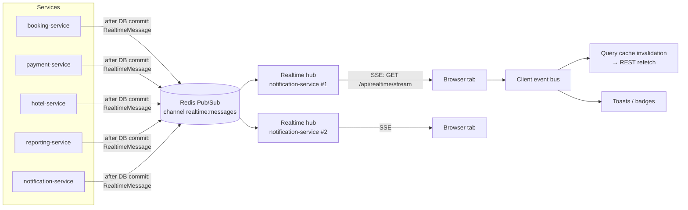

# Real-time Updates (Auto Refresh)

> Status: **design approved 2026-11-02**. Foundation built in Phase 2; each later phase wires its own events.

## 1. Decision: Server-Sent Events + client-side pub/sub

| Option | Verdict |
|--------|---------|
| Polling every few seconds | ❌ Wasteful (thousands of empty requests), slow to react, hard on mobile batteries. Kept only as a **fallback** when the live connection is down. |
| WebSocket (STOMP) | ❌ Two-way channel we would not use: every user action already goes through REST with validation and idempotency keys. It needs an extra STOMP broker (or custom fan-out), special proxy/load-balancer upgrade handling and its own heartbeat and auth logic. |
| "React pub/sub" alone | ❌ Only moves events **between components in one browser tab**. It cannot receive anything from the server by itself. |
| **Server-Sent Events (SSE) + client-side pub/sub** | ✅ **Chosen.** One long-lived HTTP response streams events **server → browser**. Plain HTTP/HTTP2 (works through the gateway, nginx and AWS ALB), built-in event IDs and retry, standard `Authorization` header. Inside React, a small typed **pub/sub event bus** spreads each event to the components and query caches that care. |

So the user's two ideas are combined. **SSE is the transport** and **pub/sub is how the frontend distributes events.**

## 2. How it works



1. A service changes data (for example, a booking becomes `CONFIRMED`). **After** the database transaction commits,
   it publishes a small `RealtimeMessage` to Redis Pub/Sub using `RealtimePublisher` from `common-lib`.
2. Every **notification-service** instance (the "realtime hub") receives the message, finds its locally
   connected users who are in the message's **audience**, and writes it to their SSE streams.
3. The browser's `RealtimeClient` reads the stream and publishes each message on the **client event bus**.
4. Subscribers react. Most of them **invalidate TanStack Query caches**, so the affected data is re-fetched through
   the normal REST API (with normal authorization). Some show a toast or update a badge.

### Why "signal, then refetch" instead of pushing full data

- **Security**: messages carry only IDs, statuses and counters, never personal data. The real data is always
  loaded through REST endpoints that check permissions.
- **Correctness**: the publisher sends the message after its commit, so the refetch always sees the new data.
- **Self-healing**: a missed message is harmless. After any reconnect, the client refetches all visible data.

### Why Redis Pub/Sub (and not Kafka) for this

Realtime messages are **short-lived UI hints**, not business events. Losing one is acceptable because reconnect
resyncs everything. Business events still go through Kafka + outbox. Redis Pub/Sub is already in the stack, adds
no latency from Debezium, and reaches every hub instance, so it works with any number of instances behind the load balancer
(no sticky sessions needed).

## 3. Message format

```json
{
  "id": "0192f0c4-8a7e-7c3a-9f1e-3b7f1c2d4e5a",
  "type": "booking.status-changed",
  "resourceType": "BOOKING",
  "resourceId": "0192f0c4-1111-7c3a-9f1e-3b7f1c2d4e5a",
  "data": { "status": "CONFIRMED", "bookingReference": "HT-7K3M9Q2X" },
  "occurredAt": "2026-11-02T17:05:11.123Z",
  "correlationId": "c0a8012e-..."
}
```

The **audience** (who may receive it) travels with the message inside Redis but is **never sent to browsers**:
`userIds` (specific users) and/or `roles` (for example `ADMIN`, `SUPPORT_AGENT`). Publishers decide the audience
on the server. Clients cannot subscribe to arbitrary channels.

## 4. SSE protocol (`GET /api/realtime/stream`)

Request headers: `Accept: text/event-stream`, `Authorization: Bearer <access token>`.

| Server sends | Meaning |
|-------------|---------|
| `retry: 5000` | Suggested reconnect delay |
| `event: connected` + `{connectionId, serverTime, tokenExpiresAt}` | Stream is ready; the client also uses `serverTime` to correct countdown timers |
| `: ping` (comment) every 25 s | Heartbeat. Keeps proxies/ALB from closing an idle connection; the client reconnects if nothing arrives for 60 s |
| `id: <message id>` + `event: message` + JSON | A realtime message |
| `event: token-expired` | Access token reached its expiry; the client refreshes the token and reconnects |
| `event: reconnect` | Server is shutting down (deploy); the client reconnects (to another instance) right away |

Limits (configurable): 5 streams per user (the oldest is closed), 10 000 streams per hub instance (then `503` and the
client backs off), 1 connection attempt per second per user at the gateway.

## 5. Frontend pieces

| File | Role |
|------|------|
| `lib/realtime/sseParser.ts` | Spec-compliant `text/event-stream` parser |
| `lib/realtime/realtimeClient.ts` | Opens the stream with `fetch` (so it can send the bearer token), reconnects with exponential backoff + jitter (1 s → 30 s), heartbeat watchdog, handles `401` (refresh token), `online`/`offline`, `token-expired`, `reconnect` |
| `lib/realtime/tabCoordinator.ts` | **One connection per browser**, not per tab: tabs elect a leader with the Web Locks API, and the leader shares messages with the other tabs via `BroadcastChannel`. Falls back to one connection per tab if unsupported |
| `lib/realtime/eventBus.ts` | Typed pub/sub: `subscribe(type, handler)` → `unsubscribe()` |
| `lib/realtime/invalidationRules.ts` | **One place** that maps message types to the query keys to refresh |
| `app/providers/RealtimeProvider.tsx` | Starts/stops the client on login/logout; hooks `useRealtimeEvent`, `useRealtimeStatus` |
| `components/ui/LiveIndicator.tsx` | Small "Live / Reconnecting…" status dot |

**Fallback:** status-critical pages (booking processing, payment result) switch to polling every 5 s while the
realtime status is not `connected`, and stop polling when the booking reaches a final state.

**UX rules**
- Detail/status pages update **in place**.
- Lists and tables do not jump while the user is reading. If new rows arrive on page 2+, or while filters or sorting
  are active, a banner says **"New updates available — Refresh"**. Page 1 with default sorting refreshes in place.
- Search results are **not** live-refreshed. Prices are rechecked by revalidation, and after the offer TTL the page shows
  "Prices may have changed — search again".
- Countdown timers (payment window, quote expiry) run in the browser from the server's `expiresAt`, corrected by
  `serverTime`.

## 6. Where auto refresh is used

| Message type | Publisher | Audience | Screens refreshed |
|-------------|-----------|----------|-------------------|
| `booking.status-changed` | booking-service | booking owner, `ADMIN`, `SUPPORT_AGENT` | Booking processing / review, Payment Result, My Trips, Booking Details + timeline, Customer Dashboard, Admin Booking Management, Support Booking Assist |
| `payment.status-changed` | payment-service | payer, `ADMIN`, `SUPPORT_AGENT` | Payment Result, Payment History, Admin Payment Management. **Phase 5: refunds use this message too** (payment status `REFUND_PENDING` / `PARTIALLY_REFUNDED` / `REFUNDED`). |
| `refund.status-changed` | payment-service | customer, `ADMIN`, `SUPPORT_AGENT` | Booking Details, cancellation quote, Payment History, Support booking lookup/assist, Admin Refund Management. Since Phase 7: sent when a refund starts, completes or fails (`resourceId` = booking id, data `refundId`, `paymentId`, `status`, `amount`), next to `payment.status-changed`. |
| `notification.created` | notification-service | recipient | Notification bell count and list (built in Phase 5); Notification Center (Phase 8) |
| `notification.read` | notification-service | recipient | Bell count and the Notification Center in other tabs and devices (also sent for "mark as unread") |
| `document.created` | notification-service | booking owner, `ADMIN`, `SUPPORT_AGENT` | Booking Details (Documents), My Trips / Payment History downloads. `resourceId` = booking id, data `documentId`, `type` (Phase 8) |
| `hotel.reservation-changed` | hotel-service | the hotel's managers, `ADMIN` | Hotel Manager Dashboard, Reservations, Guest Management, Check-in/Check-out. Phase 9: also sent for check-in, check-out, no-show and the hotel's own cancellation |
| `hotel.inventory-changed` | hotel-service | the hotel's managers | Inventory Calendar, Room Pricing |
| `review.changed` | hotel-service | author, `ADMIN`, the hotel's managers | My Reviews, Admin Review Management, Hotel Manager Reviews, hotel details reviews. Sent on create, report, approve and reject (Phase 9) |
| `support.ticket-changed` | notification-service | ticket owner, `SUPPORT_AGENT`, `ADMIN` | Support Tickets, Ticket Conversation (customer side built in Phase 8; `resourceId` = ticket id); Ticket Queue, Escalations (Phase 9); Support Dashboard metrics, every range (Phase 11) |
| `dashboard.updated` (max once per 10 s) | reporting-service | `ADMIN` | Admin Dashboard and reports. Phase 9: sent at most once per interval while facts change, from a flag checked every 10 s, so a replay of the topics sends one signal per interval. The hotel dashboard refreshes on `hotel.reservation-changed` instead (its figures live in hotel-service). |
| `flight.provider-health-changed` | flight-service | `ADMIN` | Flight Provider Management |
| `settings.changed` | reporting-service | `ADMIN` | System Settings (warns about concurrent edits) |
| `export.status-changed` (progress max once per 5 s) | reporting-service | the admin who asked | Audit Logs "Your exports" (progress, ready, failed) and a "ready" toast anywhere in the admin portal. `resourceId` = export id, data `status`, `rowsWritten`, `totalRows` (requested 2026-11-09, [API_DOCUMENTATION.md](API_DOCUMENTATION.md) §11.1) |
| `session.revoked` | identity-service | the user | Logs out every tab immediately (account deactivated / password changed) |

**Customer dashboard (Phase 11).** The summary query (`bookings.summary(...)`, every period) sits under `bookings.all`,
so `booking.status-changed`, `payment.status-changed` and `refund.status-changed` refresh it too. No new rule was needed.

## 7. Production checklist

- [x] Auth on connect + forced reconnect at token expiry (no stream outlives its token)
- [x] Server audience filtering; no personal data in messages
- [x] Heartbeats below ALB idle timeout (default 60 s); `X-Accel-Buffering: no` and gateway route without response timeout
- [x] Horizontal scaling through Redis Pub/Sub fan-out, no sticky sessions
- [x] Graceful shutdown sends `reconnect` so deploys don't freeze clients
- [x] Connection limits per user and per instance; gateway rate limit on connect
- [x] Metrics: `realtime.connections.active`, `realtime.messages.delivered`, `realtime.messages.dropped`
- [x] Client backoff with jitter (no reconnect storms), one connection per browser, polling fallback
- [x] Publishing never breaks business logic (failures are logged and counted)
- [x] HTTP/2 in production (ALB) so long-lived streams don't use up the browser's per-host connection limit
