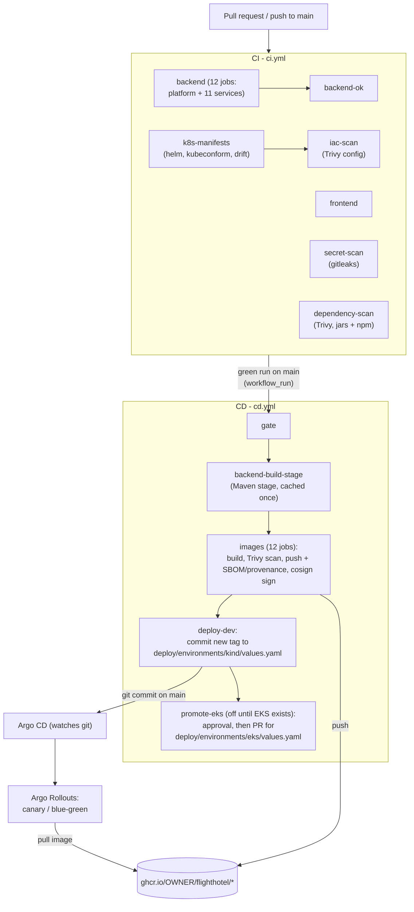

# CI/CD Guide

How code gets from a pull request to a running cluster: what the two GitHub Actions workflows check and build, how
Argo CD picks up a new version, which repository settings the pipeline needs, how to run the same checks on your
machine, and what to do when something fails. The cluster side (charts, Argo Rollouts, Argo CD, the kind cluster) is in
[KUBERNETES_DEPLOYMENT.md](../KUBERNETES_DEPLOYMENT.md).

| File | What it is |
|------|------------|
| [`.github/workflows/ci.yml`](../.github/workflows/ci.yml) | **CI**: tests, lint, Kubernetes manifest validation and security scans for every pull request and every push to `main` |
| [`.github/workflows/cd.yml`](../.github/workflows/cd.yml) | **CD**: builds, scans, signs and pushes the 12 images, then writes the new image tag into the GitOps values |
| [`.github/dependabot.yml`](../.github/dependabot.yml) | Weekly dependency updates (Maven, npm, Docker base images, GitHub Actions) |
| [`.gitleaks.toml`](../.gitleaks.toml) | Secret-scan rules (gitleaks defaults + one narrow exception for test fixtures) |
| [`scripts/ci/validate-k8s.sh`](../scripts/ci/validate-k8s.sh) | helm lint + helm template + kubeconform for every chart and environment (CI and local) |
| [`scripts/ci/check-infra-drift.sh`](../scripts/ci/check-infra-drift.sh) | Checks that the data-platform chart's copies of `infra/` scripts are identical to the originals (CI and local) |

## 1. The big picture



In one sentence: **CI proves a commit is good, CD turns it into signed images and writes their tag into git, and
Argo CD (not GitHub) changes the cluster.** GitHub Actions never talks to a Kubernetes cluster. This is the GitOps
"pull" model: the cluster pulls its desired state from git, so a laptop KIND cluster or a private EKS cluster needs no
inbound access from GitHub.

## 2. CI (`ci.yml`)

### 2.1 When it runs

| Trigger | What runs |
|---------|-----------|
| Every pull request (any target branch) | All jobs, always (so the required checks always report) |
| Push to `main` | All jobs, **except** when the push changes only `**.md`, `docs/**` or `deploy/**` (nothing to build: `deploy/` was validated in its pull request and Argo CD syncs it directly; this also covers the CD bot's own commits) |
| Manual (Actions tab, "Run workflow") | All jobs on the chosen branch |

A new push to a pull request cancels the older run of that pull request. Runs on `main` are never cancelled, because a
green run on `main` is what starts CD.

### 2.2 Jobs

| Job (= check name) | What it does | Typical time |
|--------------------|--------------|--------------|
| `backend (<name>)` | Matrix of 12 jobs: `./mvnw -B -ntp -pl <module> -am verify` for each service, plus one job for `platform/event-schemas, common-lib, test-support`. Java 21 (Temurin), Maven cache. Integration tests start their containers with Testcontainers on the runner's Docker. On failure the surefire reports are uploaded as artifact `test-reports-<name>`. | 5-15 min each, in parallel |
| `backend-ok` | Green only if **all** 12 backend jobs are green. One stable name for branch protection (matrix job names change whenever a module is added). | seconds |
| `frontend` | `npm ci`, `npm run lint`, `npm run typecheck` (`tsc -b --noEmit`), `npm test` (Vitest), `npm run build` (with `VITE_DEV_ACCOUNTS=false`). Node 24, npm cache. | 3-5 min |
| `k8s-manifests` | `scripts/ci/validate-k8s.sh`: `helm lint --strict` and `helm template` for every chart with every environment's values, then **kubeconform** (strict, Kubernetes 1.36, plus CRD schemas for Argo Rollouts and Gateway API). Then `scripts/ci/check-infra-drift.sh`. Uploads the rendered manifests as artifact `rendered-manifests`. | 1-2 min |
| `iac-scan` | **Trivy config** on both Dockerfiles and on the rendered manifests from `k8s-manifests`. Full report (MEDIUM and up) in the job summary. | 1 min |
| `secret-scan` | **gitleaks** over the whole git history (not only the current files). Findings are redacted in the log. | < 1 min |
| `dependency-scan` | Builds the service jars (`-DskipTests`), then **Trivy** on the jars (every library nested in the Spring Boot jars) and on `frontend/package-lock.json`. Also the job that saves the shared Maven cache. | 4-6 min |

`platform/coverage-report` is not a CI job: it needs the test data of every module at once, so the combined JaCoCo
report comes from a local `.\mvnw.cmd verify` ([TESTING_GUIDE.md](../TESTING_GUIDE.md) section 3.2). Coverage is
reported, never enforced, as before.

### 2.3 What fails the build

| Check | Fails on | Reported only |
|-------|----------|---------------|
| Backend | any compile error or failing test | coverage |
| Frontend | lint error, type error, failing test, failed build | |
| Kubernetes | `helm lint --strict` errors **and warnings**; a chart that does not render; a manifest that does not match its schema (unknown fields too: strict mode); infra drift | |
| Secrets | any gitleaks finding, except the `generic-api-key` rule inside test sources (fixed test passwords, idempotency keys, test-only keys; see `.gitleaks.toml`) | |
| Dependencies | a **CRITICAL** vulnerability **with a fix available** in a service jar or an npm package | |
| Misconfiguration | **HIGH or CRITICAL** in `docker/backend.Dockerfile`, `frontend/Dockerfile` and the `microservice` and `shared` charts; **CRITICAL** in the `data-platform` chart (third-party MySQL, Kafka, ... for local/dev only) | everything from MEDIUM up, in the job summary |
| CD image scan | a **CRITICAL** vulnerability with a fix in the built image (nothing is pushed then) | HIGH with a fix, in the job log |

Why these thresholds: CRITICAL with a fix is always actionable (update the dependency or rebuild the image), so it
blocks. Unfixed findings cannot be acted on and would make the pipeline red for weeks. For our own workloads the HIGH
Kubernetes checks are the ones that matter (privileged containers, host namespaces, writable root filesystem, no
security context), so they block too; third-party data stores often need root, so only CRITICAL blocks there. The
fail levels are the `APP_FAIL_SEVERITY` / `DATA_FAIL_SEVERITY` variables at the top of the `iac-scan` job.

State when the pipeline was written (local scans with the same Trivy version): both Dockerfiles have only one LOW
finding (no `HEALTHCHECK`, which Kubernetes probes replace); `frontend/package-lock.json` and the locally built
service jars had no CRITICAL finding with a fix. The first CI run is the real baseline.

**Accepted exceptions** go into a `.trivyignore` file in the repository root (Trivy reads it in every job), one ID per
line, always with a reason and an expiry date:

```text
# Spring Boot 4.1.3 fixes it; remove after the upgrade.
CVE-2026-12345 exp:2026-12-31
# frontend nginx writes /etc/nginx/conf.d at start-up (envsubst templates); mounted as emptyDir instead.
KSV-0014 exp:2027-03-31
```

## 3. CD (`cd.yml`)

### 3.1 When it runs

- **Automatically** when a CI run **on `main`** finishes **successfully** (event `workflow_run`). CD never runs the
  tests again: it trusts the green CI run of exactly that commit. CI runs of pull requests (also from forks, also if
  their branch is called `main`), failed or cancelled runs are ignored by the `gate` job.
- **By hand**: Actions, "CD", "Run workflow" on `main`. It then delivers the **newest commit on `main` that has a
  green CI run** (the CD bot's own commits never have one, because they skip CI). Use it to retry a failed delivery.

### 3.2 Jobs

| Job | What it does |
|-----|--------------|
| `gate` | Decides which commit is delivered (the CI run's `head_sha`, or the newest green one for a manual run) and refuses everything else. |
| `backend-build-stage` | Builds the `build` stage of `docker/backend.Dockerfile` (the full Maven build, identical for all 11 services) **once** and stores it in the GitHub Actions cache. |
| `images (<image>)` | Matrix of 12 jobs, one per image. For each: build into the runner's Docker, **Trivy scan** (CRITICAL with a fix fails, nothing is pushed), then push with **SBOM and provenance attestations**, then **cosign keyless signing** and a verification of that signature. |
| `deploy-dev (kind)` | Sets `global.image.tag` in `deploy/environments/kind/values.yaml` to the full commit SHA with `yq` and pushes the commit to `main` as `github-actions[bot]` (message `deploy(kind): images <sha7> [skip ci]`). Runs one at a time (concurrency group `gitops-kind`), retries if `main` moved during the push, and never replaces a newer tag with an older one. |
| `promote-eks` | Prepared, **off** until EKS exists. After an approval in the `production` environment it opens (or updates) a pull request from branch `automation/promote-eks` that sets `global.image.tag` in `deploy/environments/eks/values.yaml`. Merging that pull request is the deployment. See section 4.4. |

Only the backend's Maven stage is cached. The runtime stages (`apt-get upgrade` / `apk upgrade`) are rebuilt every
time on purpose, so every image contains the OS security fixes of the day it was built.

### 3.3 Images and tags

| Image | Built from |
|-------|------------|
| `ghcr.io/<owner>/flighthotel/<service>` (11) | `docker/backend.Dockerfile`, context = repository root, `--target runtime`, `--build-arg SERVICE=<service>` |
| `ghcr.io/<owner>/flighthotel/frontend` | `frontend/Dockerfile`, context = `frontend/`, `--build-arg VITE_DEV_ACCOUNTS=false` |

`<owner>` is the GitHub user or organization in **lowercase** (registry names must be lowercase).

| Tag | Example | Used for |
|-----|---------|----------|
| full commit SHA | `3f9c2e1d...` (40 characters) | **what the clusters deploy** (`global.image.tag`) |
| `sha-<7 chars>` | `sha-3f9c2e1` | humans |
| `latest` | `latest` | convenience only (main); never deploy `latest` |

Every image carries the OCI labels and annotations `org.opencontainers.image.source` (links the package to this
repository on GitHub), `revision` (the commit), `created`, `title`, `description` and `version`. Images are
`linux/amd64` (KIND on a PC and x86 EKS nodes). For Graviton (arm64) nodes later, add `linux/arm64` to `platforms`
(best on an arm64 runner, `ubuntu-24.04-arm`, instead of slow emulation).

### 3.4 Supply chain: scan, SBOM, provenance, signature

Each pushed image has:
- a **Trivy** result in the CD log (the image was not pushed if it had a CRITICAL finding with a fix);
- an **SBOM** (SPDX, every OS package and library) and a **SLSA provenance** attestation (`mode=max`: source commit,
  build arguments, base images), stored next to the image in GHCR by BuildKit;
- a **cosign keyless signature**: the job's GitHub OIDC token gets a short-lived certificate from Sigstore's Fulcio,
  the signature is recorded in the public Rekor transparency log. There is no private key to store or leak.

Check them yourself (any machine with Docker and [cosign](https://docs.sigstore.dev/cosign/system_config/installation/)):

```powershell
$img = "ghcr.io/<owner>/flighthotel/booking-service:<full-sha>"

# Signature: made by this repository's cd.yml on main, and nothing else
cosign verify $img `
  --certificate-identity "https://github.com/<owner>/<repo>/.github/workflows/cd.yml@refs/heads/main" `
  --certificate-oidc-issuer "https://token.actions.githubusercontent.com"

# SBOM and provenance
docker buildx imagetools inspect $img --format "{{ json .SBOM }}"
docker buildx imagetools inspect $img --format "{{ json .Provenance }}"
```

The same `cosign verify` rule can later be enforced inside the cluster (Kyverno `verifyImages` or the Sigstore
policy-controller), so the cluster refuses images this pipeline did not build.

## 4. GitOps: how a new version reaches the cluster

### 4.1 The layout CI and CD expect in `deploy/`

```text
deploy/
  charts/
    microservice/        generic chart, one Helm release per service (release name = service name)
    data-platform/       MySQL, Kafka, Kafka Connect, ... (local/dev only)
      files/             copies of infra/ (mysql/, kafka/, kafka-connect/), same relative layout, checked for drift
    shared/              namespace-wide resources
  environments/
    kind/                local KIND cluster (registry localhost:5001/flighthotel)
      values.yaml        global.image.registry, global.image.tag   <- deploy-dev writes the tag here
      services/<service>.yaml
      data-platform.yaml
      shared.yaml
    eks/                 later (registry GHCR or ECR)
      values.yaml        global.image.registry, global.image.tag   <- the promote-eks pull request writes the tag here
      services/<service>.yaml
      shared.yaml
  argocd/                projects, root app ("app of apps") and child apps per environment; they pass the value
                         files in the order of rule 1 (KUBERNETES_DEPLOYMENT.md, section 10)
```

Rules the charts and the Argo CD Applications must follow (CI checks the charts exactly this way):

1. **Value file order.** Every release gets `environments/<env>/values.yaml` first, then its own file
   (`services/<service>.yaml`, `data-platform.yaml` or `shared.yaml`). Argo CD must pass them in the same order.
2. **One tag for everything.** The image of a service is `<global.image.registry>/<service>:<global.image.tag>`, so
   for GHCR the registry value is `ghcr.io/<owner>/flighthotel`. `global.image.tag` must exist in each environment's
   `values.yaml` (CD refuses to create it, so a typo cannot silently add a second key). The bot writes it as a quoted
   string; `yq` may normalize the spacing before a comment on other lines of that file.
3. **Rendering without a cluster.** CI renders with `--kube-version 1.36.0` and tells Helm that these APIs exist:
   `argoproj.io/v1alpha1` (Rollout, AnalysisTemplate) and `gateway.networking.k8s.io/v1` (HTTPRoute). If a chart checks
   `.Capabilities.APIVersions` for something else (for example `monitoring.coreos.com/v1`), add it to
   `HELM_API_VERSIONS` in `scripts/ci/validate-k8s.sh`.
4. **Security context.** Because HIGH misconfigurations of our workloads fail CI, the `microservice` chart needs a pod
   and container `securityContext` (non-root, no privilege escalation, capabilities dropped,
   `readOnlyRootFilesystem: true` with an `emptyDir` for `/tmp`; nginx also needs writable `/var/cache/nginx`,
   `/var/run` and `/etc/nginx/conf.d`). Trivy does not know Argo Rollouts, so CI scans each `Rollout` as if it were a
   `Deployment` (same pod template).
5. **No `[skip ci]` on promotion commits**, and `data-platform/files/` changes always start in `infra/` first.

### 4.2 What happens after a merge to `main` (kind)

1. CI runs on the merge commit (about 15 minutes) and turns green.
2. CD builds and pushes the 12 images tagged with the commit SHA (about 15-20 minutes).
3. `deploy-dev` commits `global.image.tag: "<sha>"` to `deploy/environments/kind/values.yaml` on `main`.
4. Argo CD notices the new commit (it checks git every 60 seconds, `timeout.reconciliation` in
   `deploy/platform/values/argo-cd.yaml`; a laptop cannot receive GitHub webhooks, so press **Refresh** to be faster), renders the charts and sees a changed pod
   template in every Rollout.
5. Argo Rollouts replaces the pods step by step (canary weights or blue-green switch, with the analysis templates).
   Watch it: `kubectl argo rollouts get rollout <service> -n <namespace> --watch`.

Because there is one global tag, every service gets a new rollout for every delivered commit, even if only one service
changed. That keeps the versions consistent and the setup simple.

**Rollback** is a git operation too: revert the bot's commit (or set the previous SHA) in
`deploy/environments/kind/values.yaml`, or abort a running rollout with `kubectl argo rollouts abort <service>`.

### 4.3 kind and the image registry

CD pushes to **GHCR**. The kind environment's registry is `localhost:5001/flighthotel` (the local registry that
`deploy/scripts/push-images.ps1` fills with hand-built images). So that the GitOps flow works on kind, choose one:

| Option | What to do | When |
|--------|------------|------|
| A. Pull from GHCR, public packages | Set `global.image.registry: ghcr.io/<owner>/flighthotel` in `deploy/environments/kind/values.yaml` and make the 12 packages public (section 5.2). | Simplest; fine if the images may be public |
| B. Pull from GHCR, private packages | Same registry value, plus an image pull secret in the `flight-hotel` namespace (below) and `global.imagePullSecrets: [{name: ghcr-pull}]` in the same file. | Private images |
| C. Keep `localhost:5001` | Copy the delivered images into the local registry after each delivery (below). | Offline / hand-built images |

A KIND node can pull from GHCR **only** if the packages are public or the pod has an image pull secret; otherwise the
pods stay in `ImagePullBackOff`.

```powershell
# Option B: a classic personal access token with only the read:packages scope (never commit it)
kubectl create secret docker-registry ghcr-pull -n flight-hotel `
  --docker-server=ghcr.io --docker-username=<github-user> --docker-password=<token>

# Option C: copy one delivered version into the local registry (repeat for every image)
$sha = "<full-sha>"
foreach ($i in 'api-gateway','identity-service','hotel-service','flight-service','booking-service','payment-service','notification-service','reporting-service','mcp-server-service','mcp-client-service','search-service','frontend') {
  docker pull "ghcr.io/<owner>/flighthotel/${i}:${sha}"
  docker tag "ghcr.io/<owner>/flighthotel/${i}:${sha}" "localhost:5001/flighthotel/${i}:${sha}"
  docker push "localhost:5001/flighthotel/${i}:${sha}"
}
```

### 4.4 Promotion to EKS (prepared, off)

`promote-eks` runs after `deploy-dev`, but only when the repository variable `ENABLE_EKS_PROMOTION` is `true`.

1. The job waits for a reviewer of the **`production` environment** to approve it (Actions run page, "Review
   deployments"). Only the newest waiting promotion is kept; an older one is cancelled.
2. After approval it force-pushes branch `automation/promote-eks` (one commit on top of `main` that changes only
   `global.image.tag` in `deploy/environments/eks/values.yaml`) and opens a pull request, or updates the open one.
3. CI runs on that pull request; a reviewer merges it.
4. Argo CD on EKS syncs `main` and Argo Rollouts rolls out.

To enable it when EKS exists: create the `production` environment (section 5.5), configure the CD bot GitHub App
(section 5.4; a pull request opened with `GITHUB_TOKEN` does not start CI), make sure EKS can pull the images (public
GHCR packages, a pull secret, or ECR), then set `ENABLE_EKS_PROMOTION=true`.

**ECR instead of GHCR** (optional): the `images` job contains a commented block for
`aws-actions/configure-aws-credentials` (OIDC, role ARN from the variable `AWS_ECR_PUSH_ROLE_ARN`, no AWS keys in
GitHub) and `aws-actions/amazon-ecr-login`. Uncomment it, add the ECR repository as a second line under `images:` of
the metadata step, create the ECR repositories `flighthotel/<image>`, and set `global.image.registry` in
`deploy/environments/eks/values.yaml` to `<account>.dkr.ecr.<region>.amazonaws.com/flighthotel`. The IAM role's trust
policy should allow only `repo:<owner>/<repo>:ref:refs/heads/main`.

## 5. Repository settings (one-time setup)

Do these once after the first push to GitHub. Check names only appear in the branch protection lists after the
workflow has run at least once, so push first, open a test pull request, then configure 5.3.

### 5.1 Actions

Settings, Actions, General:
- **Actions permissions**: "Allow all actions", or better "Allow `<owner>`, and select non-`<owner>`, actions" with
  `actions/*, docker/*, aquasecurity/*, sigstore/*, azure/setup-helm@*` (later `aws-actions/*`). If offered, also tick
  "Require actions to be pinned to a full-length commit SHA" (every action here is pinned).
- **Fork pull request workflows**: "Require approval for first-time contributors" (default) is fine. Fork pull
  requests get a read-only token and no secrets; CI needs nothing more.
- **Workflow permissions**: "Read repository contents and packages permissions". Every job declares exactly the
  permissions it needs (`permissions:` in the workflow files), so nothing relies on the default.
- "Allow GitHub Actions to create and approve pull requests": only needed if `promote-eks` runs **without** the
  GitHub App (not recommended, see 5.4).

### 5.2 GHCR packages

The first CD run creates the 12 packages under your account or organization (Your profile / the organization,
Packages). They are **private** by default and linked to this repository through the `org.opencontainers.image.source`
label, which gives this repository's workflows write access.
- To make them public (kind option A, section 4.3): each package, Package settings, "Change visibility", Public.
  Organizations must allow public packages first (Organization settings, Packages).
- If a push fails with `denied` / `403` because a package with that name already existed before (for example pushed by
  hand): Package settings, "Manage Actions access", add this repository with the **Write** role.

### 5.3 Branch protection and required checks

Use a ruleset (Settings, Rules, Rulesets, New branch ruleset) for `main`:
- Require a pull request before merging (1 approval if you are more than one person).
- Require status checks to pass, with these checks (source: GitHub Actions):
  `backend-ok`, `frontend`, `k8s-manifests`, `iac-scan`, `secret-scan`, `dependency-scan`.
  Do not add the individual `backend (...)` jobs: `backend-ok` covers them, and the list stays correct when modules
  are added.
- Block force pushes; require linear history if you squash-merge.
- Bypass list: the CD bot (5.4), so `deploy-dev` can push the tag bump.

### 5.4 Branch protection and the CD bot

`deploy-dev` pushes one small commit to `main`. When `main` requires pull requests, the default `GITHUB_TOKEN` is
rejected (it can never bypass rules). The job uses the first of these credentials that is configured:

| Option | Setup | Notes |
|--------|-------|-------|
| **1. GitHub App** (recommended) | Create a GitHub App (Settings, Developer settings, GitHub Apps) with repository permissions **Contents: Read and write** and **Pull requests: Read and write**, no webhook. Install it on this repository. Store its Client ID as variable `CD_BOT_CLIENT_ID` and a private key as secret `CD_BOT_PRIVATE_KEY`. Add the App to the ruleset's bypass list. | Short-lived tokens (1 hour) created per job, scoped to Contents/Pull requests. Also needed by `promote-eks`, because pull requests opened by `GITHUB_TOKEN` do not start CI. |
| 2. Deploy key | `ssh-keygen -t ed25519 -f cd-deploy-key -N '""'`; add `cd-deploy-key.pub` under Settings, Deploy keys, with **write access**; store the private key as secret `CD_DEPLOY_KEY`; in the ruleset bypass list allow **Deploy keys**. | Only for `deploy-dev` (cannot open pull requests). A long-lived key: rotate it. |
| 3. Nothing | Works only while `main` allows direct pushes. | Fine for the very first days, not after 5.3. |

Commits pushed with `GITHUB_TOKEN` never start other workflows. Commits pushed with the App or the deploy key do, so
the bot commit carries `[skip ci]` and CI also ignores pushes that touch only `deploy/**`: no loop.

### 5.5 The `production` environment

Settings, Environments, New environment `production`:
- **Required reviewers**: the people allowed to promote to EKS (prevent self-review if you are more than one).
- **Deployment branches and tags**: "Selected branches", `main` only.
- Later, environment-scoped variables/secrets for EKS go here (for example the ECR role ARN).

Create it **before** setting `ENABLE_EKS_PROMOTION`: GitHub creates a missing environment automatically, but without
any protection.

### 5.6 Variables and secrets

Settings, Secrets and variables, Actions. None is needed for CI; CD works with none of them while `main` is
unprotected and GHCR is used.

| Name | Kind | Used by | Purpose |
|------|------|---------|---------|
| `CD_BOT_CLIENT_ID` | variable | deploy-dev, promote-eks | GitHub App Client ID (5.4) |
| `CD_BOT_PRIVATE_KEY` | secret | deploy-dev, promote-eks | GitHub App private key (5.4) |
| `CD_DEPLOY_KEY` | secret | deploy-dev | Alternative to the App: SSH deploy key with write access (5.4) |
| `ENABLE_EKS_PROMOTION` | variable | promote-eks | `true` turns the EKS promotion on (4.4) |
| `DOCKERHUB_USERNAME` | variable | CI backend, CD build jobs | Optional: pull from Docker Hub as a user (anonymous pulls are rate-limited) |
| `DOCKERHUB_TOKEN` | secret | CI backend, CD build jobs | Read-only Docker Hub access token for the user above |
| `AWS_ECR_PUSH_ROLE_ARN`, `AWS_REGION` | variables | images (commented) | Only if you switch on ECR (4.4) |

`GITHUB_TOKEN` is created per job by GitHub; nothing to configure.

## 6. Dependency updates (Dependabot)

Every Monday Dependabot opens pull requests (prefix `build(deps)` / `ci(deps)`):

| Ecosystem | Grouping |
|-----------|----------|
| Maven (`/`, all modules) | Spring (Boot, Cloud, AI) minor/patch together; all other minor/patch together; majors one by one |
| npm (`/frontend`) | React, Vitest and ESLint families together (majors too, they must match); then production and development minor/patch |
| Docker (`docker/backend.Dockerfile`, `frontend/Dockerfile`) | all base images together; Java and Node **majors are ignored** (deliberate upgrades: they also need `pom.xml`, CI's `NODE_VERSION` and local tools) |
| GitHub Actions | all together; Dependabot updates the pinned SHA **and** the `# vX.Y.Z` comment |

A 5-day cooldown lets brand-new releases settle (broken or malicious releases are usually pulled within days).
Security updates (Dependabot alerts) are not delayed. Each Dependabot pull request runs the full CI.

Not covered by Dependabot, update by hand (section 8): the tool versions in the workflows, and the Spring Boot property
`spring-boot.version`, which must stay equal to the parent version (they arrive in the same "spring" group).

## 7. Run the checks locally

Same commands as CI, from the repository root. PowerShell unless it says Git Bash.

```powershell
# Backend: one module the way CI does it, or everything (also writes the combined coverage report)
.\mvnw.cmd -B -ntp -pl services/booking-service -am verify
.\mvnw.cmd -B -ntp -pl platform/event-schemas,platform/common-lib,platform/test-support -am verify
.\mvnw.cmd -B -ntp verify

# Frontend
cd frontend; npm ci; npm run lint; npm run typecheck; npm test; npm run build; cd ..
```

```bash
# Git Bash (or WSL). Needs helm 4 and kubeconform on PATH
# (kubeconform: kubeconform-windows-amd64.zip from https://github.com/yannh/kubeconform/releases, same version as CI).
bash scripts/ci/validate-k8s.sh          # renders into $TMP/flighthotel-rendered and validates
bash scripts/ci/check-infra-drift.sh
```

```powershell
# Secrets: the git history, as CI does it
docker run --rm -v "${PWD}:/repo:ro" ghcr.io/gitleaks/gitleaks:v8.30.1 git /repo --config /repo/.gitleaks.toml --redact --no-banner --verbose
# (the working tree instead: replace "git" by "dir"; findings in .env, target/ and node_modules/ are expected there)

# Dependencies: build the jars first, then scan jars and npm lock file
# (shows HIGH and CRITICAL with a fix; CI fails only on CRITICAL with a fix)
.\mvnw.cmd -B -ntp -DskipTests package
docker run --rm -v "${PWD}:/repo:ro" -w /repo -v trivy-cache:/root/.cache aquasec/trivy:0.76.1 rootfs --scanners vuln --severity HIGH,CRITICAL --ignore-unfixed services
docker run --rm -v "${PWD}:/repo:ro" -w /repo -v trivy-cache:/root/.cache aquasec/trivy:0.76.1 fs --scanners vuln --severity HIGH,CRITICAL --ignore-unfixed frontend

# Misconfiguration (Dockerfiles; rendered manifests: point it at the folder validate-k8s.sh printed)
docker run --rm -v "${PWD}:/repo:ro" -w /repo -v trivy-cache:/root/.cache aquasec/trivy:0.76.1 config --severity MEDIUM,HIGH,CRITICAL docker/backend.Dockerfile
docker run --rm -v "${PWD}:/repo:ro" -w /repo -v trivy-cache:/root/.cache aquasec/trivy:0.76.1 config --severity MEDIUM,HIGH,CRITICAL frontend/Dockerfile

# An image the way CD builds and scans it
docker build -f docker/backend.Dockerfile --target runtime --build-arg SERVICE=booking-service -t flighthotel/booking-service:ci .
docker run --rm -v /var/run/docker.sock:/var/run/docker.sock -v trivy-cache:/root/.cache aquasec/trivy:0.76.1 image --scanners vuln --severity HIGH,CRITICAL --ignore-unfixed flighthotel/booking-service:ci

# The workflow files themselves (also runs shellcheck on every "run:" block) - after every workflow change
docker run --rm -v "${PWD}:/repo" -w /repo rhysd/actionlint:1.7.12 -color
```

Do **not** scan `pom.xml` with Trivy (`trivy fs .`): Trivy then downloads parent and BOM POMs from Maven Central, which
answers shared and busy IPs with HTTP 429 (blocked for 30 minutes). Scanning the built jars needs no network and shows
exactly what ships.

## 8. Updating tool versions

Dependabot keeps the actions, Maven, npm and base images current. These versions are pinned by hand:

| What | Where | How to update |
|------|-------|---------------|
| Trivy | `TRIVY_VERSION` in `ci.yml` and `cd.yml` | new version from the [releases](https://github.com/aquasecurity/trivy/releases) |
| cosign | `COSIGN_VERSION` in `cd.yml` | [releases](https://github.com/sigstore/cosign/releases) |
| Helm | `HELM_VERSION` in `ci.yml` (k8s-manifests) | same major as your local Helm |
| kubeconform | `KUBECONFORM_VERSION` **and** `KUBECONFORM_SHA256` | the line for `kubeconform-linux-amd64.tar.gz` in the release's `CHECKSUMS` file |
| gitleaks | `GITLEAKS_VERSION` **and** `GITLEAKS_SHA256` | the line for `gitleaks_<version>_linux_x64.tar.gz` in the release's `checksums.txt` |
| Kubernetes schema version | `K8S_VERSION` in `ci.yml`, default in `validate-k8s.sh` | your cluster's minor version |
| Java, Node | `JAVA_VERSION`, `NODE_VERSION` in `ci.yml` | together with `pom.xml` / the Dockerfiles |
| Runner image | `runs-on: ubuntu-24.04` | when GitHub announces the next LTS image |

Pin a third-party action by commit, never by tag: tags can be moved, commits cannot. To find the commit of a release
(dereferences annotated tags): `git ls-remote https://github.com/<owner>/<action> "refs/tags/v1.2.3" "refs/tags/v1.2.3^{}"`
(take the `^{}` line if there is one). Run actionlint after every workflow change.

## 9. Troubleshooting

| Symptom | Cause and fix |
|---------|---------------|
| `./mvnw: Permission denied` (locally on Linux/macOS) | The file was committed from Windows without the executable bit. Once: `git add --chmod=+x mvnw scripts/ci/*.sh`. (CI runs `chmod +x mvnw` itself.) |
| A backend job fails, the log shows only "Tests run ... Failures: 1" | Download the artifact `test-reports-<name>` (run page, Artifacts) and open the `*.txt` / `*-output.txt` of the failing class. |
| Testcontainers: `Could not find a valid Docker environment` or `toomanyrequests` | The first is a runner problem: re-run. The second is Docker Hub's anonymous pull limit: set `DOCKERHUB_USERNAME` / `DOCKERHUB_TOKEN` (5.6). |
| `npm ci` fails: lock file out of sync | Run `npm install` locally and commit `frontend/package-lock.json`. |
| `validate-k8s: deploy/charts/microservice does not exist` | The `deploy/` folder is not committed yet, or it does not match section 4.1. |
| `helm lint` fails with `[WARNING]` only | Lint runs with `--strict`: fix the warning (often a missing `icon` is only INFO; warnings are things like deprecated APIs or values that do not match `values.schema.json`). |
| kubeconform: `could not find schema for <Kind>` | A CRD without a published schema. Check the [CRDs-catalog](https://github.com/datreeio/CRDs-catalog); if it is not there, add the kind to `KUBECONFORM_SKIP` in `validate-k8s.sh` (comma-separated). |
| kubeconform: `additional properties 'x' not allowed` | A typo or a field at the wrong level (strict mode). Fix the template. |
| HTTPRoute / Rollout missing from the rendered output | The chart checks `.Capabilities.APIVersions` for an API that is not in `HELM_API_VERSIONS`. |
| `infra drift` | A file in `infra/` changed but its copy in `deploy/charts/data-platform/files/` did not (or the reverse, or a file exists on one side only). The diff is in the log. Change `infra/` first, then copy: `cp -r infra/<dir> deploy/charts/data-platform/files/`. |
| gitleaks finds a secret | A real secret: **rotate it first** (it is in git history, removing the line is not enough), then remove it. A false positive: add `# gitleaks:allow` at the end of that line, or a narrow allowlist entry in `.gitleaks.toml`. |
| Trivy: CRITICAL in a Java library | Pin the fixed version in `<dependencyManagement>` of the root `pom.xml` (as already done for lz4, snappy, guava). npm: update it or add an `overrides` entry. OS package (CD image scan): re-run CD, the runtime stage installs today's updates; if the fix is not released for the base image yet, wait or add a dated `.trivyignore` entry. |
| Trivy: `TOOMANYREQUESTS` downloading its database | Temporary rate limit of the database registry: re-run the job. The database is cached per day. |
| iac-scan: `KSV-0014`, `KSV-0118` and similar on our workloads | The chart lacks a security context (section 4.1, rule 4). |
| CD did not start after a merge | CI on `main` was not green, or was skipped (docs-only or `deploy/`-only commit, see 2.1), or the workflow name in `ci.yml` is no longer exactly `CI`. `workflow_run` only uses workflow files from `main`. |
| `gate` says "Start CD from main" | A manual CD run was started on another branch. |
| GHCR push: `denied: permission_denied` | The job lacks `packages: write` (do not remove it) or the package is not linked to this repository: 5.2. |
| `deploy-dev`: "main rejected the push although it did not move" | Branch protection blocks the bot: configure 5.4. |
| `deploy-dev`: "already uses ..., which is newer" | An older run finished after a newer one; nothing to do, the newer version stays. |
| The promotion pull request has no CI checks | It was opened with `GITHUB_TOKEN`. Configure the GitHub App (5.4), then re-run `promote-eks`. |
| Pods on kind: `ImagePullBackOff` | The registry in `deploy/environments/kind/values.yaml` does not have the image, or GHCR packages are private without a pull secret: 4.3. |
| Argo CD shows the old tag | Argo CD has not polled yet (Refresh), the Application points at another branch or path, or it passes different value files (section 4.1, rule 1). `argocd app diff <app>` shows what it would change. |
| `cosign verify`: `none of the expected identities matched` | The identity must be exactly `https://github.com/<owner>/<repo>/.github/workflows/cd.yml@refs/heads/main` (case included). |
| CD is slower than usual / cache warnings | The GitHub Actions cache (10 GB per repository) evicts old entries; the Maven stage is then rebuilt once. Normal. |

## 10. Design decisions (and why)

- **CD starts from CI's result instead of running CI again** (`workflow_run`). The tests run once per commit; `gate`
  only accepts green push runs on `main` of this repository, and CD checks out exactly the tested commit (`head_sha`),
  not whatever `main` is by then.
- **Build, then scan, then push.** A vulnerable image never reaches the registry, and `latest` never points at one.
- **Tags are commit SHAs.** Immutable in practice and traceable to the code; `latest` exists only for people.
- **The tag is written to git, not deployed by GitHub.** Argo CD is the only thing that changes a cluster; every
  deployment is a reviewable, revertible commit; GitHub needs no cluster credentials.
- **Never backwards.** `deploy-dev` and `promote-eks` refuse to replace a tag with an older commit, and `deploy-dev`
  runs one at a time, so re-runs or slow runs cannot roll the cluster back by accident.
- **Least privilege.** Default permissions are empty; each job gets only what it needs (`packages: write` and
  `id-token: write` only in the image jobs, `contents: write` only in the GitOps jobs). Jobs that only read never keep
  git credentials (`persist-credentials: false`). Third-party actions are pinned to commits; downloaded tools are
  checked against a SHA-256.
- **Cost.** A full CI run is about 15 jobs (roughly 90-120 runner minutes, mostly the 12 backend jobs). Free for public
  repositories; on a private repository it counts against the account's Actions minutes.
