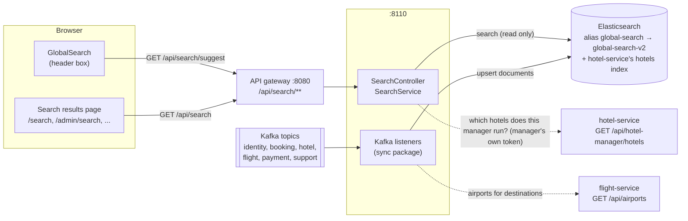
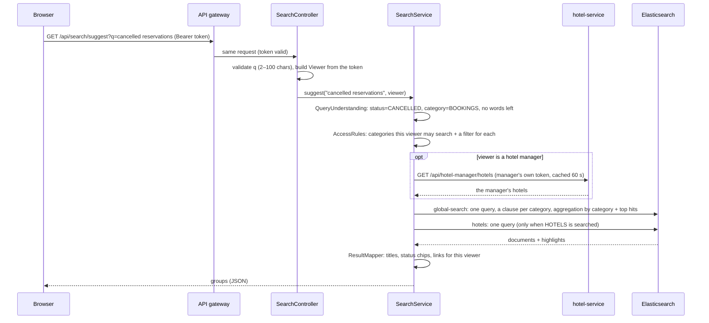
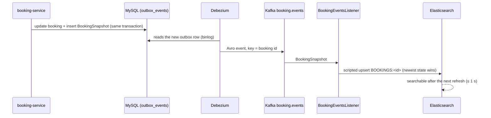

# Global search

One search box in every header (public site, customer area, admin, hotel manager and support portals). It searches
hotels, destinations, bookings, payments, refunds, support tickets, reviews, users and the application's pages at once.
Results are typo-tolerant, ranked and highlighted, and every user only sees what they are allowed to see.

| Where | What |
|-------|------|
| `services/search-service` | The search API and the Elasticsearch read model (new Spring Boot service, port 8110) |
| `frontend/src/features/search` | The header search box (`GlobalSearch`) and the results pages |
| `platform/event-schemas/src/main/avro/support/SupportTicketSnapshot.avsc`, `.../hotel/HotelReviewSnapshot.avsc` | Two new events, so tickets and reviews can be indexed |
| `services/flight-service` | New public `GET /api/airports` (all airports, for destinations) |

Contents:
1. [Architecture](#1-architecture)
2. [How React calls the search API](#2-how-react-calls-the-search-api)
3. [How the API gateway routes search requests](#3-how-the-api-gateway-routes-search-requests)
4. [How the search service queries Elasticsearch](#4-how-the-search-service-queries-elasticsearch)
5. [Keyword search](#5-keyword-search)
6. [Fuzzy search](#6-fuzzy-search)
7. [Prefix search and autocomplete](#7-prefix-search-and-autocomplete)
8. [Analyzers and mappings](#8-analyzers-and-mappings)
9. [Relevance scoring](#9-relevance-scoring)
10. [Role-based filtering](#10-role-based-filtering)
11. [Keeping the index in sync with Kafka](#11-keeping-the-index-in-sync-with-kafka)
12. [Reindexing and recovery](#12-reindexing-and-recovery)
13. [Adding a new searchable entity](#13-adding-a-new-searchable-entity)
14. [Debugging Elasticsearch queries](#14-debugging-elasticsearch-queries)
15. [Running and testing locally](#15-running-and-testing-locally)
16. [Known limitations](#16-known-limitations)

---

## 1. Architecture



**Who owns what.** The business services stay the source of truth. search-service only keeps a *copy shaped for
searching* (a read model) and never changes business data.

| Data | Source of truth | How search gets it |
|------|-----------------|--------------------|
| Users (customers and staff) | identity-service | `identity.events`: `UserSnapshot`, `UserRegistered`, profile/role/status changes |
| Bookings (hotel and flight) | booking-service | `booking.events`: `BookingSnapshot` (whole booking after every change), plus names and confirmation numbers from `BookingInitiated` / `BookingConfirmed` |
| Hotel reservations (for managers) | hotel-service | `hotel.events`: `HotelInventoryHeld` adds the reservation id and hotel to the booking |
| Flight details of bookings | flight-service | `flight.events`: `FlightOfferHeld`, `FlightBookingConfirmed` (airlines, flight numbers, PNR, tickets) |
| Payments, refunds | payment-service | `payment.events`: `PaymentSucceeded/Failed`, `RefundCompleted/Failed`, `InvoiceIssued`; refund requests from `booking.events` |
| Support tickets | notification-service | `support.events`: **new** `SupportTicketSnapshot` |
| Reviews | hotel-service | `hotel.events`: **new** `HotelReviewSnapshot` |
| Hotels | hotel-service | **not copied**: hotel-service already keeps the `hotels` index; search reads it |
| Destinations | (none) | Rebuilt every 10 minutes from the hotels' cities + flight-service's airport list |
| Pages | the web app's routes | `services/search-service/src/main/resources/search/pages.json` |

**Why a separate service and an index (and not a call to every service per keystroke)?** The admin portal used to ask
five list APIs at once for every search. That gave five rankings, no typo tolerance, only admins, and five network
calls per keystroke. Now one index answers in one or two Elasticsearch requests, ranks everything the same way, and
works for every role. Kafka events keep it up to date without the services knowing about search.

**Eventual consistency.** A change reaches the index about 1–2 seconds after it is committed: the outbox → Debezium
→ Kafka → listener → Elasticsearch refresh (every second). Search results can be that much behind; the detail page
you open always shows the live data.

## 2. How React calls the search API

| Piece | File (`frontend/src/features/search/`) |
|-------|------|
| API module | `searchApi.ts` (`searchApi.suggest`, `searchApi.search`), types in `types.ts` |
| Header box | `GlobalSearch.tsx`, in every header: `PublicLayout` (signed out and customers), `AdminLayout`, `SupportLayout`, `HotelManagerLayout` (through StaffShell's `searchSlot`) |
| Results page | `SearchResultsPage.tsx`, routes `/search`, `/admin/search`, `/support/search`, `/hotel-manager/search` |
| Highlighting | `HighlightedText.tsx` (segments → `<mark>`, plain text otherwise) |
| Categories, icons, paths, recent searches | `searchModel.ts`, `CategoryIcon.tsx` |

1. The user types. The text is **debounced** (about 250 ms) and nothing is sent below **2 characters** (the field
   takes at most 100, the API's limit).
2. `useQuery` calls `GET /api/search/suggest?q=…`:
   - It passes TanStack Query's `signal`, so a newer query **cancels** the older request.
   - Answers are cached for 30 seconds, so the same words don't ask again.
   - The query keys (`queryKeys.search.suggest(q, viewer)`, `…results(params, viewer)`) include the user id (or
     `anon`), so answers from before signing in are never reused after it. The root `search` is cleared on logout.
3. The dropdown shows the groups, best first: category icon, highlighted title, subtitle and status chip.
   - A group with more matches has a "See all N …" option; "View all results for “…”" ends the list.
   - When the box is empty it shows recent searches, stored in `localStorage` under `fh.search.recent.<userId|anon>`
     (max 5, with "Clear recent searches").
   - Arrow keys move, Enter opens, Escape closes, and the mouse works too. "/" (outside text fields) or Ctrl/⌘+K
     focuses the box.
4. Enter without a chosen item, or "View all results", opens the results page of the current area:
   - `/search` on the public site and for customers;
   - `/admin/search`, `/support/search` or `/hotel-manager/search` in the portals.

   The page keeps `?q=&category=&page=&size=` in the URL. `GlobalSearch` picks the area with `areaOfPath`.
5. A result is opened with `navigate(result.url)`. The backend builds `url`. The frontend only follows a path matching
   `^/(?![/\\])` (so never `https://…` or `//host`); anything else opens the results page. The page that opens checks
   access again with its own API call.

Header sizes:
- **Public site:** a search field from `xl`, a search button between `md` and `xl`, and the field at the top of the
  mobile menu below `md`.
- **Staff portals:** a field from `md`, a button below it.

The accessible name is always "Search hotels, flights, bookings and more".

The browser only sends `q`, `category`, `page`, `size` and the access token. It never sends a user id, role or hotel
id: the backend takes those from the verified token.

### API

`GET /api/search/suggest?q=chen` (dropdown):

```json
{
  "query": "chen",
  "tookMs": 18,
  "groups": [
    {
      "category": "HOTELS", "label": "Hotels", "total": 2,
      "items": [
        {
          "id": "HOTELS:1000…01", "category": "HOTELS",
          "title": "Chennai Grand Hotel", "subtitle": "Chennai, Tamil Nadu", "snippet": null,
          "url": "/hotels/chennai-grand-hotel",
          "status": null,
          "meta": [{ "label": "Stars", "value": "5-star" }, { "label": "Guest rating", "value": "4.6 / 5 (12 reviews)" }],
          "actions": [],
          "highlight": { "title": [{ "text": "Chennai", "match": true }, { "text": " Grand Hotel", "match": false }],
                         "subtitle": null, "snippet": null }
        }
      ]
    },
    { "category": "DESTINATIONS", "label": "Destinations", "total": 1, "items": ["…"] },
    { "category": "PAGES", "label": "Pages", "total": 1, "items": ["…"] }
  ]
}
```

`GET /api/search?q=chennai&category=ALL|HOTELS|BOOKINGS|…&page=0&size=10` (results page):

| Field | Meaning |
|-------|---------|
| `categories` | every category this user may search, with its count for this query (the tabs) |
| `total` | all results (ALL) or the category's results |
| `groups` | ALL: up to 5 results of each category with matches; a category: empty |
| `results` | a category: the requested page (`content`, `page`, `size`, `totalElements`, `totalPages`); ALL: null |
| `interpretation` | when words became filters, e.g. `"Cancelled bookings"`, `"Hotel managers"` |
| `tookMs` | time spent in the service |

Errors are the usual Problem Details: 400 `QUERY_TOO_SHORT` (under 2 characters), `QUERY_TOO_LONG` (over 100),
`INVALID_CATEGORY`, `VALIDATION_FAILED` (page 0–99, size 1–50); 403 `FORBIDDEN` (a category the user may not search);
503 `SEARCH_UNAVAILABLE` (Elasticsearch down or too slow; Elasticsearch's own error text is only logged).

Results never contain raw Elasticsearch documents: no identifiers lists, no owner ids, no access fields.

## 3. How the API gateway routes search requests

`services/api-gateway/src/main/resources/application.yml`:

```yaml
- id: search
  uri: ${SEARCH_SERVICE_URL:http://localhost:8110}
  predicates:
    - Path=/api/search,/api/search/**,/api/admin/search/**

gateway:
  public-paths:
    - "GET /api/search/**"          # signed-out visitors may search (public results only)
  role-paths:
    - "/api/admin/** ADMIN,SUPPORT_AGENT"   # covers /api/admin/search/** (the service then requires ADMIN)
```

- The gateway checks the token when one is sent (an expired token gets 401, the web app refreshes and retries) and
  applies the default rate limit (20 requests per second, bursts of 40, per user or per IP). With the debounce, a
  fast typist sends 3–4 requests per second.
- search-service checks the token again itself (common-lib resource server) and reads the user from it.
- The service's OpenAPI document is in the gateway's Swagger UI as **search-service**.

## 4. How the search service queries Elasticsearch



The code, in reading order:

| Step | Class (`services/search-service/src/main/java/com/flighthotel/search/…`) |
|------|------|
| Request, validation | `web/SearchController` |
| Who is searching | `query/ViewerResolver`, `query/Viewer`, `query/ManagedHotelsClient` |
| What the words mean | `query/QueryUnderstanding`, `query/StatusWord`, `query/ParsedQuery`, `query/PlaceNames` |
| Who may see what | `query/AccessRules` |
| The Elasticsearch queries | `query/SearchQueries` |
| Running them, grouping, paging | `query/SearchService` |
| Documents → results, links | `query/ResultMapper`, `query/Highlights` |

At most **two Elasticsearch requests** per call:
- **Own index:** one request covers every category. For the dropdown and the "All" tab it uses a `terms`
  aggregation on `category` with `top_hits` inside it, which gives the count and the best few of each category. For
  one category it adds a `post_filter` on that category, which pages the hits while the aggregation still counts the
  other tabs.
- **hotels index:** only when hotels are searched.

Each request has `"timeout": "2000ms"`, the client gives up after 5 s, and `_source` lists only the fields the results
need.

### Query understanding (words → filters)

A small fixed vocabulary, `query/QueryUnderstanding.java` (no AI). One typo is forgiven in words of 5–7 letters, two
in longer ones; shorter words must be exact.

| Typed | Understood |
|-------|-----------|
| `Hotels in Chennai` | hotel-related categories first; words "Chennai" |
| `Flights to Mumbai` | destinations open the **flight** search; flight bookings; words "Mumbai" |
| `My bookings`, `my trips`, `Reservaton` | bookings only, newest first (no words left) |
| `My cancelled reservations`, `cancelled bookings` | bookings with a cancelled status (the same set as the My Trips "Cancelled" tab) |
| `My upcoming trips` | confirmed bookings from today on, soonest first |
| `pending payments` | bookings waiting for payment (payments are only stored once they succeed or fail) |
| `open tickets`, `escalated tickets` | tickets with those statuses |
| `hotel managers`, `Custmer` | users with that role |
| `Paymnt`, `change password` | the matching pages (and, for customers, their payments) |
| `HT-7Q2X9KLM`, `john@example.com`, `6E 2134` | matched as an exact identifier (ranks first) |

When only filters are left (no other words), just those categories are listed. When there are words to match
("Refund not received"), every category is searched and the named ones are shown first. A word naming something the
user cannot search ("payments" for a hotel manager) is searched as a normal word.

## 5. Keyword search

Normal matching of all the words (AND), across the important text fields of a document at once (`cross_fields`):

```json
{ "multi_match": { "query": "chennai grand", "type": "cross_fields", "operator": "and",
                   "fields": ["title^4", "names^3", "keywords^3", "details^2", "subtitle^2"], "boost": 4 } }
```

`operator: and` means every word must match somewhere, so "Chennai Business Suites" does not return every hotel that
merely contains "Chennai". Exact matches get their own, much higher-scoring clauses:

```json
{ "terms": { "identifiers": ["ht-7q2x9klm"], "boost": 50 } },
{ "terms": { "title.exact": ["chennai grand hotel"], "boost": 30 } },
{ "match_phrase": { "title": { "query": "chennai grand hotel", "boost": 15 } } }
```

Identifiers (booking references, e-mails, ticket numbers, payment ids, PNRs, invoice numbers, flight numbers, airport
codes) are `keyword` fields: they only match exactly, never fuzzily.

## 6. Fuzzy search

```json
{ "multi_match": { "query": "chenai", "type": "best_fields", "operator": "and",
                   "fields": ["title^2", "names^2", "keywords", "details"],
                   "fuzziness": "AUTO", "prefix_length": 1, "max_expansions": 50, "boost": 1 } }
```

- `AUTO:5,9` (`SearchQueries.FUZZINESS`): no typo for words under 5 letters, 1 for 5–8 letters, 2 from 9 letters
  ("Chenai" → Chennai, "Banglore" → Bangalore).
  - Plain `AUTO` (1 typo from 3 letters, 2 from 6) was tried on the real data and was too loose: "Chenai" also found
    Singapore's Changi airport, and "reports" found "resort".
  - Plurals are not typos: the `plurals` stemmer stores "payments" as "payment", so "Paymnt" is one typo from it.
- `prefix_length: 1`: the first letter must be right, which removes most accidental matches.
- **Cities with two names** (`query/PlaceNames.java`): "Bangalore"/"Bengaluru", "Bombay"/"Mumbai",
  "Madras"/"Chennai", "Gurgaon"/"Gurugram", "Cochin"/"Kochi" and others. The query is also run with the other name, so
  "Banglore" finds the hotels stored as Bengaluru. Fuzzy matching alone cannot bridge those names.
- Lowest boost: a fuzzy match never beats an exact or prefix match.
- Only on names and titles, never on identifiers or long descriptions.
- Vocabulary words ("Paymnt", "Reservaton", "Hotle", "Custmer") are corrected before Elasticsearch, by
  `QueryUnderstanding` (edit distance with swapped letters counting as one typo).

## 7. Prefix search and autocomplete

While typing, "Che" must find "Chennai". The searchable text fields have a `.prefix` sub-field indexed with an
**edge n-gram** filter: "chennai" is stored as `ch, che, chen, chenn, chenna, chennai`. The query side is *not*
split, so the typed "che" simply equals the stored "che":

```json
"title": {
  "type": "text", "analyzer": "folded",
  "fields": {
    "exact":  { "type": "keyword", "normalizer": "lowercase" },
    "prefix": { "type": "text", "analyzer": "prefixes", "search_analyzer": "folded" }
  }
}
```

```json
{ "multi_match": { "query": "che gra", "type": "cross_fields", "operator": "and",
                   "fields": ["title.prefix^6", "names.prefix^4", "keywords.prefix^3", "details.prefix^2", "subtitle.prefix^2"],
                   "boost": 3 } }
```

Only titles, names, keywords, details and subtitles get the `.prefix` field (prefixes of 2–20 letters); long descriptions
and identifiers do not, which keeps the index small. hotel-service's `hotels` index has no prefix fields, so hotels use
`multi_match` of type `bool_prefix` (the last word is matched as a prefix).

The dropdown asks `/api/search/suggest`: the best 4 of each category.

## 8. Analyzers and mappings

The search service's index: `global-search-v2` behind the alias `global-search`.
- **Mapping.** It is in `services/search-service/src/main/resources/search/index-mapping.json` and is explicit
  (`"dynamic": "strict"`: a field that is not mapped is refused, never guessed).
- **Version 2** added the `plurals` stemmer. The running stack moved from v1 to v2 by itself, as §12 describes: 2,357
  documents were copied and the alias switched.

| Analyzer / normalizer | Does | Used by |
|-----------------------|------|---------|
| `folded` | standard tokenizer, lowercase, ASCII folding (é → e), plurals to singular (`minimal_english`: "payments" → "payment") | text fields, and the query side of `.prefix` |
| `prefixes` | `folded` + edge n-grams 2–20 | `.prefix` sub-fields (index side) |
| `lowercase` normalizer | lowercase + ASCII folding of the whole value | `identifiers`, `extraIdentifiers`, `reference`, `title.exact` |

Every document has the same shape, whatever its category:

| Field | Type | Holds |
|-------|------|-------|
| `category`, `entityId` | keyword | what it is (BOOKINGS, …) and the business id; the document id is `CATEGORY:entityId` |
| `title`, `subtitle`, `keywords`, `names`, `details` | text + `.prefix` (title also `.exact`) | the searchable words |
| `description` | text | long text (review text, refund reason, payment failure) |
| `identifiers`, `extraIdentifiers`, `reference` | keyword (lowercase) | exact identifiers |
| `status`, `type`, `paymentStatus`, `roles`, `priority`, `method`, `provider` | keyword | filters and status chips |
| `amount` (scaled_float ×100), `currency`, `date`, `endDate`, `createdAt` | numbers and dates | details, sorting, "upcoming" |
| `ownerUserId`, `hotelId`, `bookingId`, `reservationId` | keyword | access rules and links |
| `audience`, `permission`, `perHotel` | keyword / boolean | who sees a page |
| `complete`, `stateAt`, `stateRank` | boolean / long / integer | sync bookkeeping (§11) |
| `display` | object, not indexed | values only shown, never searched |

The hotels index belongs to hotel-service (`HotelIndexer`): `name` and `city` (text + `.exact`), `state`, `address`,
`countryCode`, ratings. Only active hotels are in it. search-service reads it and never writes it, so there is no second
copy of the hotels. (A copy of its mapping is in the tests, `src/test/resources/hotels-index.json`.)

## 9. Relevance scoring

A document scores the sum of the boosts of every clause it matches. The order of importance:

| # | Match | Clause | Boost |
|---|-------|--------|-------|
| 1 | Exact identifier (reference, e-mail, ticket number, payment id) | `terms identifiers` | 50 (extra identifiers 40) |
| 2 | Exact name (the whole title) | `terms title.exact` | 30 |
| 3 | The words as a phrase in the title | `match_phrase title` | 15 |
| 4 | All words, normal keyword match | `cross_fields` on the text fields | 4 |
| 5 | All words as prefixes (while typing) | `cross_fields` on the `.prefix` fields | 3 |
| 6 | All words with typos | fuzzy `best_fields` | 1 |
| 7 | Words only in a long description | `match description` | 0.5 |

Within a clause the fields are boosted too: title ×4–6, names ×3–4, keywords ×3, details and subtitle ×2. An exact match
also matches the keyword, prefix and fuzzy clauses, so it always ends far above a fuzzy-only match.

Examples (tested in `GlobalSearchIntegrationTest`):
- "HT-AAAA1111" → that booking and its payment first.
- "Chennai Business Suites" → that hotel first, and no unrelated hotels.
- "Grand" → "Chennai Grand Hotel".

Groups in the dropdown are ordered by their best score. The categories the words named ("hotel", "payments") count
double, so an exact page title still beats a one-typo match in a named category. Without words ("my bookings"), the
named categories come first and results are listed newest first (upcoming trips: soonest first).

## 10. Role-based filtering

**Elasticsearch filtering is applied in the backend, from the token, before anything is returned.** The browser
cannot widen it: it never sends roles or ids, and hidden categories are refused (403).

`query/AccessRules.java` decides, per category:

| Category | Signed out | Customer | Hotel manager | Support agent | Admin |
|----------|-----------|----------|---------------|---------------|-------|
| Users | – | – | – | customers only | all users |
| Hotels | active | active | the hotels they run | – | active |
| Destinations | ✓ | ✓ | – | – | ✓ |
| Bookings | – | own (`ownerUserId`) | their hotels' bookings (`hotelId`) | all (`BOOKING_READ_ANY`) | all |
| Payments, refunds | – | own | – | all (`PAYMENT_READ_ANY`) | all |
| Support tickets | – | own | – | all (`SUPPORT_TICKET_MANAGE`) | all |
| Reviews | – | own | their hotels' reviews | – | all (`REVIEW_MODERATE`) |
| Pages | public pages | public + account pages | manager pages, one link per hotel | support pages | admin pages (only with the page's permission) |

How it works:
- Every query is one `bool` with a `should` clause per category. Each clause carries that category's filter (for
  example `term ownerUserId = <token subject>` for a customer), so a document the user may not see never matches.
- **Hotel managers.** The hotels they run live in hotel-service (`hotel_staff`) and no event publishes them. So
  `ManagedHotelsClient` asks `GET /api/hotel-manager/hotels` with the manager's own token. hotel-service applies its
  own rule (`HotelAccess`) and answers only that manager's hotels; the answer is cached for 60 seconds. If
  hotel-service does not answer, the manager gets no hotel results (fail closed).
- **Links.** The same record opens a different page per role, for example a booking:
  - admin: `/admin/bookings/{id}`;
  - support agent: `/support/bookings/{id}`;
  - its customer: `/my-trips/{id}`;
  - the hotel's manager: `/hotel-manager/hotels/{hotelId}/reservations/{reservationId}`.

  Every link is an existing route (frontend test `searchRoutes.test.ts`), and the page re-checks access with its own
  API.
- **What results never show:** raw documents, identifiers lists, owner ids, access fields, Elasticsearch errors.
  Highlights are plain text segments, rendered by React (no `dangerouslySetInnerHTML`).

## 11. Keeping the index in sync with Kafka



| Listener (`sync` package) | Topic | Consumer group | Events used |
|---------------------------|-------|----------------|-------------|
| `IdentityEventsListener` | `identity.events` | `search-identity` | UserSnapshot, UserRegistered, UserProfileUpdated, UserRolesChanged, UserStatusChanged |
| `BookingEventsListener` | `booking.events` | `search-bookings` | BookingSnapshot, BookingInitiated, BookingConfirmed, BookingCancelled, BookingRefundRequested |
| `HotelEventsListener` | `hotel.events` | `search-hotels` | HotelInventoryHeld, HotelReviewSnapshot, HotelCatalogChanged (rebuilds destinations) |
| `FlightEventsListener` | `flight.events` | `search-flights` | FlightOfferHeld, FlightBookingConfirmed |
| `PaymentEventsListener` | `payment.events` | `search-payments` | PaymentSucceeded, PaymentFailed, RefundCompleted, RefundFailed, InvoiceIssued |
| `SupportEventsListener` | `support.events` | `search-support` | SupportTicketSnapshot |
| `PagesIndexer`, `DestinationsIndexer` | – | – | start-up and every minute (`ReferenceDataJob`) |

**New events.**
- **`SupportTicketSnapshot`** (notification-service, topic `support.events`): published after every change of a ticket:
  opened, reply, status, priority, assignment, escalation, close. There is one per ticket per transaction
  (`SupportTicketSnapshots`, like booking-service's `BookingSnapshots`).
- **`HotelReviewSnapshot`** (hotel-service, topic `hotel.events`): published when a review is written or moderated
  (`ReviewSnapshots`).
- **Backfills.** `SupportTicketSnapshotBackfill` and `ReviewSnapshotBackfill` publish every existing ticket and review
  once, guarded by the `data_backfills` rows `support-ticket-snapshots` and `review-snapshots`.

**The rules every write follows** (`index/IndexWriter.java`, two Painless scripts):
- **Idempotent.** Every write is an upsert keyed by `CATEGORY:businessId`. The same event twice gives the same
  document, so Kafka redeliveries and replays are harmless. No inbox table is needed, and the service has no database.
- **Out-of-order safe** (`FULL_STATE`). An event that carries the whole record stores its time in `stateAt`. A newer
  state replaces the old one; an older state that arrives late only fills fields that are still empty. Fields a newer
  state no longer has are removed.
- **Ranked statuses** (`MERGE`). A late "failed" never hides a "succeeded" payment (rank 2 beats 1). For refunds,
  COMPLETED beats FAILED beats REQUESTED.
- **Partial events** (`MERGE` with union) add names, flight numbers, PNRs and reservation ids to a booking. An event
  that arrives before its main record creates a stub with `complete: false`, which searches ignore until the main event
  arrives.
- **Payments before bookings.** `booking.events` and `payment.events` are separate topics, so a payment can be indexed
  before its booking. When a booking first gets its reference, the booking listener refreshes the index (a search only
  sees refreshed documents) and copies the reference onto such payments and refunds (`fillBookingReference`, an
  `update_by_query`).

**Failures.**
- **Elasticsearch down:** `SearchIndexUnavailableException`. The listener retries the same event 1 s, 2 s, 4 s … up to
  30 s apart, without end (`config/SearchKafkaConfig`). Nothing goes to the dead-letter topic, and the index catches up
  when Elasticsearch is back. Searches answer 503 meanwhile.
- **A document Elasticsearch refuses** (a bug or bad data): common-lib's error handler retries 3 times, then sends the
  event to `<topic>.DLT` and the listener carries on with the next event.
- **Unknown event types** on a topic are ignored (`default -> {}`).

## 12. Reindexing and recovery

| Situation | What to do |
|-----------|-----------|
| **Mapping changed** (new field, new analyzer) | Edit `index-mapping.json`, bump `_meta.mappingVersion` **and** `SearchIndex.MAPPING_VERSION`. On start, `SearchIndex` creates the next index (`global-search-v3` after today's v2), copies the documents with `_reindex`, and moves the alias in one atomic step. The old index is kept: delete it by hand once happy. The v1 index from before the plural stemmer is still there on the local stack: `curl -XDELETE localhost:9200/global-search-v1`. |
| **Index missing or incomplete** (Elasticsearch volume lost, a listener was down longer than 7 days) | `POST /api/admin/search/replay` (admin). Every listener goes back to the start of its topic and applies the retained events again (Kafka keeps 7 days). Pages and destinations are rebuilt. |
| **Older than 7 days** | Re-run the snapshot backfills, which publish the full current state of every record: set `done_at = NULL` on the backfill row and restart that service, then replay. `identity_db`: `user-snapshots`; `booking_db`: `booking-snapshots`; `notification_db`: `support-ticket-snapshots`; `hotel_db`: `review-snapshots`. Example: `UPDATE data_backfills SET done_at = NULL WHERE name = 'booking-snapshots';`. Payments and refunds older than 7 days have no snapshot event (see limitations). |
| **Hotels** | hotel-service's own `POST /api/admin/hotels/reindex`. |
| **Events in a DLT** | Look at them in Kafka UI (`http://localhost:8090`, topic `<topic>.DLT`); after fixing the cause, replay. |
| **Check** | `GET /api/admin/search/status`: documents per category and hotels in hotel-service's index. |

A replay never deletes anything and never duplicates anything (idempotent upserts). The first start of search-service
is itself a replay: new consumer groups start at the earliest retained event.

## 13. Adding a new searchable entity

Example: coupons (owned by booking-service).

1. **An event with the whole record.** Add an Avro schema under `platform/event-schemas/src/main/avro/…`, for
   example `CouponSnapshot` with `changedAt`. Publish it through the owning service's outbox after every change (copy
   `BookingSnapshots`), plus a one-time backfill (copy `BookingSnapshotBackfill` and add a `data_backfills` row).
2. **A category.** Add `COUPONS` to `index/SearchCategory` (its position is its tab order).
3. **A listener.** Handle the event in the topic's listener (or a new `@KafkaListener` class extending
   `AbstractConsumerSeekAware`): build `Fields.of(COUPONS, id)` with `title`, `subtitle`, `keywords`, `identifiers`,
   `status`, … and call `writer.replaceState(...)` with the list of fields the event owns.
4. **Access.** In `AccessRules`, add who may search it (`allowed`), its filter (`filter`) and its label (`label`). The
   mapping needs no change: all categories share one shape.
5. **Results.** In `ResultMapper.own`, add the case: link, details and status chip. The link must be an existing route;
   add its pattern to `frontend/src/features/search/searchRoutes.test.ts`.
6. **Vocabulary (optional).** Add words like "coupon"/"coupons" to `QueryUnderstanding.HINTS`, and status words to
   `StatusWord`.
7. **Frontend.** Add the category, with its icon, to `frontend/src/features/search/searchModel.ts` and `types.ts`.
8. **Tests.** Extend `GlobalSearchIntegrationTest`: found by the right roles, hidden from the others, and the right link.

## 14. Debugging Elasticsearch queries

- **See the exact query.** Set `logging.level.com.flighthotel.search.query.SearchService: DEBUG`. Every search is
  logged as the JSON body sent to Elasticsearch: copy it into Kafka UI or curl.

  ```bash
  curl -s -XPOST 'localhost:9200/global-search/_search?pretty' -H 'Content-Type: application/json' -d @query.json
  ```

- **What is in the index:**

  ```bash
  curl -s 'localhost:9200/_cat/aliases/global-search?v'                 # which index the alias points to
  curl -s 'localhost:9200/global-search/_count?pretty'
  curl -s 'localhost:9200/global-search/_doc/BOOKINGS:<booking-id>?pretty'
  curl -s -XPOST 'localhost:9200/global-search/_search?pretty' -H 'Content-Type: application/json' \
       -d '{"size":0,"aggs":{"c":{"terms":{"field":"category"}}}}'      # documents per category
  ```

- **How text is split:**

  ```bash
  curl -s -XPOST 'localhost:9200/global-search/_analyze?pretty' -H 'Content-Type: application/json' \
       -d '{"field":"title.prefix","text":"Chennai Grand"}'
  ```

- **Why a result ranks where it does:** add `"explain": true` to the copied query, or
  `GET /global-search/_explain/<doc-id>` with the query.
- **A record is missing.** Check that the listener received the event: search-service logs show listener errors, and a
  refused document goes to the `.DLT` topic. Check the document with the `_doc` URL above: `complete: false` means only
  partial events arrived. Check the consumer group lag in Kafka UI (groups `search-*`).
- **Wrong results for a role.** `AccessRules` builds the filter; `AccessRulesTest` and `GlobalSearchIntegrationTest`
  show the expected behaviour per role.

## 15. Running and testing locally

```powershell
# Docker: everything (search-service included), from the project folder
docker compose up -d --build
# The topic support.events is created by kafka-init. On an existing stack, run it once before the new
# notification-service starts:
docker compose up kafka-init

# search-service on its own machine process (Docker infrastructure must run):
.\scripts\run-service.ps1 search-service

# Backend tests (Docker needed for Testcontainers Elasticsearch):
.\mvnw.cmd -pl services/search-service -am verify "-Dtest=com.flighthotel.search.**" "-Dsurefire.failIfNoSpecifiedTests=false"

# Frontend tests:
cd frontend; npm test
```

URLs:
- Swagger: http://localhost:8080/swagger-ui.html → **search-service**
- The service itself: http://localhost:8110/actuator/health
- Index status (admin token): `GET http://localhost:8080/api/admin/search/status`

Try it with the development accounts (`docs/DEVELOPMENT_TEST_ACCOUNTS.md`, password `DevTest@2026!`):
- **Signed out:** "Chenai" (typo) → Chennai hotels and the destination; a booking reference → nothing.
- **Customer** `dev.customer1@flighthotel.local`:
  - "my upcoming trips", "cancelled", "Paymnt" → own trips and payments;
  - another customer's reference → nothing.
- **Hotel manager** `dev.manager1@flighthotel.local`:
  - "pending reservations", "room inventory", "reviews" → only their hotels;
  - the other manager's reservation reference → nothing.
- **Support** `dev.support1@flighthotel.local`: a customer's name or e-mail, a ticket number.
- **Admin** `dev.admin@flighthotel.local`: "hotel managers", "Custmer", a payment id, "pending payments", "Hotel
  Management".

What the tests cover:
- **Backend** (`services/search-service/src/test`):
  - `GlobalSearchIntegrationTest` (real Elasticsearch):
    - exact, fuzzy, prefix and partial matching, ranking;
    - understood words, category filter and paging, empty results, invalid requests;
    - customer, hotel manager, support and admin isolation and links, signed-out visitors;
    - duplicate events, out-of-order events, ranked statuses, payments before bookings, updates and deletes.
  - `EndpointSecurityTest`: logins and admin-only maintenance.
  - Unit tests: `QueryUnderstandingTest`, `AccessRulesTest`, and `SearchFailuresTest` (Elasticsearch down, retry rules,
    highlight safety).
  - notification-service `SupportTicketSnapshotIntegrationTest` and hotel-service `HotelReviewIntegrationTest`: the
    new events and backfills.
- **Frontend** (`frontend/src/features/search`):
  - `GlobalSearch.test.tsx`: debounce, minimum length, keyboard, mouse, loading, empty, error, recent searches,
    unsafe links;
  - `SearchResultsPage.test.tsx`: tabs, paging, empty, error, short query, interpretation;
  - `HighlightedText.test.tsx`: markup in data stays text;
  - `searchRoutes.test.ts`: every page of `pages.json` and every link pattern the backend builds is a real route.
- **Browser** (`frontend/e2e/global-search.spec.ts`, the Docker stack):
  - signed out: "Chenai" with the keyboard, "Banglore" to the results page;
  - admin: a real booking reference opens the admin booking page;
  - customer: "Paymnt" opens My payments, and another customer's reference finds nothing;
  - hotel manager: "room inventory" opens one of their hotels;
  - support: "open tickets" on the results page;
  - axe on the results pages.

  Run it with `cd frontend; npx playwright test e2e/global-search.spec.ts`.

## 16. Known limitations

- **Eventually consistent:** search can be 1–2 seconds behind a change (longer while a listener catches up).
- **Hotels:** only active hotels are searchable, because hotel-service's index only holds those. An admin finds an
  inactive hotel through the Hotels page.
- **Reviews after a rename:** renaming a hotel does not republish its reviews' snapshots, so their hotel name stays the
  old one until the review changes.
- **Payments and refunds older than Kafka's 7-day retention** cannot be rebuilt by a replay: they have no snapshot
  event (as in reporting-service).
- **Payments still waiting** are not documents: a payment is stored once it succeeds or fails. "pending payments" lists
  the bookings waiting for payment instead.
- **Flight offers** (supplier prices) are not indexed: they live minutes. "Flights to Mumbai" leads to the flight search
  with Mumbai's airport filled in; the traveller chooses the departure airport and date there.
- **A rare race:** a payment and its booking indexed in the same millisecond can leave the payment without the booking
  reference. An admin replay fixes it.
- **Development seed payments are not searchable.** `DevPaymentSeeder` writes its payments with plain SQL and sends no
  events on purpose (nobody is e-mailed). So they are not in the index, just as they are not in reporting-service.
  Payments made through the app are indexed.
- **Fuzzy matching is a trade-off:** one typo in a 6-letter word is allowed, so "report" can still match "resort"
  (low in the list, after exact matches).
